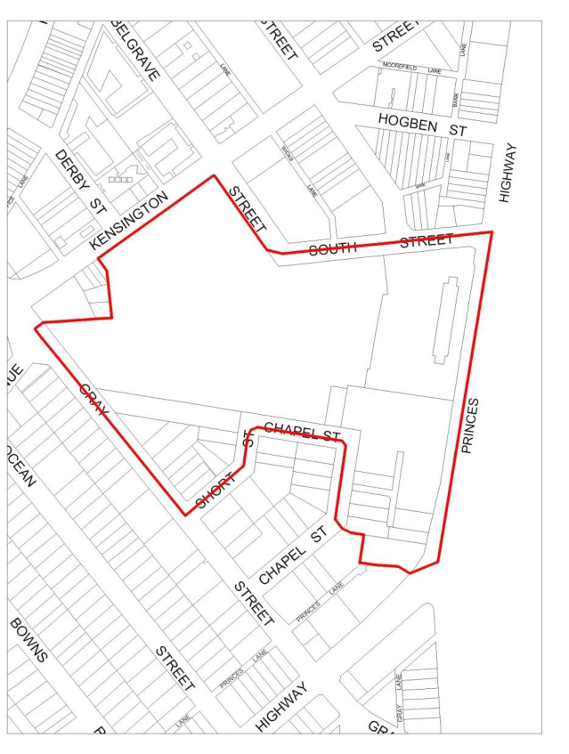

## 7. The Hospital Precinct

> [Picture on page 28: a picture, saved as a picture (images/part-08-1-kogarah-strategic-centre-page-28-2.gif, 150 dpi).]

Figure 14: The Hospital Precinct

#### Existing Character

This precinct contains St George District Hospital, St George Private Hospital and St Patrick’s Church.  It is bounded by Kensington Street, South Street, Gray Street, Short Street, Chapel Street and the Princes Highway (Figure 14).  The character of these streets is formed, in part, by the hospital precinct buildings. There is a lack of public open space within the precinct.

St George Hospital is a major teaching hospital of the University of NSW and is a tertiary referral centre providing over 3,000 jobs and is a Level 1 Trauma Centre for SESLHD. The St George hospital has been upgraded over the last five years, and future upgrades are in the pipeline:

• $43.7 million for a new emergency department, opened in October 2014.

• $277 million expansion which included an eight-level acute services building, completed in 2019.

• $385 million planned future investment in an ambulatory care unit, outpatient and day surgery services, day rehabilitation unit, increased sub-acute inpatient beds and a hub for community health and home-based services on the existing campus footprint.

St George Private Hospital is adjacent to the public hospital, is a 280-bed facility and one of the largest and most comprehensive private hospitals in Australia with around 1,000 staff. A $25 million redevelopment is currently underway at St George Private Hospital, including a footbridge that links the existing main building to a new facility on South Street.

The existing Kogarah and Rockdale town centres and hospital sites provide less than 10 per cent urban canopy cover1. This is very low when considered against the NSW Government target of 40 per cent cover in Greater Sydney by 2036.  As a result the Precinct is vulnerable to heat impact.

#### Desired Future Character

Urban tree canopy is increased within the Town Centre. Trees have been planted in reallocated road space, car parks, private and government-owned land and along active transport routes which have assisted in increasing urban tree canopy and reduces the impact of the heat island effect. Public open space has been provided within this precinct.

Kensington Street

Kensington Street will provide one of the main frontages to the St George Public Hospital and is the interface that stitches the hospital campus into the Town Centre, providing active street frontages at ground level. Gray Street

Gray Street and Gray Avenue will be the primary bus corridor, providing St George Hospital emergency vehicle access and will facilitate high pedestrian and vehicle activity due to school entries and pick up/drop off areas. South Street

South Street will have active frontages, awnings and street trees to provide a high standard of pedestrian amenity, between Kensington Street and the entry to the St George Hospital at the corner of South Street. High quality public art works associated with landscape design and pedestrian amenity will be provided in any new built work associated with or adjacent the hospital entry. Princes Highway

The existing monumental character of the St George Private Hospital and the Roman Catholic Church along the Princes Highway will be maintained.

#### Controls

Kogarah Place Strategy GSC January 2020

1\. Development is to increase the percentage of urban tree canopy within the Precinct.

2\. Development is to address urban heat island effect and includes ways it will be reduced within the Precinct.

3\. The main entry of the St George Public Hospital is to be reoriented to Kensington Street as part of the redevelopment of the Site to better integrate the hospital with the town centre.

4\. Signage and way finding is to be included as part of development within the Precinct to make it easier to move in and around the Hospital Precinct.

5\. Way to improve and provide better pedestrian access in and around the Hospital Precinct is to be included in any application for development within the precinct.

6\. Development within the Precinct is to investigate the provision of public open space.
