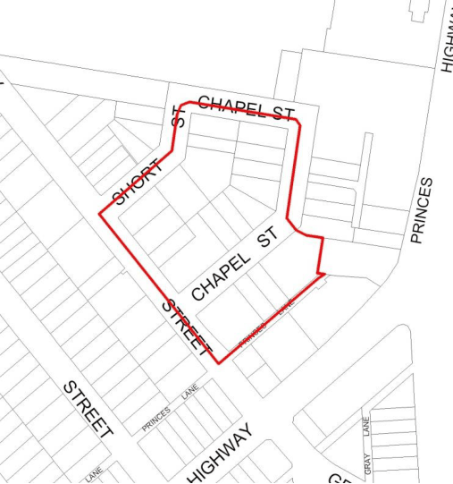

## 8. Chapel Street Precinct

> [Picture on page 31: a picture, saved as a picture (images/part-08-1-kogarah-strategic-centre-page-31-2.gif, 150 dpi).]

Figure 15: Chapel Street Precinct

#### Existing Character

The Chapel Street Precinct is comprised of the block inside the U-shape formed by Chapel Street and Short Street, and the block between Chapel Street and the Princes Highway (Figure 15).

It contains mainly medical and residential uses.  The medical uses occupy some existing houses and some purpose made buildings.  The residential uses are mainly two and three-storey residential buildings, and detached houses.

The streets contain substantial tree planting in places, and buildings are generally set back from the street frontages.  Mature trees and substantial landscaping provide a good setting for residential development set back from the street frontages.

#### Desired Future Character

The Precinct will have complementary overlapping uses comprised mainly of medical and residential uses.

#### Controls

1\. The mature trees and associated landscaping are to be retained and enhanced.

2\. The medical uses are to be retained; however improved accommodation through the development of purpose built low rise medical suites is supported.

3\. Major facades and building entries are to face Gray Street, to create a human scaled and articulated frontage.

4\. Retain the existing heritage listed building at No. 50 Gray Street and relate new development to its facade composition, proportions and materials.

5\. Pedestrian amenity with well landscaped front setbacks and awnings where appropriate is to be provided.
