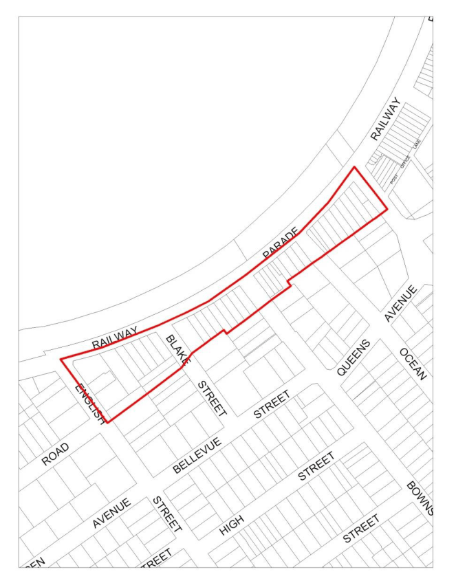
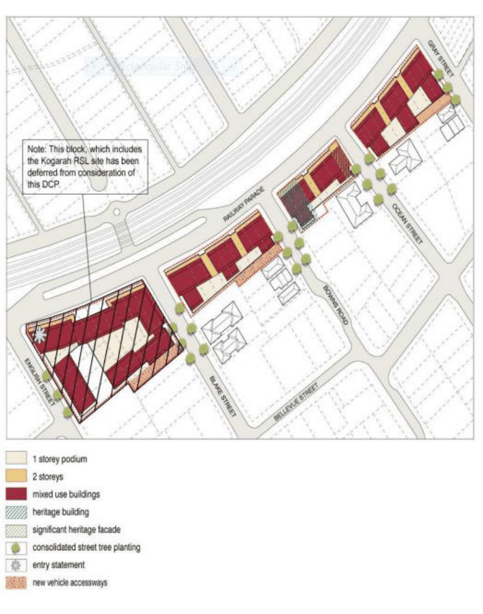
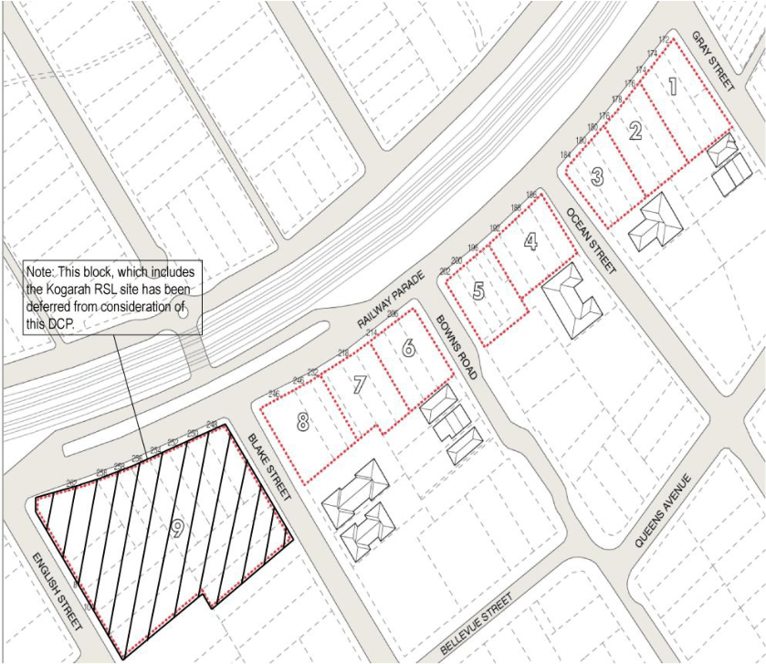
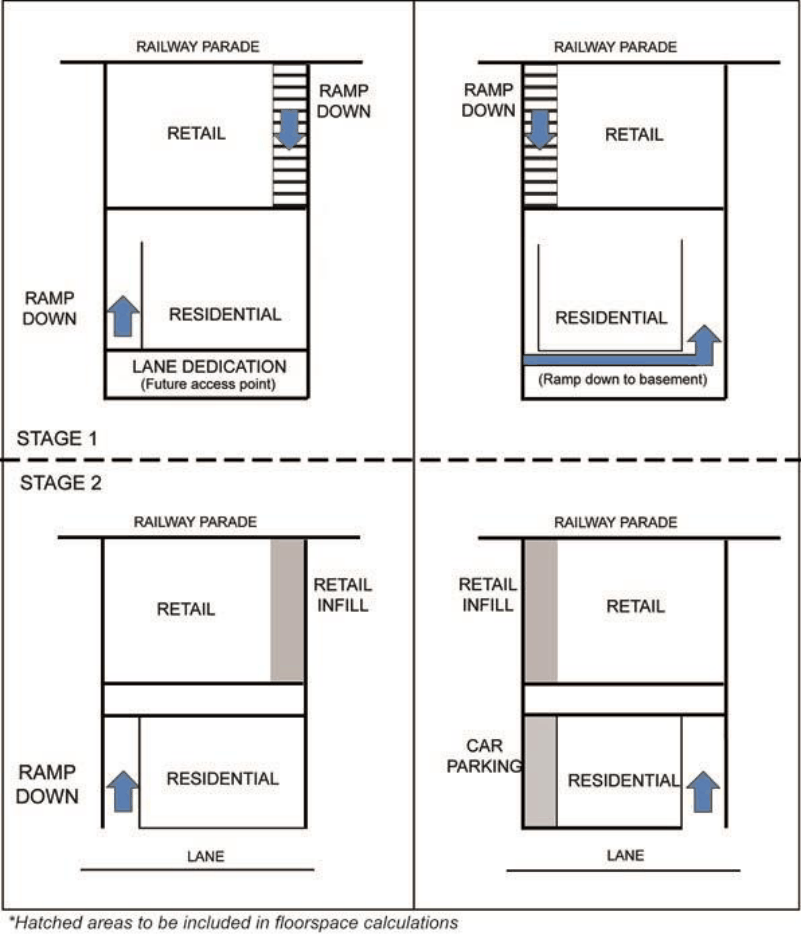

## 9. Railway Parade South Precinct

> [Picture on page 33: a picture, saved as a picture (images/part-08-1-kogarah-strategic-centre-page-33-2.gif, 150 dpi).]

Figure 16: Railway Parade South Precinct

#### Existing Character

Railway Parade runs along the southern edge of the Illawarra Railway line and forms the boundary of Georges River LGA (Figure 16).  It is the main thoroughfare for vehicular transport between Kogarah and Hurstville and is dominated by local traffic, particularly during peak times.

The Railway Parade South precinct is located at the southern end of the Kogarah Centre, midway between Kogarah and Carlton rail stations.  It curves gently on the western side of the ridge before rising from the Kogarah Centre towards the Carlton shops.  The precinct generally comprises those lots with a street frontage to Railway Parade.  Between Blake Street and English Street additional lots in consolidated ownership have an address to those side streets.

Historically, Railway Parade South has served a different role and function from the main retail strip, with a mix of larger and smaller building footprints, more varied setbacks to the street and a greater range of building heights.

Formerly a light industrial area, some light industrial land uses remain amongst increasing retail, commercial and residential uses.  A number of buildings are run-down or vacant.

The area behind the commercial strip contains predominantly 3-4 storey older residential flat buildings. Building heights within the precinct are typically 1-2 storeys for older buildings, while recent shop top developments towards Blake Street are substantially taller at 10 storeys and 12 storeys for the Kogarah RSL ‘Club house’ development.  Setbacks vary from the street alignment and there is little consistency in built form or character.

#### Desired Future Character

The Precinct will see an expansion of the existing land uses to include a mix of commercial and residential uses, the character of this precinct is to support its role as ‘edge of centre’ rather than as part of the retail core area (Figure 17).

Built form reflects the entry experience along Railway Parade from English Street to the Town Centre retail core. The creation of vehicle access ways along the rear of amalgamated sites between Gray and Ocean Streets, and between Bowns Road and Blake Street provides service access to the rear of Railway Parade.  A widened front setback extends the public domain along Railway Parade and creates a consistent street edge and strongly defined boulevard. Street trees are along both sides of Railway Parade.

Commercial uses such as small offices and specialist retail on the ground floor front Railway Parade. Active street frontages, awnings and street trees have increased pedestrian amenity.

> [Picture on page 35: a picture, saved as a picture (images/part-08-1-kogarah-strategic-centre-page-35-1.gif, 150 dpi).]

Figure 17: Urban Structure (to indicate desired new vehicle accessways)

#### Controls

1\. Applications for development should comply with the site amalgamations shown in

#### Figure 18.

Council will not approve any development, which in the opinion of the Council, would result in any other allotment of land being isolated and left without future development capacity.  Such development capacity will be determined by considering whether the site would be capable of having a similar type of development.

Where it is proposed to isolate a site, applicants must include with their development application a plan of adjoining lots showing the effect of the proposal on the remaining

allotments to demonstrate that the proposed development will not result in a single lot being isolated.

Where it is apparent that a site will be left in isolation the proponent must summit sufficient documentation with the development application to demonstrate reasonable attempts have been made to incorporate the adjoining sites in redevelopment.

This documentation must include copies of correspondence between parties and any formal financial offers and responses to offers.  If necessary, Council may require the proponent to fund an independent valuation report.

> [Picture on page 36: a picture, saved as a picture (images/part-08-1-kogarah-strategic-centre-page-36-9.gif, 150 dpi).]

Figure 18: Site Amalgamations along Railway Parade

2\. Driveways from Railway Parade are discouraged.  Access to car parking is to be from secondary streets or right of ways/access ways (as indicated in Figure 17 – urban structure).

3\. Where vehicular access is proposed from Railway Parade, this must be a temporary vehicular access.

4\. Provide vehicular access to parking and service areas from side streets or rear lanes where possible.  Where rear laneway access cannot be achieved in the short term,

temporary vehicular access may be provided from Railway Parade but should be consolidated and minimised.

5\. Provide rear lanes to ensure that mid-block sites can be accessed and serviced and to buffer existing residential development from new development.

6\. Lanes may be private and need not be continuous through blocks.

7\. Provide easements for ‘rights of access' to sites that could be isolated.  These easements are to take the form of laneways of minimum width 6m to accommodate vehicle passing.

8\. Provide a corner splay at the corner of No .172 Railway Parade to facilitate left turn movement by larger vehicles from Gray Street to Railway Parade. The land for the creation of a splay corner is to be dedicated without cost to Council.

A key feature of ensuring the success of development along Railway Parade is the creation of rights of way in the form of laneways to provide service access to the rear of Railway Parade.  Because of the multiple land ownerships involved, it will be difficult to facilitate an appropriately phased implementation process.  Developments must therefore be able to go ahead without the completion of the full laneway.

Where temporary access (Figure 19) is proposed from Railway Parade it is envisaged that developments will either provide a temporary ramp from the road to their basement car parking area, or create a temporary access way to the laneway dedication at the rear of the property.

These temporary access ways can ultimately be converted into either retail/commercial floor space or car parking.

Where temporary access ways are provided, the area identified as the temporary access way (which may at a later stage be transferred to floor area) is to be included in the floor space calculations.  In designing a development with temporary access, it is important that the façade design to Railway Parade caters for this temporary access and encourages the sharing of temporary access ways.

> [Picture on page 38: a picture, saved as a picture (images/part-08-1-kogarah-strategic-centre-page-38-1.gif, 150 dpi).]

Figure 19: Temporary Accessways

| Scenario A | Scenario B |
|---|---|
| Stage 1. Temporary access to the site from Railway Parade via a temporary ramp to the basement level. Stage 2. Ramp removed, ground floor slab poured and converted to retail at a later stage. | Stage 1. Temporary access to the site from Railway Parade via a lane way to the rear of the site. Stage 2. Access converted to ground floor retail and parking at a later stage. |

9\. The retention of the heritage items at No.200-204 Railway Parade, Kogarah. Redevelopment of the heritage sites and the sites adjoining them must consider and respond to the heritage provisions in Georges River LEP.

10\. Consideration of the significant façade of the building at No.186 Railway Parade.

11\. A two (2) storey street wall height is required that relates to the scale of the traditional strip retail buildings in the retail precinct of Railway Parade, with the uppers storeys set back from the Railway Parade frontage.

12\. A consistent street edge to Railway Parade is to be created by aligning all new development to the same front building line, with the exception of heritage items and the significant façade.

13\. A 2m front building line setback is required to visually extend and enhance the public domain and building setting.

14\. A 3m setback on side streets is required to enable landscaping in front gardens consistent with residential character.

15\. A minimum 3m setback from rear boundaries is required to protect the amenity of neighbouring residential uses.

16\. On Railway Parade, the building mass should be broken up both vertically and horizontally, for example with building bays, openings and entries.

17\. Strongly model the facades using recessed balconies, projecting bay windows, deeply recessed windows and projecting panels.

18\. Conceal meter boxes, fire hydrant boosters, sprinkler valves and the like so they are not visible from the street.

19\. Ground floor apartments are not permitted on Railway Parade.
