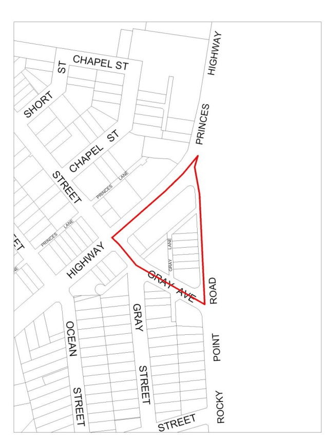

## 10. Southern Retail Precinct

> [Picture on page 40: a picture, saved as a picture (images/part-08-1-kogarah-strategic-centre-page-40-2.gif, 150 dpi).]

Figure 20: Southern Retail Precinct

#### Existing Character

The precinct is a triangular site and is bound by the Princes Highway to the north, Rocky Point Road to the east and Gray Avenue to the southwest (Figure 20).  Gray Lane currently traverses the site, which intersects with Gray Avenue to the south and Rocky Point Road to the east.

At the intersection of the Princes Highway and Rocky Point Road, the existing building is occupied by car sales showroom including large electronic advertising billboard.  The Kogarah Ambulance Superstation is located on corner of Rocky Point Road and Gray Street. There is a former RTA building and associated carpark on the corner of the Princes Highway and Gray Lane, which is used as a community centre.

The Precinct generally slopes from the northeast to southwest, with effectively one floor level change from the Princes Highway to Gray Lane, slightly more at the southernmost portion of the site.  There are no significant trees or landscaping within the Precinct.

The Precinct is highly visible being situated at the intersection of two major arterial roads, being the Princes Highway and Rocky Point Road and has three street frontages, with Gray Lane traversing the site generally in an east-west direction currently providing service access and access to parking to the existing uses.  The volume of passing motorists and the highly visible nature of the precinct make it ideally suited to retail purposes.

Between the Precinct, the established town centre and the Kogarah train station, lies the St George Public and Private Hospitals; health facilities of state significance.

#### Future Desired Character

An attractive mixed use destination precinct with active uses dominating the ground floor frontages of the three thoroughfares defining the Precinct.

The Precinct has architecturally distinctive buildings which address the corners and the Precinct’s prominent location to Kogarah Town Station, the Hospital Precinct and major road routes. The public domain provides good pedestrian amenity and the Precinct is an attractive destination to visitors whether travelling by car, public transport, cycling or walking.

Tourist and visitor accommodation is located in this precinct as it is close to the hospitals and health precinct.

#### Controls

1\. New development is to respond to the following principles:

i. Respond to the surrounding built forms

ii. Break the built form

iii. Address and celebrate the corner

iv. Activate all street frontages

v. Introduce fine grain character

vi. Improve pedestrian accessibility and experience

vii. Introduce a publicly accessible space

viii. Ensure high levels of amenity

ix. Provide adequate setbacks

x. Imbue Design Excellence and sustainability

2\. The design of the roof and any projections such as plant, lift shafts, blades or the like should minimise view loss from existing buildings on the western side of the Princes Highway.

3\. A view analysis is to be submitted with any Development Application indicating the position of the proposal on its site, the location of adjoining buildings and the degree of view loss, if any, resulting from the proposal, particularly where the building exceeds a maximum overall height of 15m.  Any analysis of views should address the views quality and such quality should be quantified.

4\. The ground, first and second floor street facing setback is 0m. At third level and above, a 2m minimum setback is required articulated by greater setbacks at points along the uppermost building line where it fronts any of the thoroughfares defining the site.  This 2m setback may be varied with respect to architectural features and entries at corner locations, subject to Council approval.

5\. On Princes Highway and Rocky Point Road, visually break up the building mass both vertically and horizontally with building bays, openings and entries, for example.  Strongly model the facades using projecting and recessed windows, projecting panels and louvres.  The street facing façade is to be designed to create smaller building elements, particularly along the Princes Highway and Rocky Point Road frontage.

6\. Express the corner of the Princes Highway and Rocky Point Road with a special feature that provides an architectural statement to the building.

7\. Use of distinctive massing and changes in roof form may be used to mark the intersection as a landmark. The incorporation of other architectural features such as porches, canopies, and display windows at the corner may assist in expressing the corner.

8\. The southern portion of the building should also be reinforced as an approach from the south.

9\. Any street facing façade with a length of more than 15m shall be treated with the following:

i. Projecting or recessed elements in the form of asymmetric bays, that break up the façade of the building to create the illusion of smaller buildings;

ii. Changes in the roof or wall plane;

iii. Varying rooflines;

iv. Changes in materials, textures, finishes and colours; and

v. Reinforcement of the street alignments.

10\. Vehicular access to the development is to be provided from Gray Avenue.

11\. No part of the basement is to be elevated above ground floor level fronting the Princes Highway.  Any part basements above ground level along Rocky Point Road and Gray Avenue may be accepted on the basis they are well articulated and incorporated into the overall façade design.  Where the basement is elevated above ground floor level, it is to be treated appropriately so as to allow natural light and ventilation and to not detract from the overall design of the development.

12\. Off street parking is to be provided underground for any new development.
