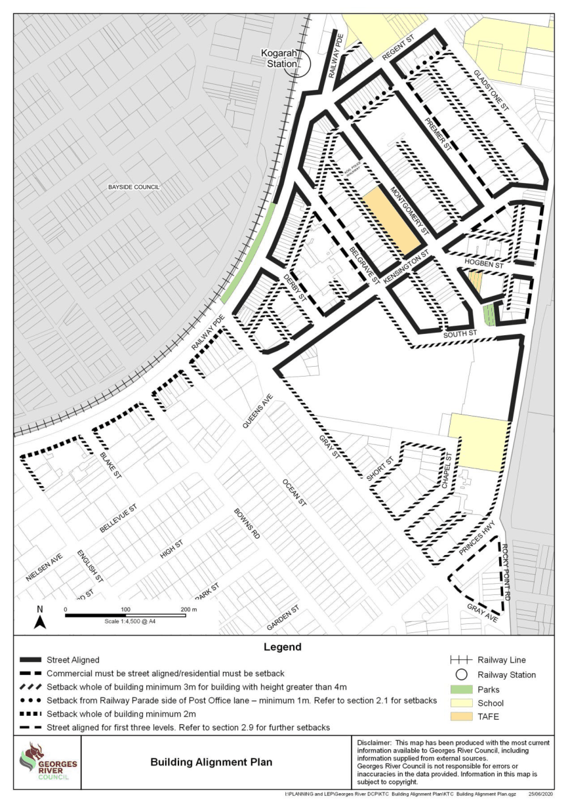
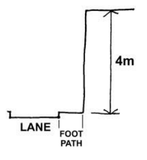
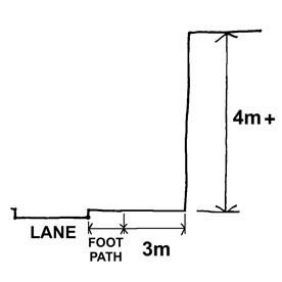

## 2. Alignment of buildings

#### Objectives

• Create cohesive streetscapes which consistently define the space of the street.

• Provide greater amenity to the street and the buildings that abut it.

#### Controls

1\. Buildings must be built to the alignments specified in Figure 21 below, for the majority of the facade length. This control requires the building to be built predominantly to the specified building alignment; however buildings are not to have straight, flat facades.

2\. Buildings require highly articulated facades with many projections such as stepped facades, entry porches, bay windows and balconies to provide vertical subdivisions and visual interest in the streetscape.

> [Picture on page 45: a picture, saved as a picture (images/part-08-1-kogarah-strategic-centre-page-45-1.gif, 150 dpi).]

Figure 21: Building Alignment Plan

Lanes

3\. Buildings up to 4m high may be built to the existing alignment of any lane except the western side of Post Office Lane, where all buildings must be set back 1m from the existing alignment (Figure 22 and Figure 23).

4\. For buildings above 4m high, the whole of the building must be built to the alignments specified in Figure 24.

> [Picture on page 46: a picture, saved as a picture (images/part-08-1-kogarah-strategic-centre-page-46-7.gif, 150 dpi).]

Figure 22: Building alignment for buildings up to 4m

#### 4m

Figure 23:  Building alignment for buildings on western side of Post office Land

> [Picture on page 46: a picture, saved as a picture (images/part-08-1-kogarah-strategic-centre-page-46-12.gif, 150 dpi).]

Figure 24: Building alignment for buildings up to 4m
