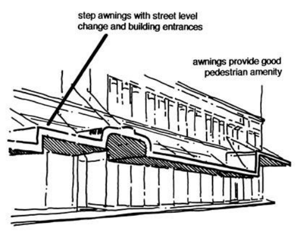
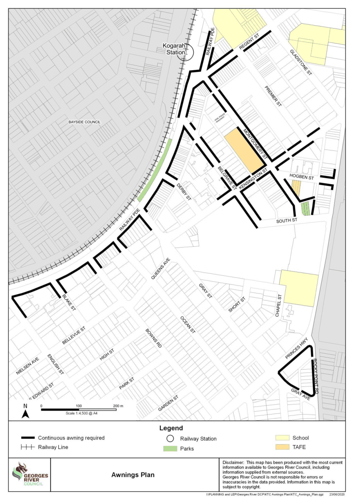

## 1. Step awnings and other weather protection devices in relation to street level changes and

building entrances (Figure 25).

2\. Avoid steeply pitched awnings which break the general alignment of awnings in the street.

3\. Provide architectural detail in the form of:

i. Posts

ii. Exposed structures and joints

iii. Fascia motifs, patterns

4\. Provide under-awning lighting to enhance safety.

5\. Awnings are to be built to the street frontage where indicated in Figure 26.

> [Picture on page 48: a picture, saved as a picture (images/part-08-1-kogarah-strategic-centre-page-48-4.gif, 150 dpi).]

Figure 25: New awnings should follow the general alignment of existing awnings in the street

> [Picture on page 49: a picture, saved as a picture (images/part-08-1-kogarah-strategic-centre-page-49-1.gif, 150 dpi).]

Figure 26: Awnings Plan
