### 8.2 Hurstville Strategic Centre

#### 8.2.1 Application of this Part

The strategic centre of Hurstville is one of two strategic centres in the Georges River LGA and is comprised of the Hurstville City Centre and the adjoining Hurstville East (Forest Road) village, refer Figure 1 below.

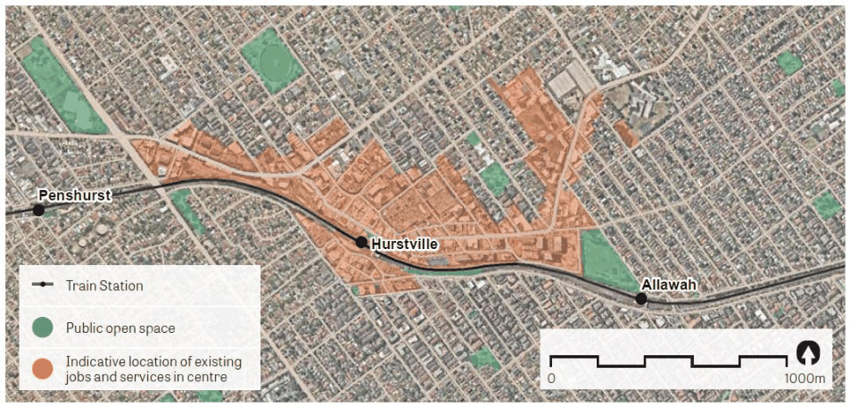

> [Picture on page 3: a picture, saved as a picture (images/part-08-2-hurstville-strategic-centre-page-3-6.gif, 150 dpi).]

Figure 1: Hurstville Strategic Centre (extract from South District Plan - Greater Sydney Commission)

The majority of the Hurstville strategic centre footprint is occupied by the Hurstville City Centre. The Hurstville City Centre is separated by the T4 Eastern Suburbs & Illawarra train line into a northern portion and a southern portion. The northern portion is generally bounded by Pearl Street and King Georges Road to the west and Roberts Lane and Kempt Field to the east. The southern portion is bounded by Woniora Road to the west, Empress Lane and Hillcrest Avenue to the south and Empress Street to the east.

This Part applies to land that is within the boundaries of the Hurstville City Centre as shown in Figure 2. This Part must be read in conjunction with the other parts of the Georges River Development Control Plan (GRDCP) 2021,  in particular Part 3 General Considerations and Part 7 Business Precincts.

In the event of any inconsistency between the controls specified in this Part of the DCP and other Parts, the specific requirements identified within this Part shall prevail.

For controls applicable to the Hurstville East (Forest Road) village, refer to Part 7 of the DCP.

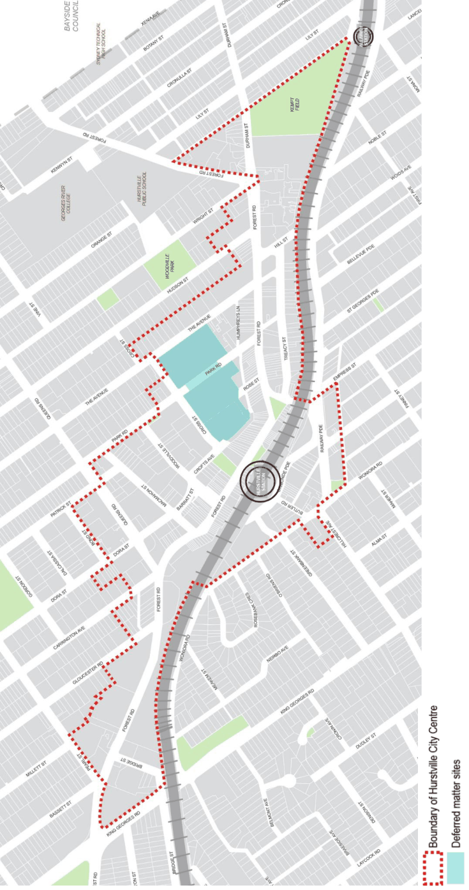

> [Picture on page 4: a picture, saved as a picture (images/part-08-2-hurstville-strategic-centre-page-4-1.gif, 150 dpi).]

Figure 2: Hurstville City Centre Boundary

#### 8.2.2 Applicable Local Environmental Plan

The Hurstville City Centre includes land zoned as B2 Commercial Centre and MU1 Mixed Used under the Georges River Local Environmental Plan 2021 Land Zoning Map as well as one ‘deferred matter’ site identified by the Georges River LEP 2021 Land Application Map.

The Hurstville Local Environmental Plan 1994 will continue to apply to the deferred matter (Westfield site) as shown in Figure 2.

#### 8.2.3 Supporting Plans and Strategies

Council has a number of key plans and strategies which guide and inform planning decisions in the Hurstville City Centre. These documents reinforce Hurstville City Centre’s position as a strategic centre, in line with objectives, actions and planning priorities in the NSW Government’s Greater Sydney Region Plan – A Metropolis of Three Cities and South District Plan:

• Georges River Economic Development Strategy 2018-2022 (2018)

• Hurstville City Centre Urban Design Strategy (HCCUDS) (2018)

• Hurstville City Centre Transport Management and Accessibility Plan (TMAP) (2018)

• Hurstville ‘Heart of the City’ Place Strategy (2019)

• Georges River 2050 Leading for Change Strategy (2020)

• Georges River Commercial Centres Strategy – Part 1 Centres Analysis (2020)

• Georges River Night Time Economy Study (2021)

• Georges River Transport Strategy (2021)

For more information, visit Council’s website:

https://www.georgesriver.nsw.gov.au/Council/About-Your-Council/Council-Plans-and- Strategies

https://www.georgesriver.nsw.gov.au/Development/Planning-Controls/Planning-Strategies-and-Studies/Hurstville-City-Centre-Planning-Controls

#### 8.2.4 Local Infrastructure Contributions and Planning Agreements

Local infrastructure contributions (section 7.11 or section 7.12 contributions) apply to land within the Hurstville City Centre.

Council may also consider planning agreements in accordance with the Environment Planning and Assessment Act and Council’s Policy on Planning Agreements. Council’s policy for planning agreements provides a list of suggested infrastructure works that may be considered to have a public benefit under a planning agreement.

Council’s contribution plans and planning agreements policy are available on Council’s website: https://www.georgesriver.nsw.gov.au/Development/Planning- Controls/Development-Contributions-and-Planning-Agreements

#### 8.2.5 Vision for the Hurstville City Centre

The Hurstville City Centre is an important retail destination with an active high street (Forest Road) and a large shopping centre (Westfield). It also has excellent public transport connectivity as provided by the Hurstville Railway Station and two bus interchanges. Historically, the City Centre provided a significant amount of employment floor space to the southern region. The City Centre is currently undergoing major transformations through enthusiastic redevelopment activities.

Supported by new residential development, the City Centre will continue to play an important role in providing employment, retail and entertainment opportunities for the area, and provide an exemplar for environmentally and socially sustainable urban development.

To achieve the vision for the Hurstville City Centre, this Part is underpinned by the following objectives:

#### Objectives

1\. Retain and strengthen the City Centre’s regional significance as a strategic centre.

2\. Prioritise the growth of jobs through the creation of additional employment floor space and prohibition of residential uses within the Commercial Core.

3\. Reinforce the existing activation of Forest Road and encourage the activation of secondary streets and laneways.

4\. Express the City Centre’s identity through good design and responsive architecture to distinguish between the myriad of land uses.

5\. Ensure the human scale is emphasised through built form which can adapt over time.

6\. Provide high quality green infrastructure and environmentally sustainable buildings.

7\. Promote vibrant night-time activities around the transit hub while increasing the safety on streets at night.

8\. Manage traffic impacts while prioritising pedestrian and active transport networks.

9\. Better connect the public domain to enhance the walkability of the City Centre.

10\. Encourage and support shopping centre improvements to better integrate with the surrounding public spaces.

#### 8.2.6 Local Precinct Character Statements

Based on the urban analysis conducted by the Hurstville City Centre Urban Design Strategy (2018), this section sets out in detail the existing character and the desired future character for each of the eight (8) character precincts within the Hurstville City Centre (refer to Figure 3).

The character precincts prioritise Forest Road as the heart of the City Centre, with various civic activities centred around this. Transition zones create a transition in built form and activity from the City Centre to the high density residential precincts at the two bookends.

New development must be consistent with the desired future character by demonstrating compliance with the precinct-specific controls.

Alternative solutions may be proposed if the overall objectives outlined in Section 8.2.5 Vision for the Hurstville City Centre can be satisfied.

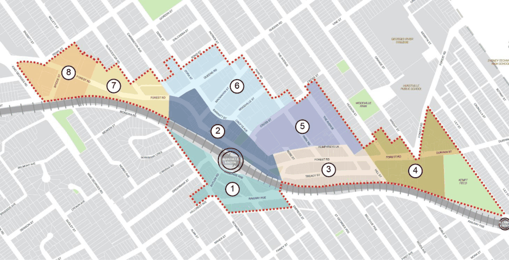

> [Picture on page 7: a picture, saved as a picture (images/part-08-2-hurstville-strategic-centre-page-7-13.gif, 150 dpi).]

Figure 3: Character precincts within the Hurstville City Centre (source: Hurstville City Centre Urban Design Strategy)

#### Hurstville City Centre Character Precincts

1\. Ormonde Parade Retail and Services

5\. Retail Centre

2\. Forest Road High Street

6\. Civic Centre

3\. City East Transition Area

7\. City West Transition Area

4\. Eastern Bookend

8\. Western Bookend

#### 8.2.6.1 Ormonde Parade Retail and Services

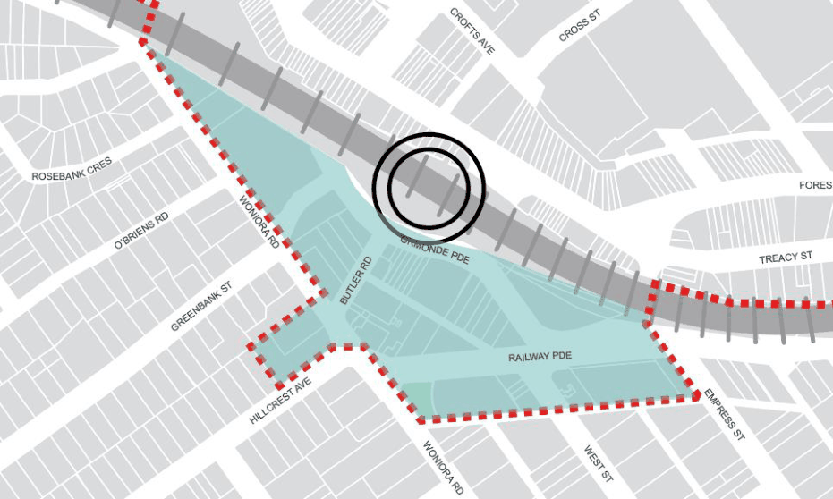

> [Picture on page 8: a picture, saved as a picture (images/part-08-2-hurstville-strategic-centre-page-8-2.gif, 150 dpi).]

Figure 4: Ormonde Parade Retail and Services

Existing Character

The Ormonde Parade Precinct provides direct access to Hurstville Station from the south. However, this Precinct is often perceived as being disconnected from the rest of the City Centre due to the physical barrier presented by the railway line.

There is a large undercover bus terminal with routes connecting through the region. Fine grain retail lines the southern side of Ormonde Parade, and offers mostly personal, public and medical services with some food and beverage offerings. Above the awning are medium-high density residential units.

There are limited pedestrian crossings, and many crossings are unmarked. Pedestrian activity is limited despite the existing retail and services offerings. This is further exacerbated by the absence of street tree plantings.

Ormonde Parade is one way which can cause congestion due to the constant stopping of private vehicles, the presence of the ‘Kiss and Ride’ bays and bus movements.

There is no distinct built form character as the buildings are a collection of styles and uses. Varying street setbacks also create an inconsistent public domain and street frontage. The older building stock is run down and in need of upgrades and renovations, whilst the newer stock is in a good state, however architecturally the styles of the buildings are varied and unimaginative.

High density residential developments occupy the periphery of the Precinct along Woniora Road and Railway Parade. These buildings feature retail and commercial tenancies at ground

floor and up to 18 storeys of residential units above. The taller tower form of these buildings function as the urban markers indicating the boundary of the Hurstville City Centre.

Desired Future Character

Ormonde Parade will continue to function as a vital transport interchange with an improved pedestrian environment supported by continuous awnings, fine grain shopfronts at grade with the street and upgrades to the public domain, including street furniture and paving.

Butler Lane will continue to be used as a service lane to ensure the street frontages of surrounding primary streets remain active and free of the presence of essential services, such as car parking entrances, loading docks and substations.

Outdoor dining will be provided along Ormonde Parade to support opportunities for both day-time and night-time trading. The presence of night-time activities will encourage a greater number of people to use the streets, increasing the surveillance on the street at night. Passive surveillance will be provided by the upper storeys of mixed use developments, while safety is enhanced through additional lighting.

The key gateway at the intersection of Forest Road and Railway Parade will be emphasised by articulated building design to mark the entrance to the Hurstville City Centre.

The Precinct will be greened through tree planting and the provision of vegetation on the façade of new developments.

Controls

1\. Prioritise active street frontages along Ormonde Parade and provide a continuous awning.

2\. Retain Butler Lane as a service lane to ensure the street frontages of surrounding primary streets remain active and free of the presence of essential services.

3\. Enhance and respond to the existing fine grain streetscape character through the use of scale, rhythm, materiality and landscaping in new developments.

4\. Maintain a street wall height of maximum three (3) storeys.

5\. Provide a minimum setback of 3 metres from the street for upper residential storeys (including balconies) to respect the human scale while allowing passive surveillance of the public domain.

6\. Encourage outdoor dining on footpaths for both day-time and night-time trading. Note: An ‘Outdoor Dining Permit’ is required, please refer to Council’s website for more information.

7\. Encourage retail and business premises to extend the hours of operation beyond the standard day-time trading schedule to diversify the offering of activities after 6pm.

8\. Ensure lighting is provided to positively contribute to the safety, legibility, wayfinding and visual interest of the public domain.

9\. Ensure developments adjacent to the O’Briens Estate Heritage Conservation Area minimise potential amenity impacts on the Heritage Conservation Area including overshadowing and visual privacy.

#### 8.2.6.2 Forest Road High Street

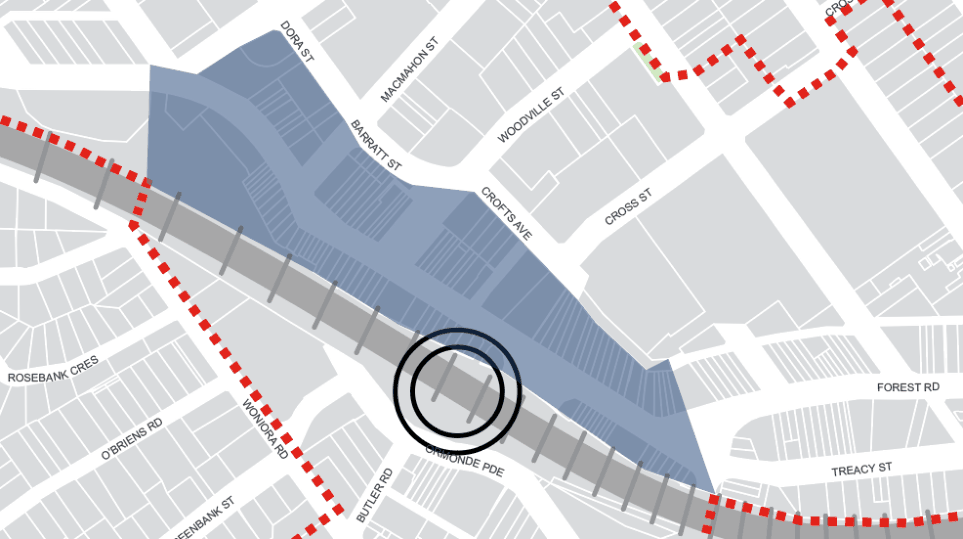

> [Picture on page 10: a picture, saved as a picture (images/part-08-2-hurstville-strategic-centre-page-10-5.gif, 150 dpi).]

Figure 5: Forest Road High Street

Existing Character

Forest Road has bustling fine grain retail with wide footpaths that create a lively public domain. Buildings adjacent to Forest Road have narrow shop front facades and rear service lanes created by the early subdivision pattern. Façades step up and down the hill as the slope changes, emphasising the importance of the topography and reflecting the historical subdivision pattern.

This area is predominantly two storeys in built form due to the historic subdivision pattern and contains numerous heritage items. The largest built form in this Precinct is the recently completed office tower of 13 storeys, located adjacent to Hurstville Plaza and opposite the railway station entry on Forest Road. This development is a prominent entry marker for the Hurstville City Centre for passengers arriving via train.

The taller built form is continued in the street block bounded by Dora Street/Queens Road/Forest Road through the recently completed mixed use buildings of approximately 14 storeys. These developments provide retail uses on the ground floor which has enabled the extension of pedestrian activity from the centre of the Precinct to Queens Road.

Traffic through this Precinct is one way only, moving in an easternly direction. Despite the one way nature of Forest Road, the Precinct experiences congestion due to buses and private vehicles frequently stopping to compete for car parking spaces and bus stops on the kerb.

There is also heavy pedestrian movement through this Precinct, with pedestrians crossing freely due to the one way nature of the street.

The presence of Hurstville Plaza on Diment Way offers great connectivity to the Civic Core Precinct to the north and provides a direct pedestrian link to the railway station. Contrarily, Memorial Square is currently under-utilised despite its prominent location on the Forest Road high street.

Desired Future Character

Forest Road is one of the three main attractors for the Hurstville City Centre with its lively, vibrant atmosphere, with the other two being the Civic Centre and the Retail Centre. This Precinct will continue to function as the ‘high street’ for the Hurstville City Centre as well as a focus for community activity enabled by the key public spaces of Hurstville Plaza, Memorial Square and MacMahon Courtyard.

The pedestrian experience will be improved by continuous awnings, fine grain shopfronts at grade with the street and upgrades to the public domain including street furniture and paving. Connectivity and permeability will remain a key focus for this Precinct. The presence of arcades and through-site links that intersect Forest Road will provide pedestrians with the linkages to connect the railway station with the remainder of the Hurstville City Centre, particularly the other two main attractors – the Civic Centre and the Retail Centre.

Night-time activities within the Hurstville City Centre are concentrated within this Precinct, particularly along Forest Road. The presence of night-time activities encourages a greater number of people to use the streets, increasing the surveillance on the street at night while safety is enhanced through additional lighting.

The use of footpaths for passive activities (outdoor dining, seating, landscaping) will generate a vibrant and lively environment to support opportunities for both day-time and night-time trading.

Respect for the human scale will be emphasised through the retention of the two storey street wall and the regular rhythm created by the historical subdivision pattern. New developments are distinctively articulated to enhance the existing streetscape character.

The Precinct will be greened through tree planting and the incorporation of green infrastructure within the design of new buildings. This will be further complemented by Council’s revitalisation program for the key public spaces.

Controls

1\. Prioritise retail activity and other active uses along Forest Road.

2\. Prohibit the creation of new car park entries on Forest Road, Barratt Street and Crofts Avenue.

3\. Retain the existing two (2) to three (3) storey street wall and subdivision pattern of Forest Road and provide a continuous building line of fine grain shopfronts with a continuous awning.

4\. Enhance and complement the ‘high street’ character through the use of scale, rhythm, materiality and/or landscaping in new developments.

5\. Where residential uses are permissible, provide a minimum setback of 3 metres from the street for upper residential storeys (including balconies) to respect the human scale while allowing passive surveillance of the public domain.

6\. Encourage outdoor dining on footpaths for both day-time and night-time trading. Note: An ‘Outdoor Dining Permit’ is required, please to refer Council’s website for more information.

7\. Encourage retail and business premises to extend the hours of operation beyond the standard day-time trading schedule to diversify the offering of activities after 6pm.

8\. Ensure lighting is provided to positively contribute to the safety, legibility, wayfinding and visual interest of the public domain.

#### 8.2.6.3 City East Transition Area

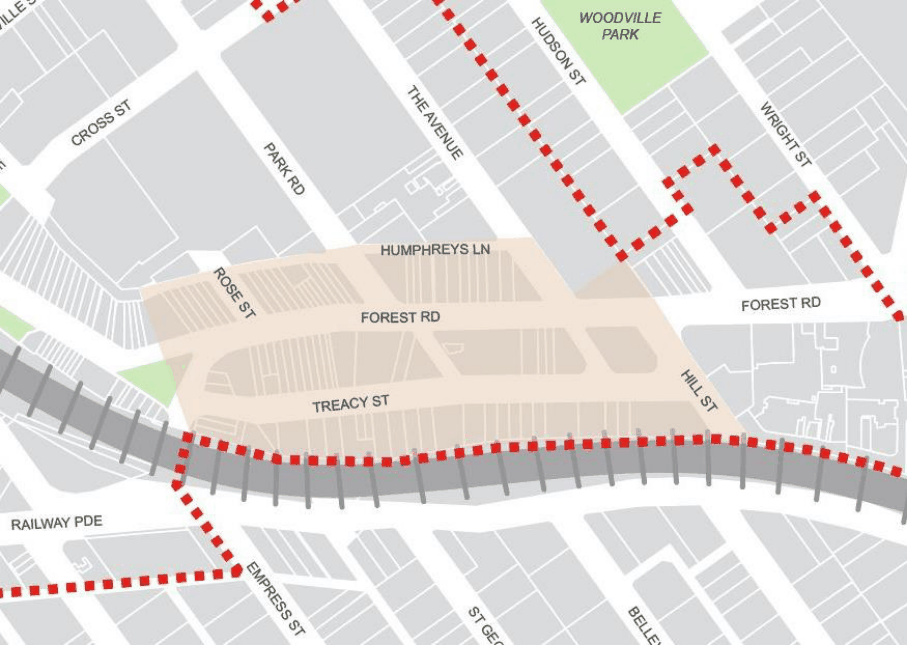

> [Picture on page 12: a picture, saved as a picture (images/part-08-2-hurstville-strategic-centre-page-12-14.gif, 150 dpi).]

Figure 6: City East Transition Area

Existing Character

This Precinct is currently undergoing a large amount of redevelopment. This area is a transition zone away from the City Centre and is predominantly mixed use with retail uses at

ground floor and residential above. The area has two predominant characters: the continuation of the Forest Road ‘high street’ and the Treacy Street ‘service street’.

The shops along Forest Road are more catered to personal services with less food and beverage offerings when compared to the Forest Road High Street Precinct. These shops are fine grain, particularly on the northern side of Forest Road where the presence of heritage items establishes a continuous built form of two storeys. Humphreys Lane to the rear of these shops contributes to the fine grain nature of these shops by providing the dedicated access points for ‘back of house’ functions. The northern side of Forest Road is contrasted to the southern side, which features recent mixed use developments like Times Plaza with a taller and bulkier built form on consolidated sites.

Treacy Street comprises of a predominately inactive street frontage with narrow footpaths. Many buildings have service entries to Treacy Street, rendering this street unpleasant with little pedestrian activity. This is exacerbated by the absence of planting and weather protection creating a harsh pedestrian environment.

Treacy Street also has large open setbacks for car parking on site, and waste collection. This results in the street feeling unpleasant and unsafe at night-time. The recent 16 storey mixed use development on Treacy Street is gradually bringing more pedestrian traffic and activation.

Desired Future Character

Forest Road will continue to provide the ‘high street’ character and function for the Hurstville City Centre through the retention of the two storey street wall and the regular rhythm created by the historical subdivision pattern.

Humphreys Lane will continue to provide essential services such as car parking entry and loading areas for the shops fronting Forest Road and the adjoining Retail Centre Precinct. In addition to this role, the careful placement of essential services will reduce the cumulative impacts of ‘back of house’ functions on the laneway to give way to increased pedestrian activity.

This Precinct will also see an overall increase in pedestrian activity on Treacy Street through the introduction of employment-generating uses at the ground and lower levels of new developments.

Both day-time and night-time trading are encouraged across the Precinct to enable passive and active surveillance of the public domain. Safety during the night will be enhanced through additional lighting provided by new developments.

Local road widening will occur where required to enable widening of existing footpaths accompanied by improvements to the public domain materiality to create a consistent streetscape.

The pedestrian experience across the Precinct will be improved by the provision of continuous awnings along active frontages and fine grain shopfronts at grade with the street along with upgrades to the public domain including street furniture and paving.

The Precinct will be greened through tree planting and the provision of vegetation on the façade of new developments.

Controls

1\. Prioritise retail activity and other active uses along Forest Road.

2\. Retain the existing two (2) to three (3) storey street wall and subdivision pattern of Forest Road and provide a continuous building line which defines the public domain.

3\. Enhance and complement the ‘high street’ character through the use of scale, rhythm, materiality and/or landscaping in new developments.

4\. Where residential uses are permissible, provide a minimum setback of 3 metres from the street for upper residential storeys (including balconies) to respect the human scale while allowing passive surveillance of the public domain.

5\. Upgrade existing lanes and consolidate the location of essential services in new developments to create a pedestrian-friendly environment.

6\. Encourage outdoor dining on footpaths for both day-time and night-time trading. Note: An ‘Outdoor Dining Permit’ is required, please refer to Council’s website for more information.

7\. Encourage retail and business premises to extend the hours of operation beyond the standard day-time trading schedule to diversify the offering of activities after 6pm.

8\. Ensure lighting is provided to positively contribute to the safety, legibility, wayfinding and visual interest of the public domain.

9\. Ensure widening of existing footpaths in accordance with Section 8.2.7.6 to improve pedestrian access and safety.

#### 8.2.6.4 Eastern Bookend

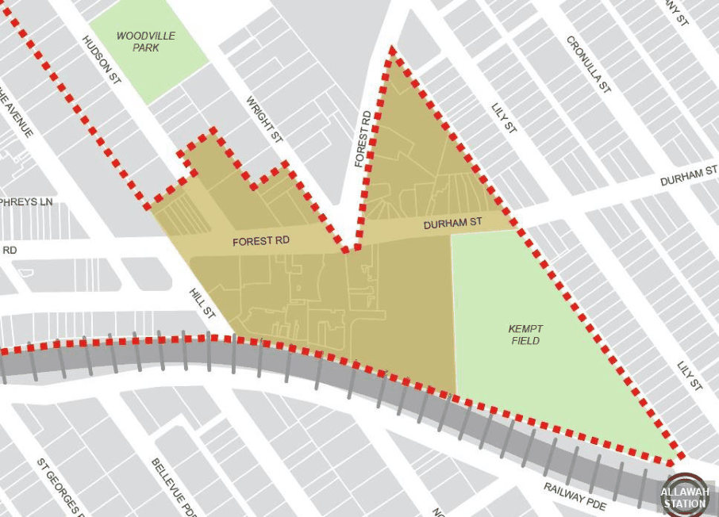

> [Picture on page 15: a picture, saved as a picture (images/part-08-2-hurstville-strategic-centre-page-15-2.gif, 150 dpi).]

Figure 7: Eastern Bookend

Existing Character

This Precinct is currently undergoing a large amount of redevelopment and will change considerably in the next few years.

The residential flat buildings here are taller, punctuating the topographical high-point, and providing a ‘gateway’ into the Hurstville City Centre from the east.

There is limited ground-floor retail provided within this area and as a result the street frontage is not as active as elsewhere along Forest Road. This is further exacerbated by the harsh pedestrian environment caused by the absence of street trees and weather protection. Vehicular traffic is the dominant form of movement in this Precinct.

A publicly accessible plaza is provided in the East Quarter development, however it appears underutilised due to the absence of street furniture and shading.

Kempt Field is a popular park for the local catchment since the installation of an adventure playground. It also offers a pedestrian link between the Precinct and Allawah Railway Station to the south-east.

The “Bing Lee” and “Landmark Square” sites are both located within this Precinct, refer to Section 8.2.8 for site-specific controls for these two development sites.

Desired Future Character

The Eastern Bookend will define and create a sense of entry into the Hurstville City Centre, reinforced by articulated towers at the intersection of Forest Road and Durham Street. A continuous 4 storey street wall will be provided by new developments to respond to the human scale and to provide visual relief from the assertive skyline created by the taller towers.

Active uses will be provided at the ground and lower levels of developments fronting Forest Road and Durham Street to promote vibrancy and passive and active surveillance of the public domain. The public domain will have uniformity with paving types and paving width.

The key gateway at the intersection of Forest Road, Durham Street and Wright Street will be emphasised by articulated building design to mark the entrance to the Hurstville City Centre.

The Precinct will be greened through tree planting and the provision of vegetation on the façade of new developments.

The “Bing Lee” and “Landmark Square” sites will be developed in accordance with the site-specific Desired Future Character specified in Section 8.2.8 of this DCP.

Controls

1\. Define the street edge using building podiums that feature and active uses.

2\. Maintain a street wall height of maximum four (4) storeys.

3\. Provide a continuous awning along all active street frontages.

4\. Provide a minimum setback of 3 metres from the street for upper residential storeys (including balconies) to respect the human scale while allowing passive surveillance of the public domain.

5\. Enhance the streetscape character through the use of scale, rhythm, materiality and/or landscaping in new developments.

6\. Provide a transition in scale, form and massing on land that is adjacent to a lower density zone.

#### 8.2.6.5 Retail Centre

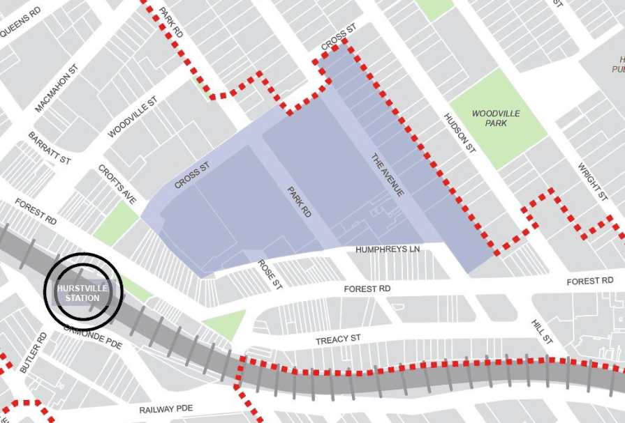

> [Picture on page 17: a picture, saved as a picture (images/part-08-2-hurstville-strategic-centre-page-17-2.gif, 150 dpi).]

Figure 8: Retail Centre

Existing Character

This Precinct is predominantly made up of Westfield Shopping Centre and a number of commercial office buildings. The Westfield site is a deferred matter under the Georges River LEP 2021.

There is little to no street interaction between the surrounding streets and Westfield. The shopping centre presents itself to the street via a large inactive frontage, with multiple service entries which creates a poor interface with the rest of the Hurstville City Centre. This also makes the streets unpleasant for walking because they are not visually appealing and there is minimal activation to draw people through the spaces.

The public domain surrounding Westfield has little to no street trees which makes the spaces quite uncomfortable in hot temperatures.

The Precinct is bordered by Humphreys Lane to the south and the developments at the southern edge of this Precinct which share this laneway for ‘back of house’ functions with the shops on Forest Road. The laneway is a hostile environment for pedestrians with little to no footpath available.

Park Road consists predominantly of service entries to Westfield with buses parked along the lefthand side of the street. There are a number of one way streets that restrict vehicular movements throughout the area. Overpasses create connections between the two sides of Westfield.

In comparison, The Avenue has more trees that help create a visual barrier between the Westfield’s carpark and street, thereby offering a more pleasant public domain. The Avenue has predominantly single storey detached and multi-unit residential development, opposite the four-storey street wall of Westfield. The Avenue has a number of heritage listed single dwelling houses which add character to the street.

Desired Future Character

The Retail Core is one of the main attractors for the Hurstville City Centre with Westfield as the anchor which continues to offer diverse retail uses that service residents within the South District and beyond.

Westfield will be seamlessly integrated into the vibrant context of the Hurstville City Centre by prioritising pedestrian access to and from the surrounding streets. The pedestrian movement between this Precinct and the other four main attractors – Club Central, Hurstville Plaza, Forest Road High Street and the Civic Centre – will be enhanced by the active uses and street art located within the arcades and through-site links. Additionally, the use of these passages for outdoor dining will generate a vibrant and lively environment to support opportunities for both day-time and night-time trading. All entries into the shopping centre will be prominently identified and embellished with a focus on pedestrian amenity and safety.

The connected built form of the Westfield centre which spans across Park Road will be reinforced as a key gateway marker for the Hurstville City Centre through distinctively articulated building façades.

Supplemented by the commercial and civic services present along The Avenue, this Precinct will continue to provide a focus for large scale employment uses.

New development will build on this Precinct’s highly active pedestrian environment interlinked with laneways and arcades. Humphreys Lane will continue to provide essential services such as car parking entry and loading areas for the shops at the southern side of this Precinct. In addition to this role, the careful placement of essential services will reduce the cumulative impacts of ‘back of house’ functions on the laneway to give way to increased pedestrian activity.

The pedestrian experience will be further improved by continuous awnings on active street frontages, fine grain shopfronts at grade with the street and upgrades to the public domain including street furniture and paving, particularly along The Avenue and Cross Street.

The Precinct will be greened through tree planting and the provision of vegetation on the façade of new developments.

Controls

1\. Provide a continuous awning along all active street frontages.

2\. Maintain a street wall height of maximum three (3) storeys along The Avenue.

3\. Retain arcades and through-site links between Forest Road and secondary streets and laneways.

4\. Upgrade existing lanes and consolidate the location of essential services in new developments to create a pedestrian-friendly environment.

5\. Maximise through-site links and active arcades linking Westfield to the surrounding streets by enhancing the visibility and amenity of the entrances.

6\. Encourage outdoor dining on footpaths for both day-time and night-time trading. Note: An ‘Outdoor Dining Permit’ is required, please refer to Council’s website for more information.

7\. Encourage retail and business premises to extend the hours of operation beyond the standard day-time trading schedule to diversify the offering of activities after 6pm.

8\. Ensure lighting is provided to positively contribute to the safety, legibility, wayfinding and visual interest of the public domain.

9\. Where residential uses are permissible, provide a minimum setback of 3 metres from the street for upper residential storeys (including balconies) to respect the human scale while allowing passive surveillance of the public domain.

10\. Enhance the streetscape character through the use of scale, rhythm, materiality and/or landscaping in new developments.

11\. Provide a transition in scale, form and massing on land that is adjacent to a lower density zone.

#### 8.2.6.6 Civic Centre

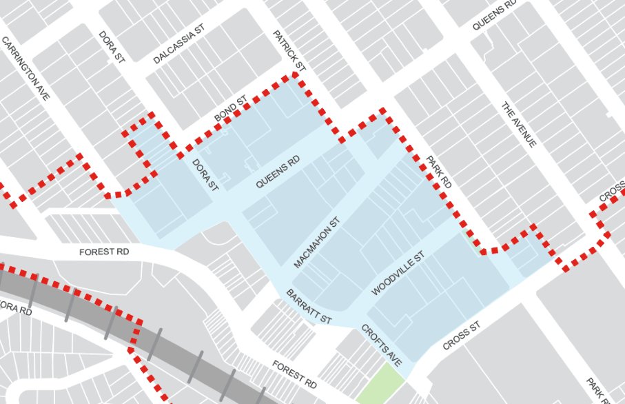

> [Picture on page 20: a picture, saved as a picture (images/part-08-2-hurstville-strategic-centre-page-20-2.gif, 150 dpi).]

Figure 9: Civic Centre

Existing Character

The Precinct contains a number of heritage items, in particular along MacMahon Street. The street wall is 2-3 storeys with taller residential towers set back from the street. Despite the presence of these residential towers, there is a good balance between non-residential and residential uses within the Precinct, representing a true ‘mixed use’ development outcome. It has a mixture of civic, commercial and residential buildings including a historic Fire Station, the Hurstville Entertainment Centre (Marana Auditorium and Theatre), Art Gallery and Council Chambers and Administration Building.

The Civic Precinct site is located on the northern side of MacMahon Street. A large parking lot is located on the corner of MacMahon Street and Park Road. The street has pockets of respite for sitting, made up of trees and other planting inside brick edged planter boxes.

A range of employment generating uses are concentrated in the street block bounded by MacMahon and Cross Streets. These uses are accommodated in commercial buildings of varying styles with no distinct built form character.

Queens Road, a 5-6 lane road, runs through this Precinct and is a major access route into the Precinct. The volume of traffic along this road can make walking unpleasant, as well as the limited shelter from sun and rain.

On Queens Road, a large 10 storey residential building provides an urban marker for the Precinct. The retail premises are located behind planter beds and are barely visible for passing trades on Queens Road. There is no transition in height from 10 storeys to the single detached dwellings that are located on the edge of the Precinct.

Desired Future Character

The Precinct will provide a focus for community and civic functions for the Hurstville City Centre and will be characterised by the integration of public buildings with new civic spaces for public celebration and recreation. The balance between non-residential and residential uses will be maintained through genuine mixed used developments.

Day time activities such as shopping, walking and outdoor dining will continue to be concentrated primarily along Forest Road. Nonetheless, the growth of jobs and intensification of civic activities within this Precinct will increase pedestrian activity.

The pedestrian networks and connectivity with surrounding areas will be strengthened through opportunities for public art to provide better amenity and points of interest for pedestrians. The public domain will have uniformity with paving types and paving width.

Arcades will be retained to provide a high level of connectivity throughout the Centre. Active uses will be provided within the arcades to encourage safe and interesting passages through the City Centre. This will be further reinforced by the presence of active uses along all street frontages.

Both day-time and night-time trading are encouraged to enable passive and active surveillance of the public domain, while safety at night is enhanced through additional lighting. Footpaths are shared spaces for both pedestrian movement and passive activities, such as outdoor dining, seating and landscaping. The Precinct will be greened through tree planting and the provision of vegetation on the façade of new developments.

The Planning Proposal for the Civic Precinct will be a major catalyst for change within this Precinct by providing new gateway developments into the City Centre as well as an array of public spaces, including a public plaza, park and ‘eat street’. The poor pedestrian amenity along Queens Road will be addressed by the redevelopment of the Civic Precinct through the continuous planting of trees on the southern side of the Queens Road streetscape. Refer to Section 8.2.8 for site-specific controls for this development site.

Controls

1\. Provide a continuous awning along all active street frontages.

2\. Prohibit the creation of new car park entries on Barratt Street and Crofts Avenue.

3\. Retain and promote arcades and through-site links to enable better connectivity between street blocks.

4\. Encourage outdoor dining on footpaths for both day-time and night-time trading. Note: An ‘Outdoor Dining Permit’ is required, please refer to Council’s website for more information.

5\. Encourage retail and business premises to extend the hours of operation beyond the standard day-time trading schedule to diversify the offering of activities after 6pm.

6\. Ensure lighting is provided to positively contribute to the safety, legibility, wayfinding and visual interest of the public domain.

7\. Define the street edge using building podiums that feature fine grain retail and active uses.

8\. Maintain a street wall height of maximum three (3) storeys.

9\. Where residential uses are permissible, provide a minimum setback of 3 metres from the street for upper residential storeys (including balconies) to respect the human scale while allowing passive surveillance of the public domain.

10\. Enhance the streetscape character through the use of scale, rhythm, materiality and/or landscaping in new developments.

11\. Ensure the widening of existing footpaths in accordance with Section 8.2.7.6 to improve pedestrian access and safety.

#### 8.2.6.7 City West Transition Area

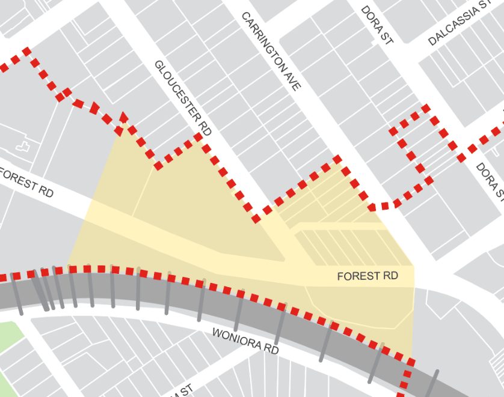

> [Picture on page 22: a picture, saved as a picture (images/part-08-2-hurstville-strategic-centre-page-22-12.gif, 150 dpi).]

Figure 10: City West Transition Area

Existing Character

Forest Road continues through this Precinct with 4 lanes of traffic. The area is well planted with mature street trees and creates a green gateway to the City Centre when entering from King Georges Road.

Dense planting on Forest Road provides a visual barrier from the railway line, making the street more appealing for pedestrians. However, pedestrian movement across the street is difficult due to the infrequent location of signalised crossings.

Large format commercial and retail offerings are spread along the length of Forest Road. The setbacks along the road vary greatly, with a business park forecourt, car parking, and service station creating large and inactive spaces for pedestrians to walk past.

Some food and beverage offerings are located along Forest Road to provide amenities for office workers.

Due to the recent changes in planning controls for 9 Gloucester Road at the corner of Forest and Gloucester Roads, this Precinct is expected to change considerably in the next few years with a significant shift in focus towards residential uses. Refer to Section 8.2.8 for site-specific controls for this development site.

Desired Future Character

The Queens / Forest / Carrington intersection located at the eastern end of this Precinct will become the entry marker to the key activity nodes of the Hurstville City Centre.

The emerging presence of residential uses within the Precinct will be supported by active uses at the ground and lower levels of developments fronting Forest Road and Gloucester Road. The public domain will have uniformity with paving types and paving width.

The green setting of this Precinct will be retained and enhanced through the provision of vegetation on the façade of new developments as well as additional tree planting on the southern side of Forest Road.

The site “9 Gloucester Road” will be developed in accordance with the site-specific Desired Future Character specified in Section 8.2.8 of this DCP.

Controls

1\. Define the street edge using building podiums that feature fine grain retail and active uses.

2\. Maintain a street wall height of maximum three (3) storeys.

3\. Provide a continuous awning along all active street frontages.

4\. Prohibit the creation of new car park entries on Forest Road.

5\. Provide a minimum setback of 3 metres from the street for upper residential storeys (including balconies) to respect the human scale while allowing passive surveillance of the public domain.

6\. Enhance the streetscape character through the use of scale, rhythm, materiality and/or landscaping in new developments.

7\. Provide a transition in scale, form and massing on land that is adjacent to a lower density zone.

#### 8.2.6.8 Western Bookend

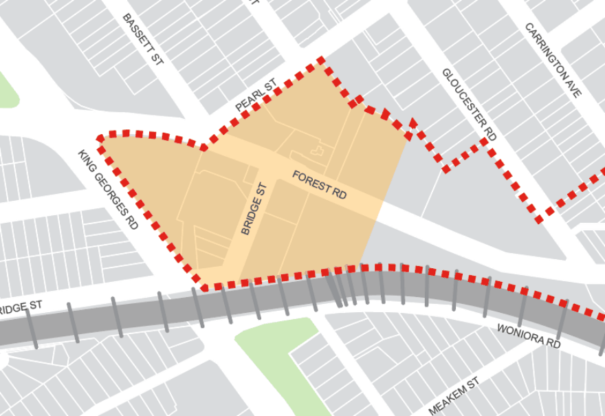

> [Picture on page 24: a picture, saved as a picture (images/part-08-2-hurstville-strategic-centre-page-24-2.gif, 150 dpi).]

Figure 11: Western Bookend

Existing Character

This Precinct is characterised predominantly by large commercial or residential buildings. The Highpoint Hurstville development occupies the large site at the corner of Pearl Street and Forest Road and provides an urban marker into the City Centre.

Unlike the adjoining City West Transition Area, this Precinct has no street tree planting and the only greenery is offered by the private open space for the Highpoint Hurstville development. As a result, there is minimal pedestrian activity in this Precinct.

Retail uses within this Precinct are generally of a larger format and due to the absence of a fine grain quality, the Forest Road streetscape lacks the vibrancy of the main-street retail further towards the eastern side of the City Centre.

Desired Future Character

The Western Bookend will continue to define and create a sense of entry into the Hurstville City Centre but with increased greening through tree planting and the provision of vegetation on the façade of new developments.

Active uses will be provided at the ground and lower levels of developments fronting Forest Road and Bridge Street to promote vibrancy and passive and active surveillance of the public domain. The public domain will have uniformity with paving types and paving width.

Controls

1\. Define the street edge using building podiums that feature fine grain retail and active uses.

2\. Maintain a street wall height of maximum three (3) storeys.

3\. Provide a continuous awning along all active street frontages.

4\. Prohibit the creation of new car park entries on Forest Road.

5\. Provide a minimum setback of 3 metres from the street for upper residential storeys (including balconies) to respect the human scale while allowing passive surveillance of the public domain.

6\. Enhance the streetscape character through the use of scale, rhythm, materiality and/or landscaping in new developments.

7\. Provide a transition in scale, form and massing on land that is adjacent to a lower density zone.

#### 8.2.7 Hurstville City Centre General Controls

#### 8.2.7.1 Consolidation of Sites

Objectives

a) Enable the provision and retention of active street frontages.

b) Consolidate utility services and infrastructure to minimise impact on the streetscape.

c) Enhance the pedestrian amenity by prioritising active and walkable streets.

d) Encourage site consolidation of allotments in order to promote the efficient use of land and to avoid the creation of isolated sites.

e) Encourage the development of existing isolated sites in a manner that responds to the site’s context and characteristics and that maintains a satisfactory level of amenity.

f) Conserve the historic fine grain pattern at the street level, despite consolidation through site amalgamation.

Controls

1\. A minimum street frontage of 30 metres is required for buildings taller than 3 storeys to ensure the provision of an active street frontage is prioritised while allowing for adequate car parking and the provision of essential services.

2\. Exceptions to the minimum street frontage will be considered if at least two-thirds of the street frontage is allocated to active uses, such as shopfronts and lobby entrances.

3\. Any site amalgamation in the Forest Road High Street and the City East Transition Area Character Precincts is to ensure that the development reflects the fine grain character of the historical subdivision pattern and surrounding heritage items.

4\. In considering an application for redevelopment of a site, Council will consider the impact of the proposed development on adjoining allotments of land that will be left as isolated sites and the impact on their future development capacity.

5\. Where amalgamation of the isolated site is not proposed, applicants will be required to:

a. Demonstrate that negotiations between the owners of the properties commenced at an early stage that was prior to the lodgement of the Development Application.

b. Demonstrate that where no satisfactory result is achieved in relation to amalgamating the site, the Development Application submission must include evidence of the negotiations with the owners of the adjoining properties. The submission must include details of the financial offers to such owners. This must be based on the development potential of the combined site, not just the adjoining site if developed independently. Such offers are to be reasonable and are to be based on at least one recent independent valuation prepared by a suitably qualified valuer and include other expenses likely to be incurred by the owner of the potentially isolated site in the process of the sale of the property.

c. At the request of Council, fund a second valuation to be undertaken on behalf of the owner of the site that would be isolated as a result of a proposed

development. The valuation may be independently reviewed by Council at the applicant’s expense.

6\. Where amalgamation of the isolated site is not achieved through negotiations, applicants will be required to demonstrate that an orderly and economically viable development of the isolated site can be achieved. Applicants will be required to prepare a concept design for the isolated site compliant with the ADG, and at the same density as proposed in the Development Application, indicating height, setbacks, resultant site coverage (building and basement), sufficient to understand the relationship between the application and the isolated site. The concept design will be required to demonstrate the likely impacts the developments will have on each other, such as solar access, visual and acoustic privacy, the impact of development of the isolated site on the streetscape and the compliance with the required car parking rates. The concept plans will be placed in Council’s records in order to form the basis for any future development proposals on the isolated site.

7\. The development of an isolated site is not to detract from the character of the streetscape and is to achieve a satisfactory level of amenity in the opinion of the consent authority, including solar access, visual and acoustic privacy.

#### 8.2.7.2 Commercial and Retail Ceiling Heights

Objectives

a) Ensure the building remains flexible to cater for different future uses.

b) Ensure a hierarchy of spaces is created through the use of height and scale.

Controls

1\. New development with a commercial or retail use is to have a minimum floor to floor height of:

a. 4.5 metres on the ground floor (minimum floor to ceiling height of 3.6 metres),

b. 3.6 metres on any floor above the ground floor (minimum floor to ceiling height of

3.3 metres).

#### 8.2.7.3 Landscaping and Tree Canopy Cover

Objectives

a) Increase the tree canopy and green cover within the Hurstville City Centre.

b) Reduce the impacts of heat in the urban environment.

c) Enhance the public domain at the edges of developments.

d) Contribute to an integrated and connected network of green infrastructure.

Controls

1\. The primary façade (most prominent to the public domain) must integrate elements of landscaping and/or greening alternatives such as green façades, green walls, podium planters and other forms of planting on structures.

2\. New mixed use developments must:

a. Incorporate a combination of green infrastructure comprising of both deep soil planting and planting on structures, and

b. Achieve a minimum tree canopy cover of 10% of the total site area.

3\. New non-residential developments must achieve a minimum tree canopy cover of 5% of the total site area.

4\. Any form of planting on structures must provide sufficient soil depth and volume to support the long-term growth of plants. Refer to Section 4P of the Apartment Design Guide for the minimum soil standards. Any sub-surface drainage requirements are in addition to the soil depths listed. Note: All volumes are subject to review against current industry best practice standards. An arborist or soil scientist can provide specific advice about the volume of soil that planting requires in your development.

5\. A Tree Canopy Plan must be submitted for Development Applications that involve new or significant redevelopments. The Plan must show the existing and proposed trees at their nominated mature size and details of the proposed canopy cover by area and percentage of site. The canopy cover is to be calculated in accordance with the following requirements:

a. The minimum tree spread to count towards the calculation is 3 metres diameter.

b. Trees on structures, including podiums and rooftops, can be included in the calculation.

c. Any overlap between tree canopies can only be counted once towards the total area.

d. Any areas of canopy extending into the site from trees planted in adjacent sites are not to be included in the calculation.

e. Any areas of canopy extending outside of the site are not be included in the calculation.

f. A written statement from a qualified arborist (minimum AQF 5) must be provided on the Plan to confirm that the nominated tree spreads and overall canopy cover can be achieved.

6\. Refer to Figure 12 for the areas that can be counted towards or excluded from the canopy cover calculation.

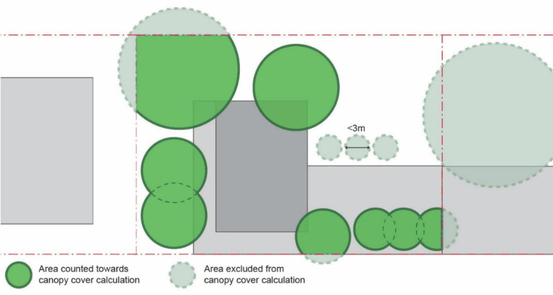

> [Picture on page 29: a picture, saved as a picture (images/part-08-2-hurstville-strategic-centre-page-29-1.gif, 150 dpi).]

Figure 12: Calculation of Tree Canopy Cover

#### 8.2.7.4 Street Hierarchy and Through-Site Links

Objectives

a) Ensure that vehicle movements are compatible with pedestrian movements and activities.

b) Minimise the impact of vehicle access points and driveway crossovers on streetscape amenity, pedestrian safety and the quality of the public domain.

c) Retain and enhance the activation of Forest Road.

d) Retain and enhance existing through-site links and arcades.

e) Enhance the permeability of the City Centre’s pedestrian network.

f) Create attractive, vibrant and safe pedestrian linkages that promote improved walkability throughout the City Centre.

Controls

1\. Creation of new vehicular access points along the primary street (Forest Road) to the site are not permitted.

2\. Vehicle access should not be located on secondary streets if the site can be accessed by lanes and other streets. Refer to the hierarchy of streets in Figure 13.

3\. Existing publicly and privately owned through-site links are to be retained in accordance with Figure 13.

4\. Maximise permeability of pedestrian movement through the Forest Road High Street Precinct to enhance connectivity to the Civic Centre and the Retail Centre.

5\. All through-site links must have strong visual cues and be clearly signposted in wayfinding signage at street entries indicating public accessibility and the street to which the link connects.

6\. Incorporate upgrades to the adjoining public domain as part of new developments, including but not limited to the provision of paving, street furniture, landscaping and where required, footpath widening. Note: upgrades are to be carried out in accordance with Council’s specifications to ensure a consistent approach in delivering a high quality public domain.

7\. Letter boxes are to be recessed from the entrance of through-site links to ensure they are not visually prominent when viewed from the public domain.

8\. Through-site links may be open air or sheltered arcades.

9\. Through-site links are to be registered on the title of the land as an easement for public access.

10\. Integration of deep soil planting as part of open air through-site links is strongly encouraged.

11\. Through-site links provided as part of commercial or mixed use developments (such as arcades) must provide public access at all business trading times.

12\. Through-site links must have a minimum width of 3 metres non-leasable space and clear of all obstructions (including columns, stairs and escalators).

13\. Arcades are to:

a. Have active frontages for the entire length,

b. Connect to existing public footpaths,

c. Have access to natural light for at least 30% of the length, and

d. Have a minimum ceiling height of 6 metres.

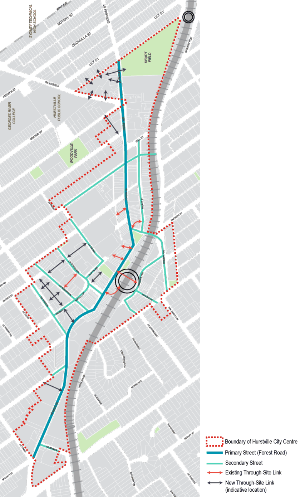

> [Picture on page 31: a picture, saved as a picture (images/part-08-2-hurstville-strategic-centre-page-31-1.gif, 150 dpi).]

Figure 13: Street Hierarchy and Through-Site Links Map

#### 8.2.7.5 Green Travel Plans and Cycleways

Objectives

a) Maximise public transport patronage.

b) Promote a pedestrian and cycle friendly City Centre.

c) Encourage alternate means to accessing a site rather than by private motor vehicles.

Controls

1\. A Green Travel Plan must be submitted for all Development Applications that involve:

a. New, or redevelopment of, non-residential developments with at least 2,000m2 of gross non-residential floor space, or

b. New, or redevelopment of, hotel or motel accommodation with at least 100 rooms.

2\. The Green Travel Plan must be prepared by a qualified transport planner or traffic engineer. It must detail measures to promote and support the use of sustainable transport options, such as public transport, cycling and walking.

3\. As part of the Plan’s preparation, consideration should be given towards the location of future cycleways proposed in the Strategic Cycling Network (Georges River Transport Strategy 2021). Refer to Figure 14 for the proposed cycling network within the City Centre.

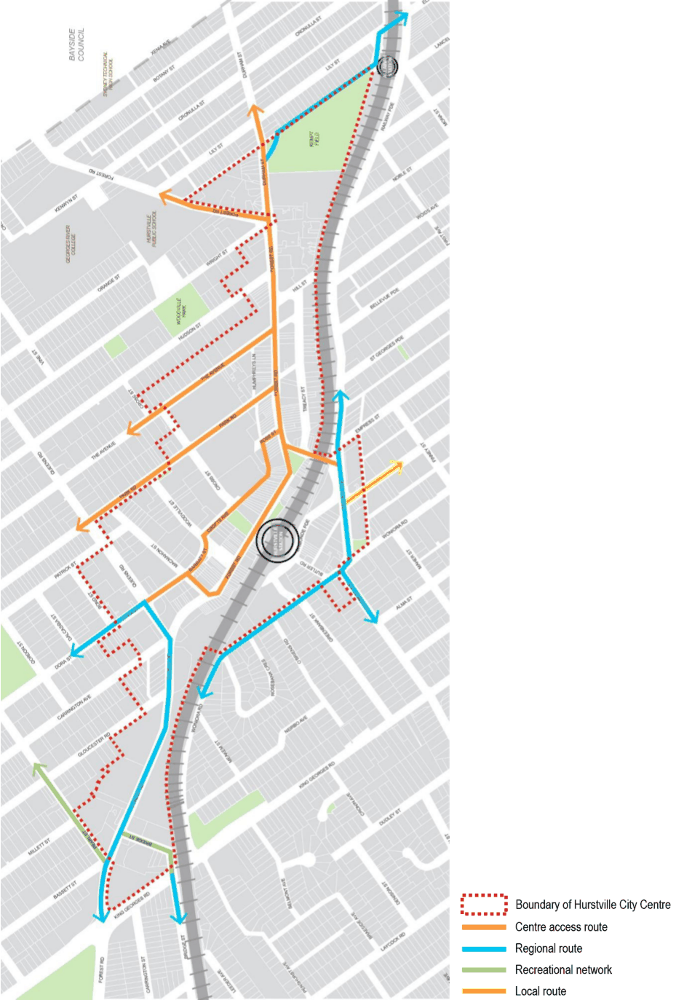

> [Picture on page 33: a picture, saved as a picture (images/part-08-2-hurstville-strategic-centre-page-33-1.gif, 150 dpi).]

Figure 14: Strategic Cycling Network within the Hurstville City Centre

#### 8.2.7.6 Dedication of Land to Council for Road/Lane Widening

Approval for development on land listed in the table below will be subject to dedication of land (for road/lane widening) without cost to Council.

A method for the dedication of land is by planning agreement under s 7.4 of the Environmental Planning and Assessment Act 1979. Council’s planning agreements policy is available on Council’s website.

The area of the land to be dedicated can be included in the site area when calculating the maximum permissible gross floor area of the development.

| Location | Land Dedication |
|---|---|
| Land fronting Alfred Street (143 Forest Road and 16 Alfred Street) | Dedication of land along the western side of Alfred Street to allow widening of the existing footpath. |
| Land fronting Queens Road (12-22 Dora Street) | Creation and dedication of 1 metre setback from the Queens Road boundary to allow widening of footpath and street tree planting. |

Additional local road widening has been identified for specific sites within the Hurstville City Centre. Refer to the Section 8.2.8 for their location and the extent of land dedication required.

#### 8.2.7.7 Wind Mitigation

Objectives

a) Ensure new developments maintain comfortable conditions for pedestrians.

b) Mitigate the impacts of downdraught wind on the public domain.

Controls

1\. Minimise the use of square corners in tower buildings to reduce the impacts of downdraught wind.

2\. Set tower buildings back from lower structures built at the street frontage to protect pedestrians from strong downdraught wind at the base of the tower.

3\. A Pedestrian Wind Effects Report prepared by a suitably qualified engineer is to be submitted with Development Applications for buildings 30 metres or higher, and for other buildings at the discretion of Council. At a minimum, the report is to:

a. Identify the likely impacts of wind on the pedestrian environment at the footpath level within the site and the public domain,

b. Consider the cumulative impact generated by existing developments within the surrounding context,

c. Demonstrate how the proposal minimises the impact of downdraught wind on the public and private domains, and

d. For buildings over 50 metres in height, results of a wind tunnel test are to be included in the report.

#### 8.2.7.8 Solar Access to Public Spaces

Objectives

a) Allow sufficient sunlight access to new and existing public spaces.

b) Ensure new development will not exacerbate existing overshadowing impacts.

Controls

1\. New developments are to minimise overshadowing impacts on the surrounding public streets, especially Forest Road.

2\. Maintain and achieve adequate solar access to existing public open spaces such as parks and plazas.

3\. For new developments in the vicinity of existing public open spaces, a detailed set of shadow diagrams must be submitted with the Development Application to demonstrate a comparison of the existing and proposed overshadowing impacts on the public open space between 9am and 3pm at midwinter.

#### 8.2.7.9 Built Form Controls for Deferred Matter Sites

Objectives

a) Ensure that buildings are compatible with the height, bulk and scale of the existing and desired future character of the locality.

b) Minimise the impact of overshadowing, visual privacy, disruption of views and loss of privacy on adjoining properties and open space areas.

c) Ensure an appropriate height transition between new buildings and adjoining land uses or heritage items.

Controls

1\. Development density and intensity of land use are to consider:

a. The environmental constraints and values of the site, including retaining the scenic, visual, and landscape qualities of the area,

b. The amenity of adjoining land and the public domain, and

c. The capacity of the road network to accommodate the vehicular and pedestrian traffic that the development will generate.

2\. The height of a development on land identified as a ‘deferred matter’ under the Georges River Local Environmental Plan 2021 is not to exceed the maximum height shown for the land in Figure 15.

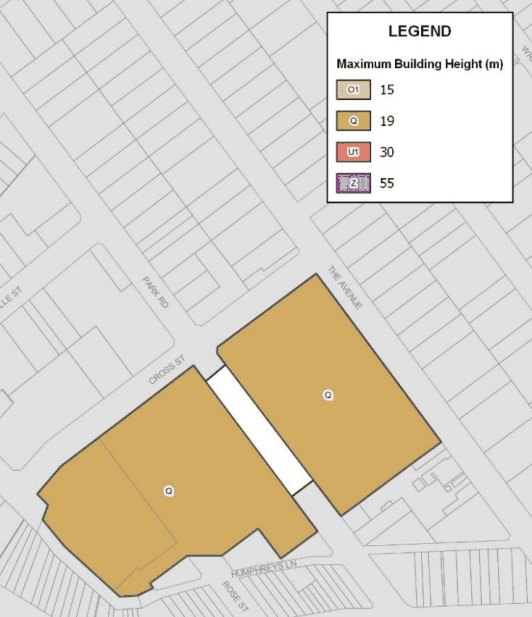

> [Picture on page 36: a picture, saved as a picture (images/part-08-2-hurstville-strategic-centre-page-36-1.gif, 150 dpi).]

Figure 15: Maximum Height of Buildings Map for Deferred Matter Sites

3\. The floor space ratio of a development on land identified as a ‘deferred matter’ under the Georges River Local Environmental Plan 2021 is not to exceed the maximum floor space ratio shown for the land in Figure 16.

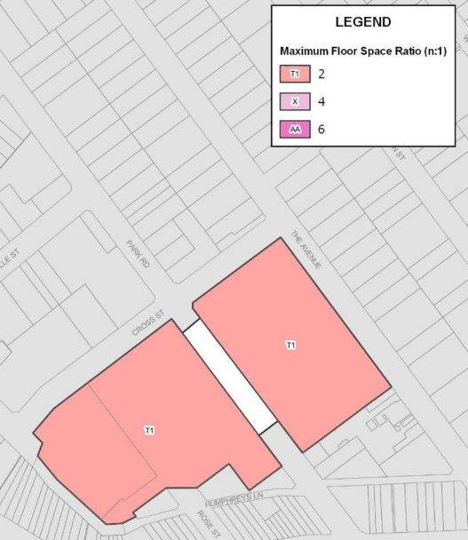

> [Picture on page 36: a picture, saved as a picture (images/part-08-2-hurstville-strategic-centre-page-36-6.gif, 150 dpi).]

Figure 16: Maximum Floor Space Ratio Map for Deferred Matter Sites

#### 8.2.8 Controls for Specific Sites and Localities

In the event of an inconsistency between the controls specified in other sections of this DCP and the site-specific controls in the following sections, the following site-specific controls shall prevail.

Refer to Council’s website for the following site-specific DCPs:

#### 8.2.8.1 Bing Lee Site

#### 8.2.8.2 Landmark Square Precinct

#### 8.2.8.3 No. 9 Gloucester Road

#### 8.2.8.4 Hurstville Civic Precinct
