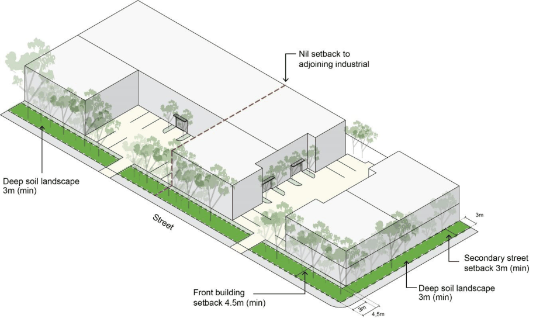

#### 9.2.3 Setbacks

#### Objectives

(a) Minimise the impact of development and buildings on the surrounding area;

(b) Provide a setback that enhances the streetscape and provides for landscaping;

(c) Ensure that adequate area is available to accommodate landscaping, access, parking and manoeuvring of vehicles;

(d) Ensure sufficient solar access for occupants of adjacent buildings, particularly residences and recreational areas; and

(e) Create a pleasant environment within and external to the site.

#### Controls

1\. A minimum front setback of 4.5 metres is required for all industrial development, except where otherwise specified in the site specific precinct controls (Figure 1).

2\. Within the front setback, a minimum 3 metres wide deep soil landscaped strip is to be provided along the front boundary. This area is to be devoid of any structures, storage areas, car parking and manoeuvring areas.

3\. A minimum secondary street setback of 3 metres is required for all industrial development, except where otherwise specified in the site specific precinct controls.

4\. The secondary street setback frontage is to contain deep soil landscaping with minimum dimensions of 3 metres in width. This area is to be devoid of any structures, storage areas, car parking and manoeuvring areas.

5\. Nil setbacks to side and rear boundaries are permitted where abutting existing industrial development.

6\. Greater setbacks are required where adjoining a sensitive land use – refer to Section

9.2.11 – Industrial / Sensitive Land Use Interface controls in this DCP.

> [Picture on page 5: a picture, saved as a picture (images/part-09-industrial-development-page-5-10.gif, 150 dpi).]

Figure 1: Industrial Building Setbacks Diagram
