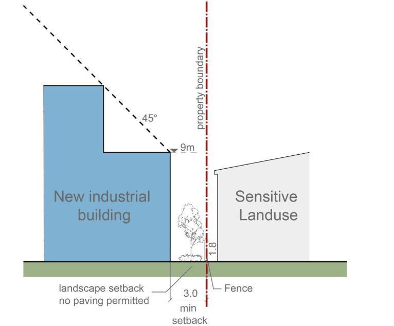
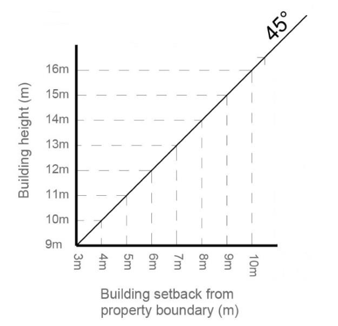

#### 9.2.11 Industrial / Sensitive Land Use Interface

Note: Sensitive land uses include any adjoining residential uses, community land uses, educational uses, stormwater channels / watercourses, public open space and recreational areas.

#### Objectives

(a) Reduce the land use conflict between Industrial and sensitive land uses;

(b) Achieve an appropriate transition between development on the fringe of Industrial zones and development in surrounding areas;

(c) Ensure industrial development and related uses are sympathetic with the streetscape character and maintains the amenity of surrounding development; and

(d) Ameliorate any potential adverse amenity, noise, privacy or overshadowing impacts upon any adjoining or neighbouring residential development from any proposed non-residential development.

#### Controls

1\. A minimum 3 metre side or rear building setback is required for any building abutting a sensitive land use. This setback is to be increased by 1 metre for every additional metre in height for the proposed development, above 9 metres in building height (refer to Figures 2 and 3 below).

> [Picture on page 15: a picture, saved as a picture (images/part-09-industrial-development-page-15-1.gif, 150 dpi).]

Figure 2: Sensitive land use building setbacks

> [Picture on page 15: a picture, saved as a picture (images/part-09-industrial-development-page-15-3.gif, 150 dpi).]

Figure 3: Sensitive land use building setbacks

2\. A minimum 3m setback area, adjoining a sensitive land use, is to be densely landscaped with indigenous trees and shrubs, which at maturity will screen the

development from the residence. Details of the proposed planting are to be provided on a landscape plan to be submitted with the Development Application.

3\. At least one living area of a dwelling on an adjoining allotment must receive a minimum 3 hours of sunlight between 9.00am and 3.00pm at the winter solstice. Where this requirement cannot be met, the development must not result in additional overshadowing on the affected living areas of the dwelling.

4\. A minimum 50% of the required private open space for a dwelling that adjoins a development receives at least 3 hours of sunlight between 9.00am and 3.00pm at the winter solstice. Where this requirement cannot be met, the development must not result in additional overshadowing on the affected private open space.

5\. For any proposed development that adjoins a residential property, the hours of operation are to be restricted to between 7.00am and 6.00pm Mondays to Saturdays and no work on Sundays or public holidays.

6\. Uses that operate outside of the normal hours of operation referenced above are required to submit a Plan of Management, which will need to be supported by an acoustic report.

7\. Noise emissions are to comply with the following noise criteria:

i. An industrial development is to be designed to locate sources of noise such as garbage collection, loading/unloading areas, air conditioning plant/other machinery, and parking areas away from adjoining sensitive land uses.

ii. Industrial waste pick up and drop off is only to occur within the hours of 7.00am to 6.00pm Monday to Saturday.
