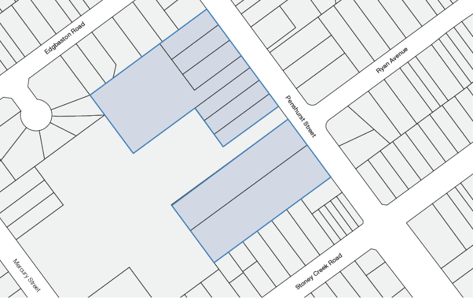
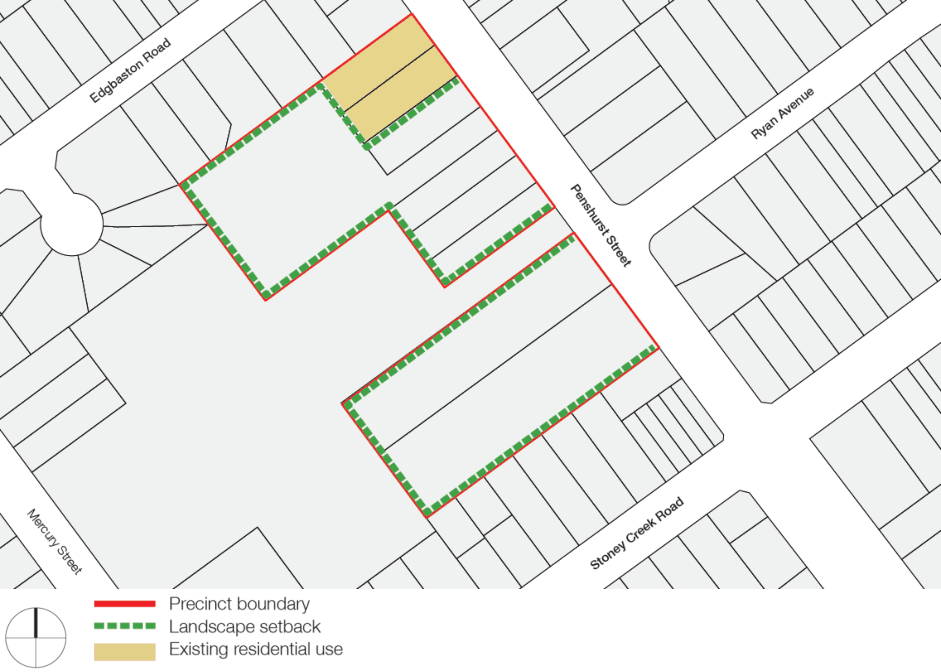

#### 9.3.1 Beverly Hills

> [Picture on page 17: a picture, saved as a picture (images/part-09-industrial-development-page-17-2.gif, 150 dpi).]

Figure 4: Map of Beverly Hills – Penshurst Street Industrial Precinct

#### Desired Future Character

The Beverly Hills precinct is a relatively small precinct on Penshurst Street, comprising a mix of manufacturing and wholesale trade or auto related uses servicing the local community. Buildings are older with a high degree of site coverage and minimal provision of off-street parking.

Redevelopment of the precinct is encouraged, to renew building stock and provide improved and more attractive streetscape, public domain and amenity outcomes. New development should ideally include the amalgamation of No.169B with Nos. 171 to 175. This would significantly increase the development potential and yield within the Precinct. Future redevelopment would also provide opportunities for landscaped setbacks to residential interface.

Street tree planting and landscaping of front setbacks will improve public domain and the streetscape.

#### Objectives

(a) Promote development of urban industrial services to support local residents and businesses;

(b) Encourage active streetscapes by promoting ground floor employment generating uses;

(c) Promote amalgamation of lots to improve street presence at northern end of Precinct;

(d) Encourage high quality buildings of contemporary design to create attractive streetscapes;

(e) Deliver improved public domain and streetscapes through street tree planting and landscaped front setbacks; and

(f) Improve amenity by providing landscaped setbacks to residential interfaces.

#### Precinct Specific Controls

> [Picture on page 18: a picture, saved as a picture (images/part-09-industrial-development-page-18-8.gif, 150 dpi).]

Figure 5: Beverly Hills – Penshurst Street Industrial Precinct specific controls

• Amalgamation of Nos. 169B with 171-175, otherwise 169B and 171 Penshurst Street preferred.

• Landscaped setbacks to residential interfaces (Figure 5).
