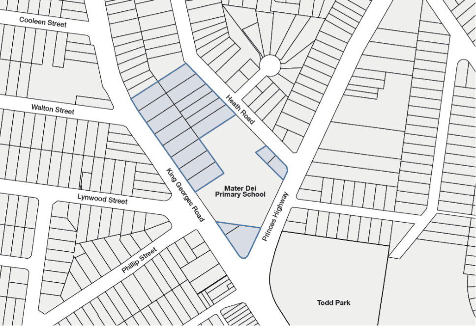
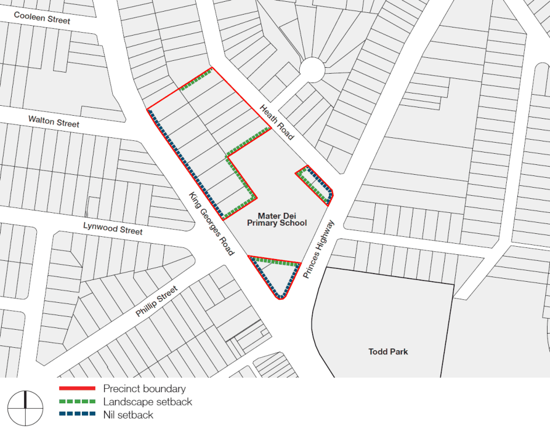

#### 9.3.2 Blakehurst

> [Picture on page 19: a picture, saved as a picture (images/part-09-industrial-development-page-19-2.gif, 150 dpi).]

Figure 6: Map of Blakehurst Industrial Precinct

#### Desired Future Character

Blakehurst is a small but highly visible precinct on the eastern side of King Georges Road at the intersection of Princes Highway. Fragmented by the Mater Dei Catholic Church and Primary School, the precinct also includes a number of properties along Heath Road to the north.

Development within this precinct will continue to build on the strength of the excellent exposure, but will require improved access and increased off-street parking as part of future development to remain successful.

New development can continue to retain a nil setback to the King Georges Road and Princes Highway street frontages. Relatively large lot sizes provide opportunity for redevelopment and renewal of older building stock. Amalgamation with the Heath Road properties should be encouraged to provide opportunities for improved vehicular access and provision of off-street parking. Future redevelopment will also enable the provision of improved landscaped buffers to sensitive adjoining uses.

#### Objectives

(a) Promote development of urban industrial services to support local residents and businesses;

(b) Encourage active street frontages to King Georges Road;

(c) Promote amalgamation of lots to deliver improved access (via Heath Road) and increase the provision of off-street parking;

(d) Encourage the construction of high quality buildings of contemporary design to create attractive streetscapes; and

(e) Improve amenity by providing landscaped setbacks to neighbouring school and residential interfaces.

#### Precinct Specific Controls

> [Picture on page 20: a picture, saved as a picture (images/part-09-industrial-development-page-20-12.gif, 150 dpi).]

Figure 7: Blakehurst Industrial Precinct specific controls

• Maintain nil setbacks to King Georges Road and Princes Highway frontages (refer Figure 7).

• Increase landscaped buffers to sensitive interface.

• Amalgamation with Heath Road properties encouraged.
