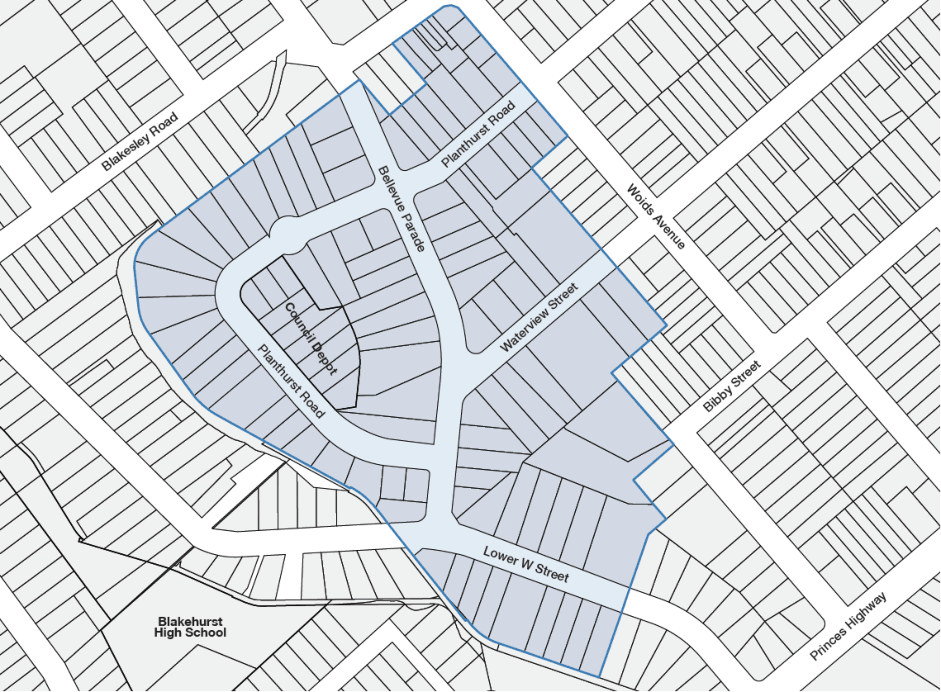
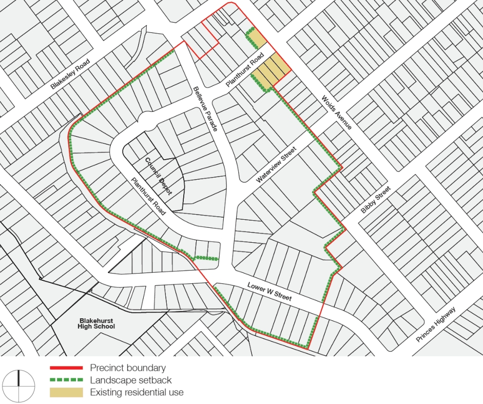

#### 9.3.3 Carlton

> [Picture on page 21: a picture, saved as a picture (images/part-09-industrial-development-page-21-2.gif, 150 dpi).]

Figure 8: Map of Carlton Industrial Precinct

#### Desired Future Character

The Carlton precinct is an important precinct as it provides and will continue to provide a largely local service function and essential services to the local community and businesses.

Regeneration of older building stock should be encouraged, along with amalgamation of smaller and narrower lots to achieve larger development sites, with increased landscaping and off street parking.

Opportunities exist for greening of this precinct and improved public domain, through street tree planting, landscaped frontages and landscaped setbacks to the stormwater channel and residential interfaces.

#### Objectives

(a) Promote development of urban industrial services to support local residents and businesses;

(b) Encourage lot amalgamation to increase lot sizes and increased off-street parking and improved landscaped frontages;

(c) Encourage high quality buildings of contemporary design to create attractive streetscapes;

(d) Retain, protect and enhance existing landscape character along stormwater channels by providing tree planting and landscaped setbacks;

(e) Deliver improved public domain and street planting; and

(f) Improve amenity by providing landscaped setbacks to residential interfaces.

#### Precinct Specific Controls

> [Picture on page 22: a picture, saved as a picture (images/part-09-industrial-development-page-22-8.gif, 150 dpi).]

Figure 9: Carlton Industrial Precinct specific controls

• Landscaped setback to the stormwater channel (refer Figure 9).

• Landscaped setbacks to residential interface.
