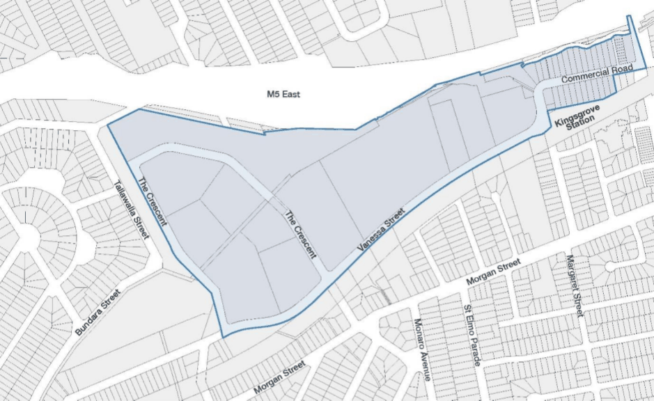
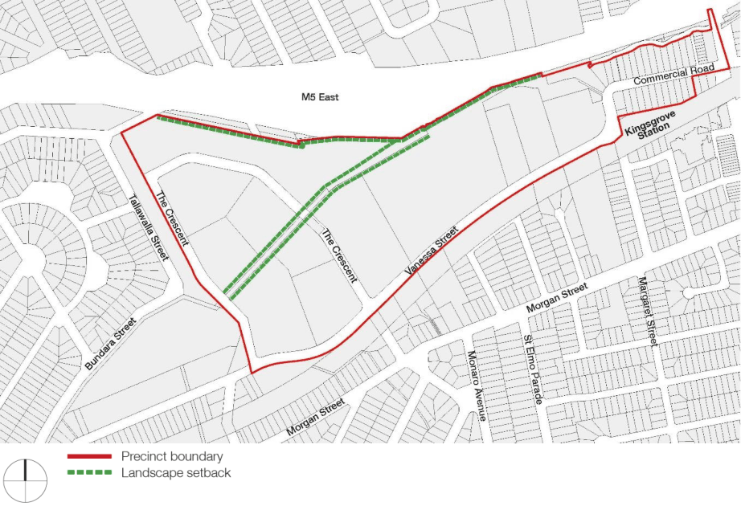

#### 9.3.4 Kingsgrove

> [Picture on page 23: a picture, saved as a picture (images/part-09-industrial-development-page-23-2.gif, 150 dpi).]

Figure 10: Map of Kingsgrove Industrial Precinct

#### Desired Future Character

Layout/setting

Kingsgrove Precinct plays an important employment role in a highly accessible location adjacent the M5 Motorway and Kingsgrove Railway Station. Existing land uses comprise a mix of wholesale trade, manufacturing, rental/hiring/real estate services and professional/scientific and technical services.

This Precinct is a very large precinct that has the greatest potential for redevelopment and intensification given it comprises large flat industrial parcels, relatively unconstrained land and is well buffered from sensitive land uses. There is the potential for redevelopment of the larger landholdings with more intensive, modern business park development with significant office components or higher intensity industrial.

Changes in built form would provide opportunities for increased frontage activity on larger sites. Strata title subdivision of existing and future business parks should be avoided to retain flexibility for comprehensive and integrated development of the area.

Existing stormwater channels, being the upper headwaters of Wolli Creek, traverse the precinct. These stormwater channels provide an important drainage function but also have the potential to provide opportunities for improved amenity to be delivered through the creation of landscaped corridors with increased tree canopy, provision of bike and pedestrian links, which may facilitate the potential future naturalisation of these creek corridors in the future.

The eastern end is more constrained with buildings, typically built boundary to boundary with a high degree of site coverage providing limited opportunities for parking or landscaping.

Buildings and parking forward of the building dominate the streetscape resulting in a very pedestrian unfriendly public domain. Opportunities exist for greening through improvements to the public domain and street tree plantings.

#### Objectives

(a) Encourage new land uses including high-tech industries, research and development, freight handling and other airport related industries in addition to the existing more traditional employment uses;

(b) Encourage active street frontages;

(c) Increase amenity by introducing landscaped setbacks along the water channels and provide for pedestrian and cyclist movement;

(d) Encourage new buildings to also address the stormwater channel corridors;

(e) Encourage high quality buildings of contemporary design to create more attractive streetscapes; and

(f) Retain, protect and enhance existing landscape character by providing tree planting along stormwater channels.

#### Precinct Specific Controls

> [Picture on page 24: a picture, saved as a picture (images/part-09-industrial-development-page-24-17.gif, 150 dpi).]

Figure 11: Kingsgrove Industrial Precinct specific controls

• Landscaped setbacks to stormwater channels (refer Figure 11).
