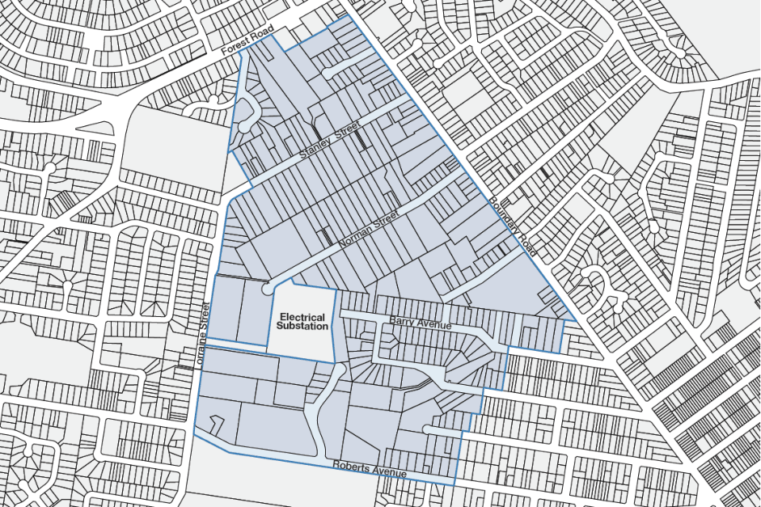
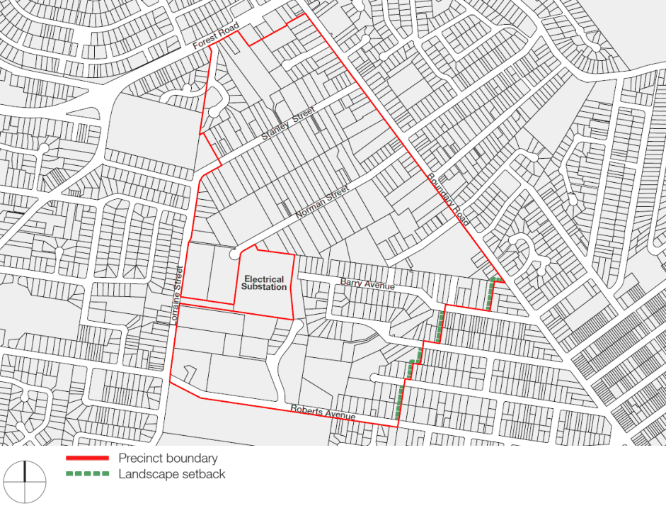

#### 9.3.5 Peakhurst

> [Picture on page 25: a picture, saved as a picture (images/part-09-industrial-development-page-25-2.gif, 150 dpi).]

Figure 12: Map of Peakhurst Industrial Precinct

#### Desired Future Character

The Peakhurst industrial precinct is the largest and most diverse industrial precinct in the LGA (Figure 12). The precinct plays an important employment role with a broad mix of land uses, including traditional manufacturing, trade and construction industries, and a mix of community uses, bulky goods retailing and is anchored by the Mortdale Plaza (Woolworths development). This composition should be maintained and further retail development within the precinct avoided.

With the exception of several large business parks, the subdivision pattern is highly fragmented, with a dominance of long narrow lots. Amalgamation of these long narrow lots is encouraged to provide more efficient industrial development. The creation of larger and wider lots will reduce the dominance of driveways and loading docks to the street, increase opportunities for landscaped front setbacks, street tree planting and the provision of off street parking.

Recent development has delivered higher quality contemporary designs to an otherwise precinct of mixed building stock. Increased renewal of the older building stock is encouraged and provides opportunities to address the shortage of off-street parking, some through basement parking.

The precinct requires the provision of street trees and planting of significant canopy trees within front setbacks, to improve streetscapes and the public domain. Increased landscaped buffers are to be provided to the residential interface along the south-east boundary of the precinct as part of redevelopment.

#### Objectives

(a) Maintain a diverse range of industries to support local residents and the wider area and minimise retail uses;

(b) Encourage active streetscapes by promoting ground floor employment generating uses;

(c) Promote amalgamation of lots;

(d) Encourage increased off-street parking, landscaping and improved public domain;

(e) Encourage high quality buildings of contemporary design to create more attractive streetscapes; and

(f) Improve amenity by providing landscaped setbacks to residential interfaces.

#### Precinct Specific Controls

> [Picture on page 26: a picture, saved as a picture (images/part-09-industrial-development-page-26-12.gif, 150 dpi).]

Figure 13: Peakhurst Industrial Precinct specific controls

• Landscaped setbacks to residential interface (refer Figure 13).
