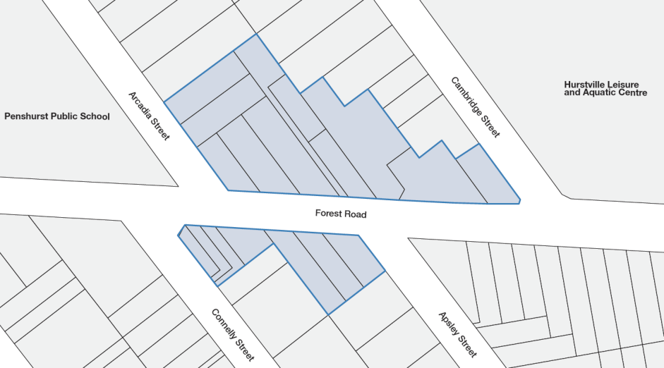
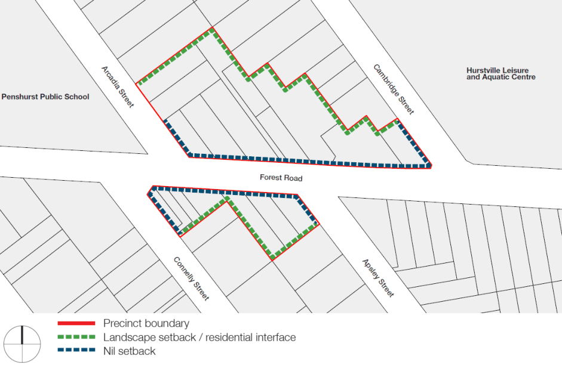

#### 9.3.6 Penshurst – Forest Road

> [Picture on page 27: a picture, saved as a picture (images/part-09-industrial-development-page-27-2.gif, 150 dpi).]

Figure 14: Map of Penshurst – Forest Road Industrial Precinct

#### Desired Future Character

Forest Road, Penshurst is a relatively small precinct that enjoys frontage to the busy Forest Road, in close proximity to King Georges Road and the Penshurst Local Centre (Figure 14).

Existing land uses are largely auto related, servicing the local community and businesses and operate out of older building stock. There is an absence of any recent development or upgrade of building stock.

Older building stock on a number of the key corner sites provides an excellent opportunity for renewal, with high quality contemporary buildings. New development should promote pedestrian amenity along Forest Road through the provision of active building frontages and awnings. Nil setbacks to front and secondary street frontages are promoted and landscaped setbacks provided to adjoining residential land uses to the side and rear. Vehicular access should be via the secondary frontage, where available. Storage areas are to be provided at the rear, where possible, and screened.

The busy arterial road frontage of this precinct prevents any significant public domain improvement works or tree planting. Landscaping should therefore be provided to rear and side boundaries that have an interface to the adjoining residential development.

(a) Promote development of urban industrial services to support local residents;

(b) Encourage active streetscapes by promoting ground floor employment generating uses;

(c) Promote amalgamation of lots;

(d) Encourage high quality buildings of contemporary design to create more attractive streetscapes, in particular on key corner sites; and

(e) Improve amenity by providing landscaped setbacks to residential interfaces.

#### Precinct Specific Controls

> [Picture on page 28: a picture, saved as a picture (images/part-09-industrial-development-page-28-9.gif, 150 dpi).]

Figure 15: Penshurst – Forest Road Industrial Precinct specific controls

• Nil setback to Forest Road and secondary frontages (refer Figure 15).

• Landscaped setbacks to residential interfaces.
