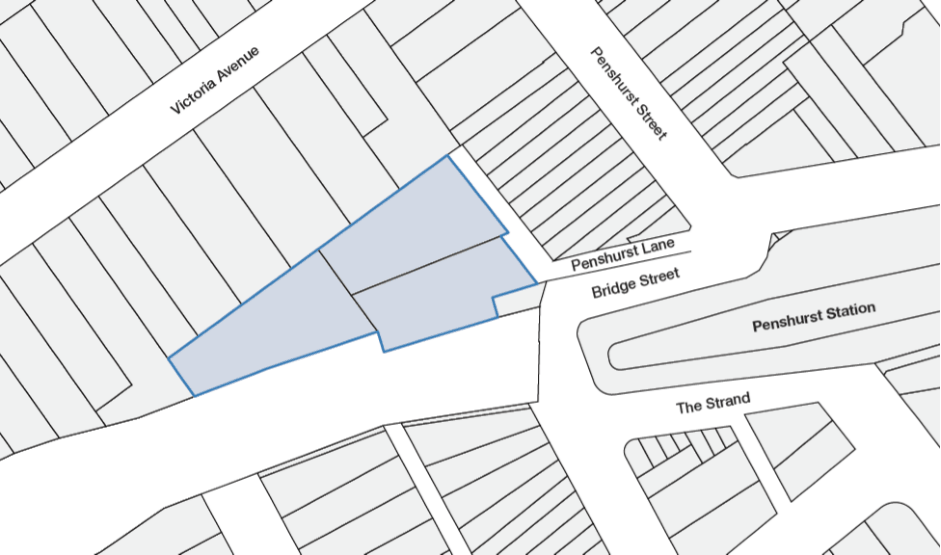
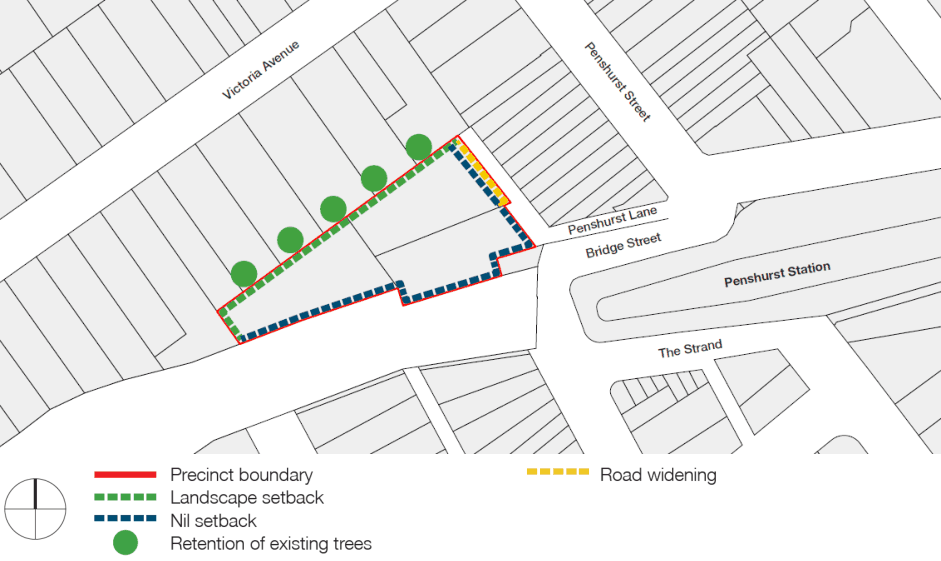

#### 9.3.7 Penshurst – Penshurst Lane

> [Picture on page 29: a picture, saved as a picture (images/part-09-industrial-development-page-29-2.gif, 150 dpi).]

Figure 16: Map of Penshurst – Penshurst Lane Industrial Precinct

#### Desired Future Character

The Penshurst Lane precinct is a very small industrial precinct hidden at the centre of the Penshurst Local Centre, adjacent the Penshurst Railway Station (Figure 16).

Whilst being a very small precinct with limited exposure to passing traffic and poor vehicular access, the precinct enjoys an excellent location near public transport and at the centre of the Penshurst Local Centre. This provides potential for more creative, flexible and innovative industries that could leverage off the location yet function in harmony with the surrounding residential and commercial development. This could include artisan type uses, galleries, and workshops.

The older buildings and laneway location lend redevelopment towards adaptive re-use of existing buildings. Alternatively, a wholesale redevelopment could provide an upgrade in building stock and quality of architecture including removal of mobile phone infrastructure. Any redevelopment will be required to protect the line of existing trees along the northern boundary that provide amenity to the adjoining residential flat buildings. Redevelopment could encourage revitalisation of the immediate commercial properties that back onto Penshurst Lane to the east and assist with the broader function and vitality of the local centre.

Lot amalgamation and wholesale redevelopment could facilitate public domain improvements, including road widening of Penshurst Lane, and provision of a turning head and pedestrian footpath.

(a) Promote development of urban industrial services to support local residents;

(b) Foster a diverse range of industries, including creative and innovative industries;

(c) Encourage active streetscapes by promoting ground floor employment generating uses;

(d) Promote amalgamation of lots;

(e) Encourage high quality buildings of contemporary design to create more attractive streetscapes;

(f) Deliver improved public domain to improve amenity and pedestrian access and safety; and

(g) Improve amenity by providing landscaped setbacks to residential interfaces.

#### Precinct Specific Controls

> [Picture on page 30: a picture, saved as a picture (images/part-09-industrial-development-page-30-12.gif, 150 dpi).]

Figure 17: Precinct specific controls

• Amalgamation (Figure 17).

• Road widening outside No.3 Penshurst Lane.

• Side setback to northern boundary of No.3 Penshurst Lane to protect/maintain adjoining trees within adjoining residential properties.
