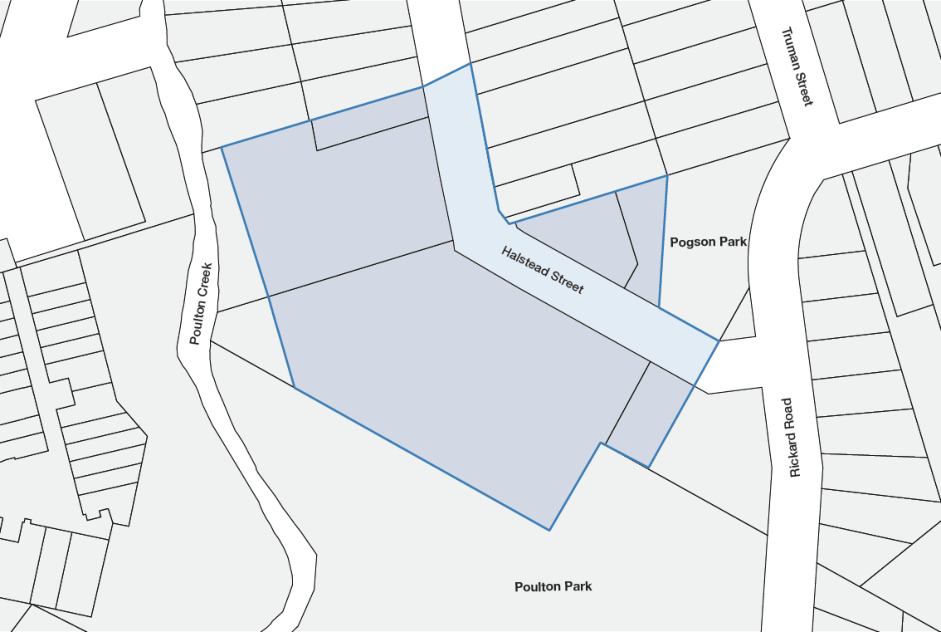
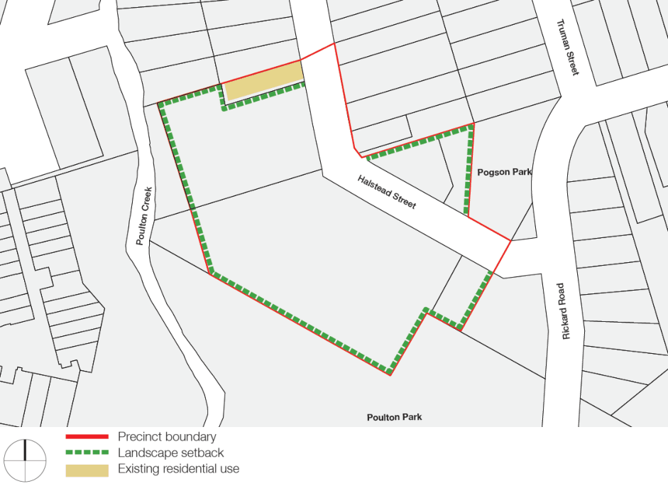

#### 9.3.8 South Hurstville

> [Picture on page 31: a picture, saved as a picture (images/part-09-industrial-development-page-31-2.gif, 150 dpi).]

Figure 18: Map of South Hurstville Industrial Precinct

#### Desired Future Character

The South Hurstville precinct is a small, isolated precinct abutting residential properties and public open space (Figure 18). Vehicular access is via the surrounding residential streets with little or no public transport in the vicinity.

The precinct provides for a diversity in industries, including community use, construction, offices, bulky goods, storage, auto and other services. The precinct has the potential to foster creative uses that could function in harmony with the surrounding residential development.

The majority of the precinct is occupied by existing strata developments. Consequently, there is limited opportunity for significant changes in built form. The age and scale of existing buildings have potential for re-use rather than any wholesale redevelopment.

The public domain has an absence of street tree canopy but is otherwise in relatively good condition. Street tree planting should be undertaken, where possible.

#### Objectives

(a) Promote development of urban industrial services to support local residents;

(b) Foster a diverse range of industries, including creative and innovative industries;

(c) Encourage active streetscapes by promoting ground floor employment generating uses;

(d) Encourage high quality buildings of contemporary design to create more attractive streetscapes; and

(e) Improve amenity by providing landscaped setbacks to residential interfaces and open space.

#### Precinct Specific Controls

> [Picture on page 32: a picture, saved as a picture (images/part-09-industrial-development-page-32-8.gif, 150 dpi).]

Figure 19: Precinct specific controls

• Landscaped setbacks to residential and open space interfaces (refer Figure 19).
