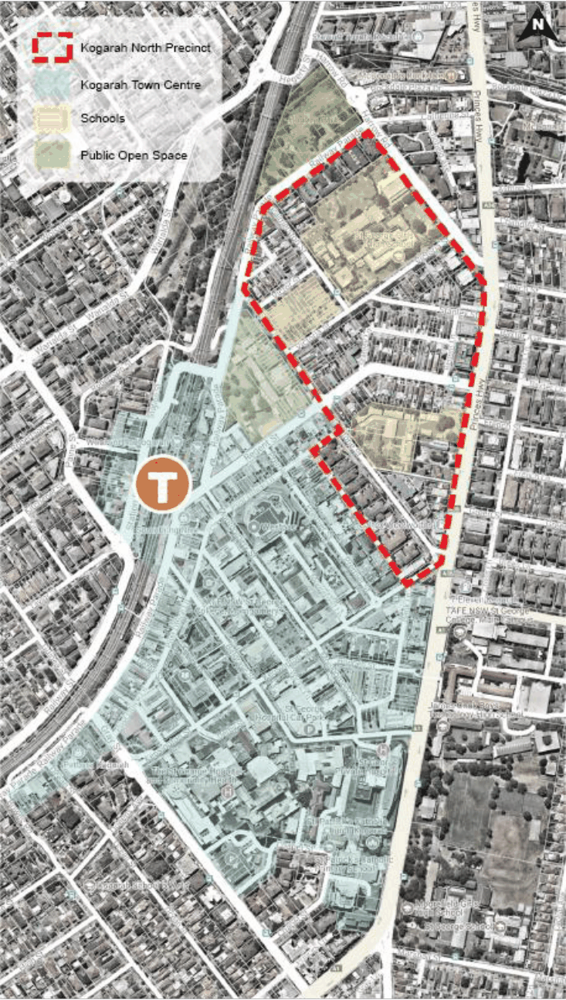

### 10.1 Kogarah North Precinct

The Kogarah North Precinct is situated at the northern tip of the Georges River Local Government Area boundary which covers an area of 75,688m². The Precinct is bounded by the Illawarra and Eastern Suburbs rail line, Railway Pde, Harrow Road, the Princes Highway, Kensington Street, Bank Lane, Post Office Lane and Gladstone Street. The Precinct is illustrated in Figure 1.

The amendment to the Kogarah LEP 2012 which was gazetted on 26 May 2017 enabled a greater intensity of residential uses across the Precinct; giving effect to broader metropolitan-wide directions to support urban consolidation, particularly in locations close to jobs and public transport services.

The Kogarah North Precinct sits to the north of Kogarah Town Centre, an area which has undergone a significant transformation over the last decade, to become a vibrant, liveable and working Town Centre. Kogarah is a highly concentrated business district, with two major hospitals (St George Public and St George Private Hospitals) and the second largest TAFE in NSW.

The Kogarah Health and Education Precinct; which encompasses the existing Town Centre and the adjoining two hospitals has been identified as a ‘Collaboration Area’ under the Greater Sydney Region Plan - A Metropolis of Three Cities (updated March 2018).  Kogarah is identified as a Strategic Centre in the Eastern Harbour City and a Health and Education Precinct.

The Kogarah Collaboration Area is referred to in several Planning Priorities under the South District Plan (Updated March 2018).  These include the following Planning Priorities:

• S2 - Working through collaboration. The report Collaboration Area Kogarah Place Strategy (Kogarah Place Strategy) was issued in January 2020, and identified Kogarah North as “a focus for new housing close to the health, knowledge and wellness education core”

• S5 Providing housing supply, choice and affordability, with access to jobs, services and public transport

• S6 – Creating and renewing great places and local centres, and respecting the District’s heritage.

Given the Regional and District Planning, Kogarah is targeted to grow in terms of jobs and housing. The Kogarah North Precinct will assist in this growth and in the establishment of Kogarah as both a strategic centre and a Health Education Precinct – creating a centre that provides a mix of uses and development types. The Kogarah North Precinct is not part of the Kogarah Strategic Centre. Refer to Part 8.1 of this DCP for controls relevant to the Kogarah Strategic Centre.

This part of the DCP seeks to support the development of Kogarah North and the priorities and actions identified in the Kogarah Place Strategy. The Strategy states that one of the places in

the Kogarah Collaboration Area is Kogarah North which will be a focus for new housing close to the health, knowledge and wellness education core1.

One of the shared objectives in the Strategy relates to Kogarah North and states:

Kogarah North Precinct will be a renewed neighbourhood village for the community – an authentic place where the community enjoys attractive and safe pedestrian and cycle paths and facilities, green infrastructure, and a variety of public open spaces.2

The relevant actions in the Strategy are as follows:

Action 6: Use the Movement and Place framework to achieve the desired future character for streets and places in the Collaboration Area

Action 8: Refine and plan for the Green Grid in the Collaboration Area

Action 26: Explore precinct wide and site specific energy efficiency initiatives, with a focus on NSW Government-owned land, high energy users and catalyst projects

Action 29: Plan for sustainable development through controls for new buildings and higher BASIX targets

Action 34: Map open space deficiencies, explore the expansion of open space, investigate acquisition of land for new open space and investigate initiatives for large roof surface areas and car parks for open space

Action 35 - Increase the percentage of urban tree canopy in:

• town centres and main streets

• areas with high pedestrian activity and high vulnerability and high urban heat island effect

• NSW Government- owned land including hospitals

• areas with low urban tree canopy cover

• Green Grid routes

Note: The Strategy states on page 71- Increase the urban tree canopy as identified in Kogarah North and Rockdale Town Centre master plans, and prioritise planting according to urban heat mapping, heat vulnerability and Green Grid planning3

The Strategy in Appendix 24 captures discussions and work undertaken as part of the Movement and Place Framework pilot and seeks in part to identify:

• A desired 2036 future character statement for streets and places in the Collaboration Area

• Issues and opportunities for that street or place

• Actions to deliver the desired character

1 Greater Sydney Commission Collaboration Area Kogarah Place Strategy page 6 2 Greater Sydney Commission Collaboration Area Kogarah Place Strategy page 8 3 Greater Sydney Commission Collaboration Area Kogarah Place Strategy page 71 4 Greater Sydney Commission Collaboration Area Kogarah Place Strategy page 72

> [Picture on page 6: a picture, saved as a picture (images/part-10-precincts-page-6-1.gif, 150 dpi).]

Figure 1: Kogarah North Precinct

#### 10.1.1 Existing Character

The Kogarah North Precinct is characterised by low-scale residential streets of mid-century one and two storey red brick houses, and semis. There are three schools within the Precinct

which are likely to remain low-scale in terms of their built form – Kogarah Public School, Kogarah High School and St George Girls High School. They provide breathing space between redevelopment sites.

The Precinct adjoins the Kogarah Town Centre and Kogarah Railway Station and is within easy walking distance of Rockdale Plaza and Rockdale Station. Hogben Park is situated to the north of the Precinct, and along with Fry’s Reserve (outside of the Precinct) is part of a broader green network that encompasses public and private lands.

The future change to the Precinct will see a shift from low density residential to higher density apartment buildings. The change in the local character and increase in population will see the area transform, providing an array of opportunities to the current and future population. New residents will live at higher densities and in apartment buildings. Consequently, public and communal spaces will play a far greater role as places for entertaining, socialising, exercise and all kinds of recreation.

#### 10.1.2 Land to which this part applies

This section forms part of Part 10 – Precincts and applies to the Kogarah North Precinct which incorporates the land outlined in blue in Figure 1.

This part needs to be read in conjunction with: Part 1 – Introduction Part 2 – Application Process for Georges River DCP 2021 Part 3 – General Planning Considerations Part 4 – General Land Use Part 6 – Residential Controls Part 7 – Business Precincts Part 9 – IN2 Light Industrial Zones Appendices

Development within the Precinct must comply with all other applicable parts of the DCP. If there is a discrepancy between Section 10.1 and other parts of the DCP the controls in Section

10.1 will always prevail.

This part is to be read in conjunction with the Georges River Local Environmental Plan

2021\. It contains detailed objectives and controls that will be used by council when determining development applications under Section 4.15 of the Environmental Planning and Assessment Act 1979 (the ‘Act’). Each application will be considered on the individual circumstances and merits.

This part has also been prepared taking into account Chapter 4 of State Environmental Planning Policy Housing (Housing SEPP) and has been formulated to respond to the design quality principles of the Housing SEPP and the NSW Apartment Design Guide 2015 (ADG). The objectives, design criteria and design guidance provisions contained in the ADG apply to design issues not specifically covered within this part of the DCP.

#### 10.1.3 Development Contributions

Council levies Development Contributions under the Environmental Planning and Assessment Act 1979 on development to help cover the costs of delivering infrastructure needed to support the additional population and community.

Council seeks the following development contributions:

• Section 7.11 Contributions;

• Section 7.12 levies; and

• Voluntary Planning Agreements.

Please refer to Council’s website (http://www.georgesriver.nsw.gov.au/Development) for the applicable development contribution plan and policies relating to Planning Agreements.

Early contact is to be made with Council officers where Planning Agreements are envisaged for the provision of public facilities.

#### 10.1.4 The Kogarah North Urban Design Strategy

The Kogarah North Urban Design Strategy (UDS) was endorsed by Council on 27 November 2017.

The Kogarah North UDS includes a series of urban design principles which have been informed by urban design and planning analysis of the Kogarah North Precinct.

The principles identify appropriate planning and urban design measures to encourage the renewal of land within the Precinct and address the scale and density of development, traffic and pedestrian management, landscaping and other public domain improvements.

The controls in this DCP (as amended) are informed in part by the analysis undertaken in the UDS.  Since 2017, there has been several development applications lodged in the Precinct. The controls in this part of the DCP (as amended) are also based on a review of the recent development applications, including those approved by the Land and Environment Court in the Precinct.  This is with a view to ensure that the aims of the up-zoning of the Precinct in 2017 with regards to increased density can be realised.

#### 10.1.5 Vision for the Kogarah North Precinct

The Kogarah North Precinct presents the opportunity to create a vibrant and diverse precinct, where a spacious, high quality public domain is the setting for thriving social activities and cohesive built form. New development has the opportunity to promote a sense of place through maintaining a human scale at the street level creating a great environment for residents and visitors. The Precinct also has the opportunity to evolve into a place of activity, establishing a connection to the Kogarah Town Centre with its range of transport modes, interconnectivity, permeability and accessibility. The growth potential of Precinct is to be guided by an urban framework that emphasises an extensive and revitalized public domain, excellence in its urban and architectural design, an integrated transport network and sustainable development in the public and private domains.

#### The Vision for the Kogarah North Precinct is:

Kogarah North offers high density living within an excellent public domain. Kogarah North will consist of residential and community uses in the form of apartment buildings that will deliver a diversity of heights but will maintain a human scale built form at street level creating a balance between increased housing opportunities, public and private amenity and an active and safe pedestrian environment. The built form will be complemented by generous public domain with a strong landscape character to create a verdant, attractive and high quality landscape for the amenity of residents, neighbours and visitors to Kogarah North.

A variety of apartments help to build a community made up of many kinds of households. Importantly, this enables people to pass through life's different stages while remaining within the neighbourhood. The convenience of having work, services, entertainment and the station nearby means people rarely need a car to meet their daily needs, or to access the rest of Sydney.

The area's leafy streets, beautiful public and hidden parks, community facilities and visible heritage features make for an attractive, people-friendly environment. There are many pleasant places to stop awhile and chat to neighbours, providing the setting for a rich and varied community life.

#### 10.1.6 The Controls
