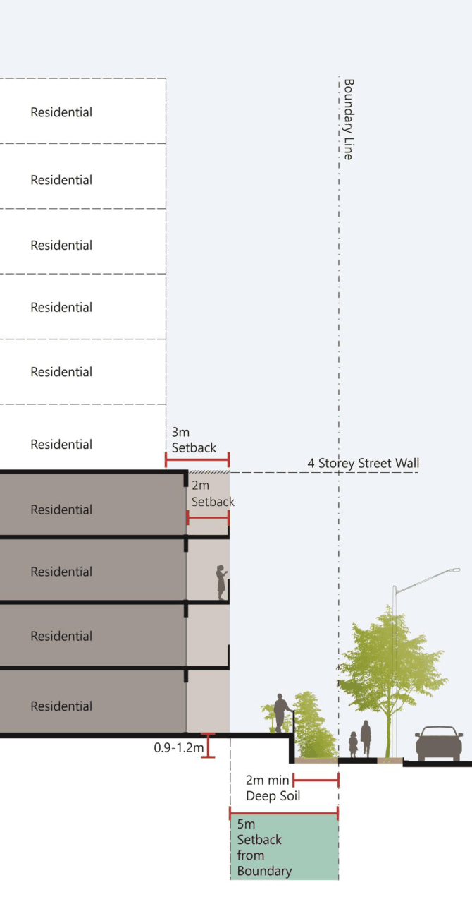
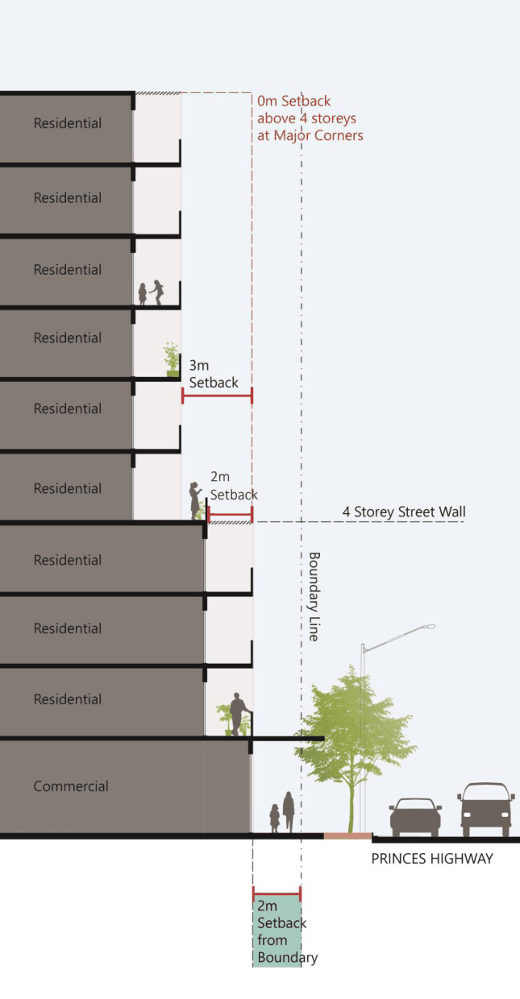
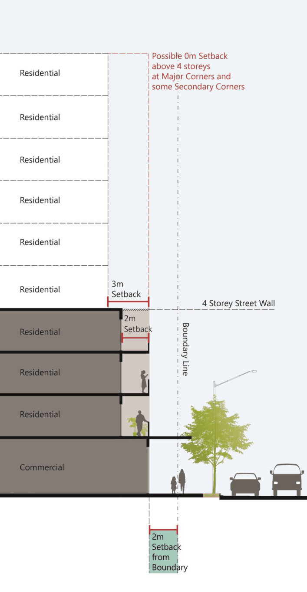
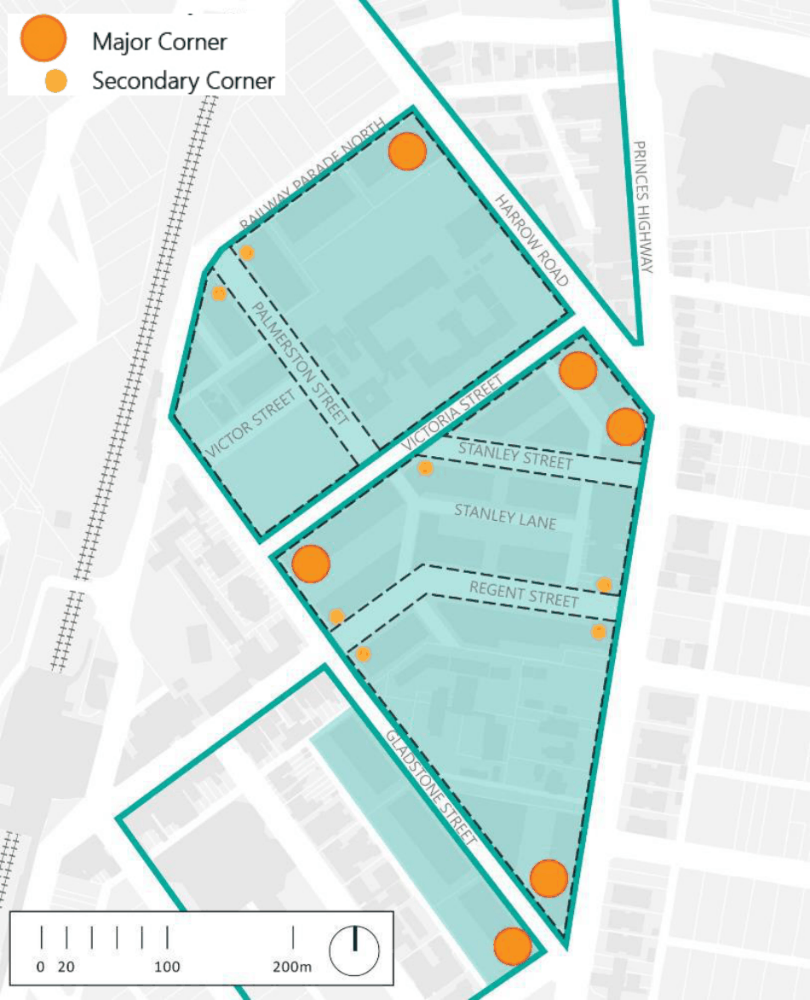

## 4. Setbacks

These controls apply to the setback of any part of the building that faces onto a street or laneway, whether it is designed as the front, rear or side of the building.  For setbacks from a common boundary to another property, usually a side setback, the requirements of the ADG will apply.

#### Objectives

(a) Establish the desired spatial proportions of the street and define the street edge.

(b) Ensure setbacks to streets are appropriate for the street widths and functions to ensure a comfortable urban scale of development.

(c) Given the nature of the street and the desire to provide a hard edge (unlike other street where a landscaped edge is appropriate), there may be reduced setbacks at the ground floor level on the Princes Highway, Harrow Road and Railway Parade North.  Further, sites on defined major and secondary corners may have reduced setbacks above the ground floor to bookend of the block.

(d) Preserve and enhance street settings.

(e) Ensure that residential frontages are well designed and safe.

(f) Provide visual and acoustic privacy for existing and new occupants.

(g) Control overshadowing of adjacent properties and private or shared open space.

(h) To retain existing street trees and provide opportunities for deep soil zones for planting of additional canopy trees and landscaping.

(i) Avoid an unreasonable sense of enclosure and to facilitate an appropriate separation between buildings.

(j) Mitigate the visual intrusion of building bulk on neighbouring properties.

(k) Minimise direct overlooking into neighbouring schools within the Precinct.

#### Controls – General – All Development

1\. Setbacks dimensions are to be increased where needed to maximise the retention of existing trees and their root systems (including those on adjoining properties and in the street).

2\. Setbacks are to include the planting of canopy trees, both small and large varieties.

3\. All property boundary front setbacks must be deep soil and landscaped and must not have any underground intrusions such as underground car parking or on-site detention.

4\. No ground floor apartments are to be below the adjacent footpath level.

5\. Ground floor residential units with a street frontage may provide some privatisation of the area within the setback from the street, but this shall be limited to a maximum depth of half the required setback, and must not occur across the whole frontage of the site.  Any private courtyard areas must incorporate landscaping, to provide for privacy as well as for a consistent, attractive and well maintained landscape frontage.

6\. The primary area of outdoor private open space must not be located on the street frontage.

7\. Blank walls are to be avoided for any location visible from the public domain.

8\. Side or rear boundary fencing over 1.5m in height is not permitted fronting the public domain.

9\. On site with frontages to the Princes Highway, Harrow Road and Railway Parade North, the balconies on the lower levels may be wintergardens.  The wintergarden will count as GFA for the purposes of the calculation of the FSR.

10\. Development of 4 storeys or greater in height adjacent to a school are to consider the following:

a. Mitigation of overshadowing impacts on the school and its grounds through setbacks and controlling the bulk and scale of buildings;

b. Orientating internal spaces so that main living areas face away from school property; and

c. Windows and balconies are to be designed to reduce opportunities for overlooking school grounds.

#### Setback Controls

1\. The setbacks of the building to the street are to be as shown in Figure 2:

• Ground floor (street level):

5m, with the first 2m to be at grade with the footpath to provide landscaped edge

• Up to 12 m (4 storeys):

7m to the building – balconies/wintergardens may encroach up to 2m into the 7m setback

• Over 12m (5th storey and above):

8m to the building or balcony

2\. A variation to the setback may be considered for certain streets.  For that part of the proposed building that has a boundary to the Princes Highway, Harrow Road or Railway Parade North, the setbacks are to be as shown in Figure 3:

• Ground floor (street level):

2m

• Up to 12 m (4 storeys):

4m to the glass-line. Balconies may encroach 2m within the setback

• Over 12m (5th storey and above):

5m to any balcony.

For sites that have a splay corner or a boundary of less than 10m to the subject streets, the setbacks above do not apply and the setbacks in Control (1) apply.  Further, the visibility of a building or part of a building from one of the subject street/s does not trigger this control; Control (1) will apply.  The reduced setback control applies only to that part of the building that is parallel to the alignment of the subject street.

3\. A variation of the above setbacks, may be considered for major and secondary corners. See Figure 4 for setback requirements and Figure 5 for the location of these corners.

> [Picture on page 16: a picture, saved as a picture (images/part-10-precincts-page-16-1.gif, 150 dpi).]

Figure 2:  Developments with frontage to streets

> [Picture on page 17: a picture, saved as a picture (images/part-10-precincts-page-17-1.gif, 150 dpi).]

Figure 3: Front setbacks for sites with frontage to the Princes Highway, Harrow Road and Railway Parade North

> [Picture on page 18: a picture, saved as a picture (images/part-10-precincts-page-18-1.gif, 150 dpi).]

Figure 4: Setbacks on identified corners

> [Picture on page 19: a picture, saved as a picture (images/part-10-precincts-page-19-1.gif, 150 dpi).]

Figure 5: Location of Major and Secondary Corners

#### Controls for Side and Rear Setbacks

4\. Side and rear setbacks to another property must result in a development that:

• Provides resident amenity, including landscaping and deep soil planting, protection of large established trees, privacy, solar access and ventilation.

• Responds to the local context and provides streetscape amenity, including providing adequate separation from existing and future development.

• Does not prevent a neighbouring site from achieving its full development potential.

5\. Council may consider a request for zero side boundary setbacks up to four storeys to sites fronting the Princes Highway to maximise yield.  Council may consider the reduction of the side boundary setbacks on other sites within the Precinct, where the proposed development complies with the principles of solar access and cross ventilation in the Housing SEPP and where it can be demonstrated that there would be no additional impacts on adjoining properties and trees are retained.

Council will require the submission of a schematic design for the redevelopment of neighbouring sites so that Council can undertake an assessment of the impact of adjoining developments and compliance with the ADG.
