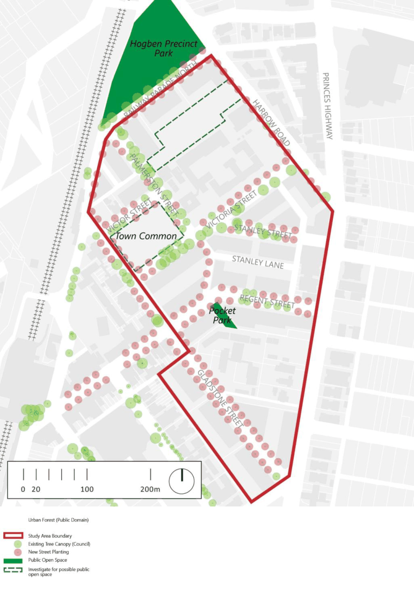

## 5. Trees and Landscape

#### Objectives

(a) Retain and increase the existing tree canopy (refer to Figure 6) within the Precinct.

(b) Contribute to streetscape character and the amenity of the public domain by using planting and landscape elements appropriate to the desired character of the streetscape and the scale of the development.

(c) Encourage landscape treatments, both deep soil landscaping and planting on podiums, which provide privacy for residents.

(d) Contribute to water and stormwater efficiency by integrating landscape design with water and stormwater management.

(e) Minimise the impact of driveways and parking areas on existing landscaping, landform and streetscape, in terms of siting and choice of materials.

(f) Ensure any planting on podiums, roof tops and in planter boxes is sustainable by providing adequate rainwater storage and water efficient irrigation.

(g)

> [Picture on page 21: a picture, saved as a picture (images/part-10-precincts-page-21-2.gif, 150 dpi).]

Figure 6: Existing Tree canopy and proposed new street tree plantings

#### Controls

1\. All development is to be designed to eliminate the impact upon significant trees on site, street trees and trees on adjoining land including public open space and educational establishments.  Existing mature trees in good health and condition are to be retained through the appropriate siting of buildings, car parks, basements, pools, ancillary buildings, driveways and hard stand areas.

2\. Landscaped areas must be effectively distributed on the site to minimise the dominance of buildings, structures and paving when viewed from the street, public places and surrounding properties.

3\. Additional street trees are to be incorporated into the overall design of the development in locations identified in Figure 6.

4\. Common open space/courtyards are to be located, designed and landscaped to:

• Enhance views from dwellings and create recreational opportunities.

• Be the focal point for residents and incorporate public art and water features where appropriate.

• Achieve good amenity in terms of solar access and natural air flow.

5\. Communal open space on roof tops is encouraged in locations where it does not adversely impact on the residential amenity of surrounding residents.  A plan of management will be required for the use of large communal terraces that must be implemented through the Owners Corporation by-laws.

6\. Deep soil zones are to be located within ground floor setbacks providing screening/interface to the street where large trees will benefit the maximum number of residents and are to be located where they will contribute to the public domain.

7\. Landscaping should give precedence to species with low water needs, include native plant species and select and position trees to maximise control of sun and winds.

8\. Landscape design is to be integrated with water and stormwater management.  On-site detention tanks must not be located within deep soil zones.
