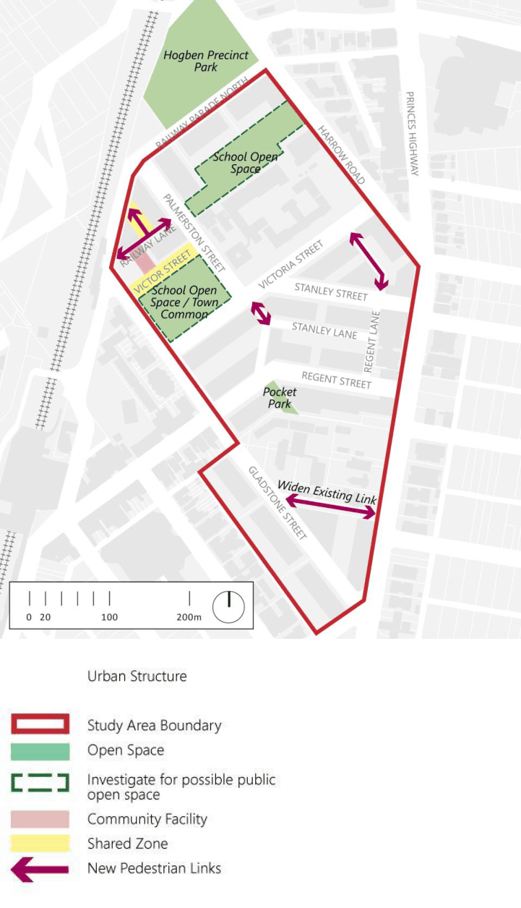
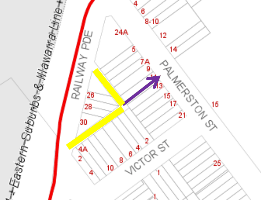

## 7. Creation of Through Site Pedestrian Links and Additional Open Space

#### Objective

(a) Ensure that publicly accessible open space is linked to surrounding streets with a network of lanes and through site links.

(b) Create new links to increase permeability of movements within the Precinct and increase pedestrian movement through the neighbourhood and back into the Kogarah Town Centre.

(c) Provide pedestrian linkages and access routes through the Precinct to offer residents and visitors greater choice of movement, as well as safer and more enjoyable walking or cycling experiences.

(d) Enhance the pedestrian amenity of the Kogarah North Precinct with awnings, street tree planting and upgraded footpath, Conditions of consent will require these upgrades as a consequence of the development.

#### Controls

1\. A public through site pedestrian link, in the form of the creation of a public ROW is to be provided as part of the development sites identified in Table 3 below.  This public through site connection is to form part of the development but is to allow public access through the site.

2\. The area of the land will be taken into account in calculating the permitted density of development.

3\. Council will require the identification of a through site pedestrian link as part of any Development Application.

4\. The location of streets proposed to become pedestrianised or shared ways that connect to the proposed through site links/ are shown in Figures 7 and 7A.

|  | Requirement |
|---|---|
| Through Site Link #1 – Creation of pedestrian link from Railway Lane to Palmerston Street | A public through site pedestrian link – minimum 3m wide - is to be provided which creates a pedestrian connection between Palmerston Street and Railway Parade North. The preferred location for the through site pedestrian link/shared way is through No 11 Palmerston Street. Where a development site includes or is adjacent to No 11 Palmerston Street and over lot 1 DP. |
| Through Site Link #2 – Creation of pedestrian link from Stanley Lane to Victoria Street | A public through site pedestrian link – minimum 3m wide - is to be provided which creates a pedestrian connection between Stanley Lane and Victoria Street. The preferred location for the through site pedestrian link is through No 22 Victoria Street. Where a development site includes or is adjacent to No 22 Victoria Street. |
| Through Site Link #3 – Widening of existing pedestrian link from Princes Highway to Gladstone Street | The existing pedestrian link from the Princes Highway through to Gladstone Street is to be widened on its northern side. Council will require upon redevelopment of No 57 Princes Highway and 24B Gladstone Street, the dedication of 3m for the widening of the existing pedestrian link. |

Table 3: Identification of Land Required for Through Site Links

> [Picture on page 25: a picture, saved as a picture (images/part-10-precincts-page-25-1.gif, 150 dpi).]

Figure 7: Pedestrian Links and proposed new shared zones - refer to Figure 7A for more detail

> [Picture on page 26: a picture, saved as a picture (images/part-10-precincts-page-26-1.gif, 150 dpi).]

Figure 7A: Additional detail for pedestrian link
