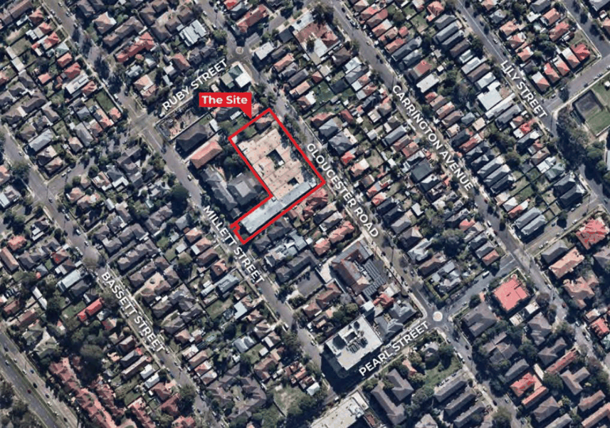

## 1. Land to apply

The site is located to the north west of the Hurstville Strategic Centre and lies in close proximity to Hurstville Private Hospital. The site has historically accommodated a care facility operated by Regis Aged Care.

These controls apply to land at 53A–59A Gloucester Road, Hurstville, being legally described as Lot 10 DP1077198 and Lot Y DP411930.

> [Picture on page 39: a picture, saved as a picture (images/part-10-precincts-page-39-15.gif, 150 dpi).]

Figure 6: Site that is subject to this section of the DCP outlined in red
