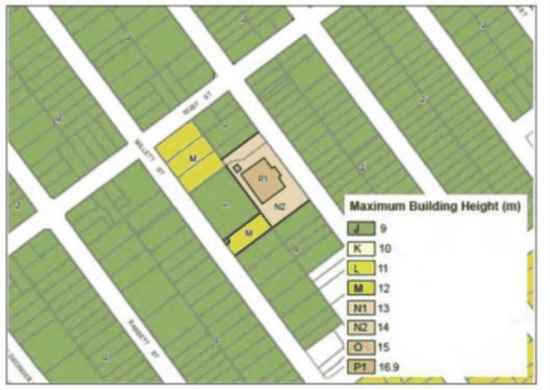
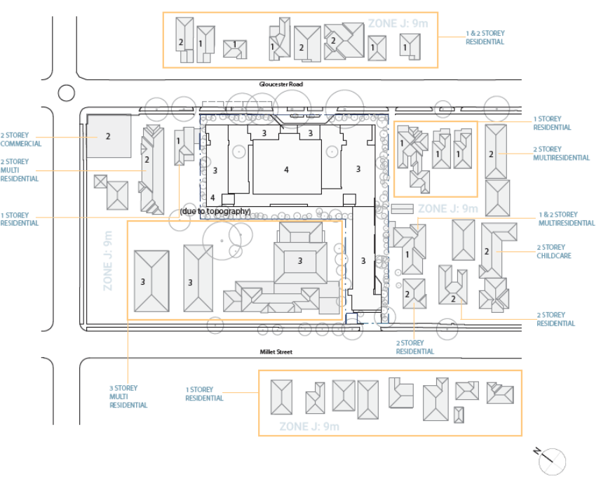
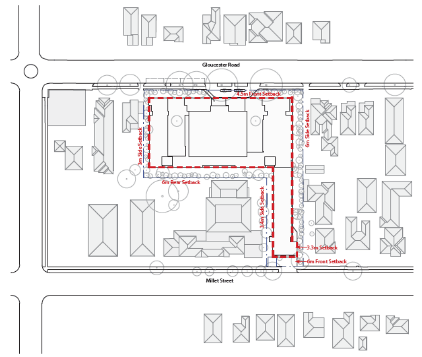
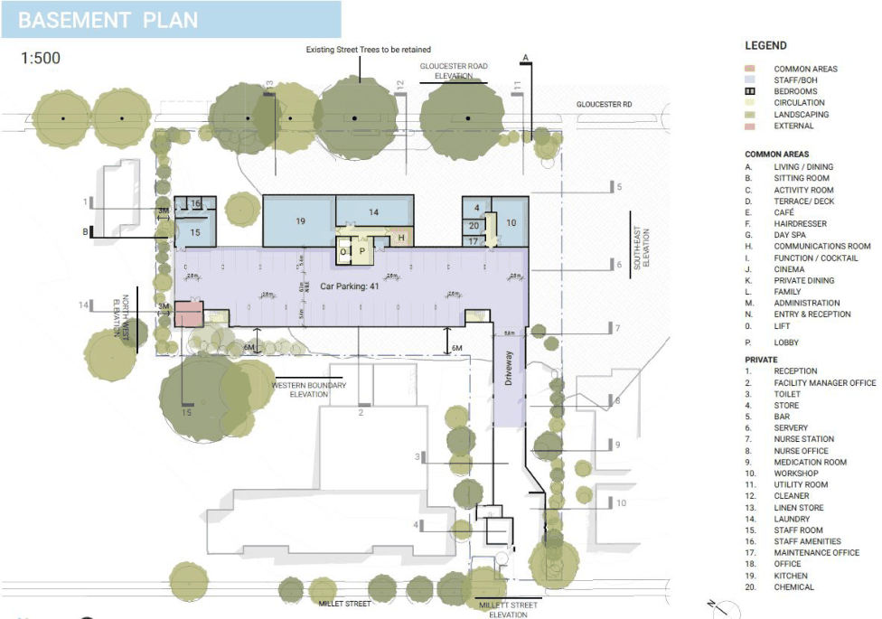

## 4. Bedroom yield

Any new residential care facility is limited to a maximum of 110 beds; providing a maximum bedroom floor space of 3,850m2 of a total development floorspace of 8,203sqm.

Note: The above limitation on bedroom numbers/floor space is in accordance with advice provided by Regis Aged Care Pty Ltd in August 2021 through the assessment of the planning proposal and if a planning agreement was warranted based on the uplift sought. Council was advised that the main purpose of the planning proposal was to facilitate the replacement of the existing residential care facility.  The additional building height and floor space that was sought on the site will allow each resident to be accommodated in their own bedroom and the expansion of common facilities. Council was advised that there was to be no increase on the 110 beds of the current facility and therefore no increase in development yield, environmental impacts, demand on infrastructure or associated services.

#### 10.2.2 Building height distribution within the Site

The building heights of the residential care facility are to be distributed within the site as illustrated in Figures 2 and 3 below.

(a) Be compatible with the planned scale of surrounding development.

(b) Minimise overshadowing of surrounding properties and the adjacent public domain.

(c) Ensure that rooftop plant is located and scaled appropriately to avoid potential visual impacts.

#### Controls

1\. Development is to reinforce the existing or desired future neighbourhood character.

2\. The maximum building height (including plantrooms and lift overruns) shall be distributed on the site in accordance with that shown in Figures 2 and 3 to minimise visual impacts, building scale and overshadowing issues.

3\. As a residential care facility, the development is to have a minimum floor height of 3.4m.

4\. In consideration of the maximum number of storeys illustrated in Figure 3, the comparable building height in metres for a residential care facility would be as follows:

(a) 3 storeys = 14m

(b) 4 storeys = 16.9m (inclusive of lift overrun)

> [Picture on page 41: a picture, saved as a picture (images/part-10-precincts-page-41-15.gif, 150 dpi).]

Figure 2: Maximum Building Height (Source: Mecone)

> [Picture on page 42: a picture, saved as a picture (images/part-10-precincts-page-42-1.gif, 150 dpi).]

Figure 3: Height in storeys

#### 10.2.3 Built form and setbacks

#### Objectives

(a) Establish the desired spatial proportions of the street and define the street edge.

(b) Ensure setbacks to streets are appropriate for the street widths and functions to ensure a comfortable urban scale of development.

(c) Preserve and enhance street settings.

(d) Provide visual and acoustic privacy for existing and new occupants.

(e) Control overshadowing of adjacent properties and private or shared open space.

(f) Retain existing street trees and provide opportunities for deep soil zones for planting of additional canopy trees and landscaping.

(g) Mitigate the visual intrusion of building bulk on neighbouring properties.

#### Controls

1\. Setbacks and separation distances in accordance with Figure 4.

2\. A minimum front setback of 4.5m should be provided along Gloucester Road to maintain the streetscape character and site context. All existing street trees at the front of the site are to be retained.

3\. A minimum 3.4m setback should be provided to the north-west boundary on Millett Street to ensure sufficient separation is provided between habitable rooms. Where this cannot be

achieved, alternative design treatments such as screening or vegetation must be provided to maximise privacy.

4\. A minimum 3m setback should be provided to the north-west boundary on Gloucester Road to ensure sufficient separation is provided between habitable rooms. Where this cannot be achieved, alternative design treatments such as screening or vegetation must be provided to maximise privacy.

5\. A minimum 6m setback should be provided to the eastern boundary and southern boundaries to provide sufficient building separation to the adjoining developments.

6\. Upper level setbacks are to be introduced to be consistent with the distribution of heights in Figures 2 and 3 above.

7\. Interface with neighbouring dwellings, particularly the southern neighbour on Millett Street must maximise privacy between the development and the existing dwellings.

> [Picture on page 43: a picture, saved as a picture (images/part-10-precincts-page-43-13.gif, 150 dpi).]

Figure 4: Setback Map

#### 10.2.4 Privacy

#### Objectives

(a) Achieve adequate visual privacy.

(b) Minimise direct overlooking between main living areas within the site and adjoining sites.

#### Controls

1\. Adequate setback distances to the common boundaries are to be provided in accordance with the controls in Section 3 and Figure 4 of this Part of the DCP to minimise impact to adjacent properties.

2\. The design of windows and balcony openings should take into account the streetscape, privacy, orientation and outlook.

3\. Screening devices such as landscaping, fencing, obscure glazing, vertical or horizontal screening should be introduced where appropriate, and are to be permanently fixed and made of durable material.

#### 10.2.5 Communal open space

#### Objectives

(a) Provide suitable areas for communal open spaces, deep soil zones and landscaping.

(b) Communal open space should be designed to allow for a range of activities, respond to the site conditions and be attractive and inviting.

#### Controls

1\. A minimum 25% of the site area should be devoted to communal open space.

2\. Developments should achieve a minimum of 50% direct sunlight to the principal useable part of the communal open space for a minimum of 2 hours between 9am and 3pm on 21 June (mid-winter).

#### 10.2.6 Landscaped area

#### Objectives

(a) Protect existing habitat features within and adjacent to development sites.

(b) Improve the diversity and abundance of locally indigenous flora and fauna species across the LGA.

(c) Contribute to streetscape character and the amenity of the public domain by using planting and landscape elements appropriate to the desired character of the streetscape and the scale of the development.

#### Controls

1\. The minimum amount of landscaped area is 20% of the site area. The minimum dimension of landscaped area is 2m in any direction.

2\. Minimum of 10% of the site should be a deep soil zone with a minimum dimension of 6m.

3\. Landscaping between the front of buildings and the street boundary should achieve a balance between reducing the visual impact of building when viewed from the street, while also facilitating passive casual surveillance of the street.

4\. Courtyards should be integrated into the design of the building to allow solar access.

5\. Minimise the impact upon street trees and trees on adjoining land. An Arboricultural Impact Assessment Report and a Tree Protection Plan in accordance with Council’s Development

Assessment Guide is to be provided to support the development application demonstrating compliance with this control.

6\. A landscaped plan in accordance with Council’s Development Assessment Guide is to be submitted with the development application demonstrating compliance with the planning controls.

#### 10.2.7 Solar access

#### Objectives

(a) Ensure an appropriate amount of solar access to main living areas and areas of principal private open space of adjoining sites.

(b) Minimise the potential for significant overshadowing of neighbouring dwellings and open spaces.

#### Controls

1\. Developments should achieve 70% of bedrooms receiving a minimum of 2 hours direct sunlight between 9 am and 3 pm at mid-winter.

2\. New development should not create any additional overshadowing onto surrounding residential properties which prevent living rooms and private open spaces of at least 70% of dwellings in a building receiving a minimum of 2 hours direct sunlight between 9 am and 3 pm at mid-winter.

3\. Where an adjoining property does not currently receive the required hours of solar access, the proposed building ensures solar access to neighbouring properties is not reduced by more than 20%.

4\. The development application must be supported by detailed shadow diagrams demonstrating compliance with the above controls.

#### 10.2.8 Architectural diversity and articulation

#### Objectives

(a) Break down the scale of large buildings into more pedestrian scaled parts.

(b) Create harmonious, well-balanced facades containing much articulation and architectural detail.

(c) Articulation of facades and use of materials and finishes to enhance and complement the character of the streetscape.

#### Controls

1\. Developments are to include high quality and durable finishes and materials.

2\. Building facades must be articulated and employ materials and finishes that enhance and complement the street character.

3\. Buildings should be appropriately modulated and articulated in all facades in order to provide well-proportioned elevations.

#### 10.2.9 Vehicular access and car parking

#### Objectives

(a) Provide adequate facilities for parking for residents, staff and visitors.

(b) Promote the use of public transport facilities and bicycles and walking as an alternative to private motor vehicles.

(c) Minimise the environmental and visual impacts of parking and driveways by integrating them with the building design.

(d) Minimise the potential for vehicular/pedestrian conflict.

#### Controls

1\. Car parking rates in accordance with the State Environmental Planning Policy (Housing) 2021. Note: The Basement Car Parking Plan in Figure 5 indicates that the site can provide 41 car spaces. The provision of adequate car parking on site will need to be addressed in the DA lodgement documentation.

> [Picture on page 46: a picture, saved as a picture (images/part-10-precincts-page-46-15.gif, 150 dpi).]

Figure 5: Basement Car Parking Plan (Source: Concept Design, Regis Hurstville, April 2022)

2\. Vehicle access points are designed and located to achieve safety, minimise conflicts between pedestrians and vehicles and create a high quality streetscape.

3\. A Traffic Impact Statement must be provided to support the development application and to justify the proposed parking numbers.

4\. Transport for NSW is to be consulted at the Development Application stage regarding the relocation of the existing bus stop along Gloucester Road.

#### 10.2.10 Waste minimisation

#### Objectives

(a) Promote the use of recyclable materials in the design, construction and operation of buildings and land use activities.

(b) Maximise waste minimisation, reduction, material separation and resource recovery in all stages of development (demolition, design, construction) and the on-going operation of the development.

(c) Encourage the design and construction of waste and recycling storage facilities that are:

i. Of an adequate size and design;

ii. Appropriately designed for the intended uses;

iii. Hygienic and safe to access;

iv. In compliance with any occupational health and safety requirements;

v. Visually compatible with their surroundings; and

vi. Minimise noise transfer.

(d) Minimise the environmental impact of poorly designed waste and recycling storage facilities or from the poor management of those facilities.

(e) Provide on-going control for waste handling and minimisation in all premises.

(f) Encourage source separation of recyclables and organic waste, minimising waste generation and maximising recovery from each area.

(g) Ensure efficient waste management practices from each area with regards to managing bulky waste materials for kerbside clean-up services.

(h) Ensure the appropriate on-site storage of all bins and bulky waste for each area so that the visual amenity of the area and neighbouring properties are not negatively impacted.

(i) Ensure a waste collection vehicle can access and service the residential care facility to provide essential waste collection services.

#### Controls

1\. Controls for the management of demolition, construction and ongoing operational waste are outlined within Appendix 4 - Waste Management of the GRDCP.

#### 10.2.11 Safety and security

#### Objectives

(a) Reduce crime risk and minimise opportunities for crime.

(b) Encourage the consideration and application of crime prevention principles when designing and siting buildings and spaces.

(c) Encourage dwelling layouts that facilitate safety and encourage interaction and recognition between residents.

(d) Ensure pedestrian and vehicle safety.

#### Controls

1\. The design of development is to incorporate Crime Prevention Through Environmental Design (CPTED) principles.

2\. Development is to be designed to incorporate and/or enhance opportunities for effective natural surveillance by providing clear sight lines between public and private places, installation of effective lighting, and the appropriate landscaping of public areas.

#### 10.2.12 Plan of Management

#### Objectives

(a) Ensure the facility operates safely and efficiently for residents, staff and members of the public.

(b) Ensure that proper training and induction procedures are adopted for all staff and residents.

(c) Ensure that proper management practices are in place and followed with an appropriate level of accountability.

#### Controls

1\. Any future development application for the site in relation to a proposed residential care facility must be accompanied by a Plan of Management which provides all details relevant to the operation of the facility.

#### 10.2.13 Ecologically sustainable development

#### Objectives

(a) Create a development which will have high standards of environmental sustainability, particularly with regard to energy and water use.

(b) Ensure the highest standards in environmentally sustainable design and construction.

(c) Reduce the impacts of development on the environment.

(d) Ensure the development is resilient to the impacts of climate change.

(e) Ensure that greenhouse gas emissions will be minimised.

#### Controls

1\. Key elements such as a rainwater system, water saving devices, energy efficient fittings and appliances, solar power collector and thermal insulation should be implemented where feasible to minimise energy use and ensure the building performs well environmentally.

2\. A BASIX report should be provided to ensure that the development satisfies sustainability targets, such as water and energy efficiency, prescribed by the NSW Department of Planning and Environment.

3\. Building design is to demonstrate that the indoor environmental quality has been considered through:

(a) Use of passive design elements i.e., natural lighting and natural cross ventilation for thermal comfort; and

(b) Provision of shading devices to reduce heat load and for glare control.

4\. The use, location and placement of photovoltaic solar panels are to consider their potential amenity impacts on the adjacent properties.

5\. Where possible, proposals for new buildings, alterations and additions and major tree plantings are to maintain solar access to existing photovoltaic solar panels having regard to the performance, efficiency, economic viability and reasonableness of their location. Note: Refer to Section 3.11 Ecologically Sustainable Development of the GRDCP.

#### 10.2.14 Fencing

#### Objectives

(a) Ensure adequate safety of residents of the facility including appropriate passive surveillance.

#### Controls

1\. Fencing up to 1.8m is permitted along all boundaries of the site.

2\. Fencing up to 1.8m along Gloucester Road is permitted subject to:

(a) The facility housing dementia patients; and

(b) The fencing being at least 50% transparent with generous landscaping being provided directly behind the fencing (within the site).
