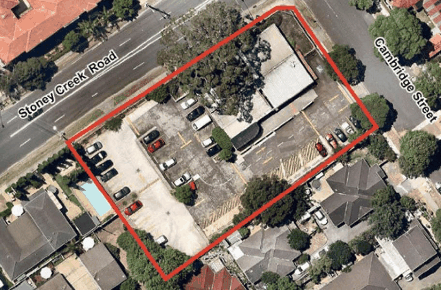

## 1. Land to apply

These controls apply to land at 143 Stoney Creek Road, Beverly Hills, being legally described as Lot 2 in DP1205598 and Lot 3 in DP1205598.

> [Picture on page 50: a picture, saved as a picture (images/part-10-precincts-page-50-12.gif, 150 dpi).]

Figure 1: Site that is subject to this section of the DCP outlined in red
