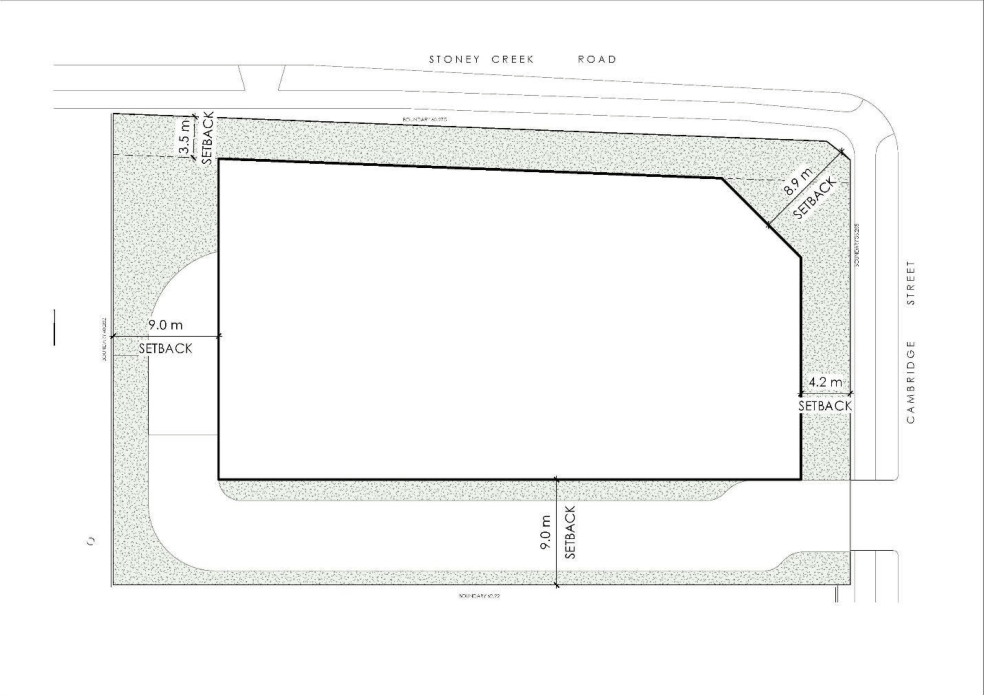
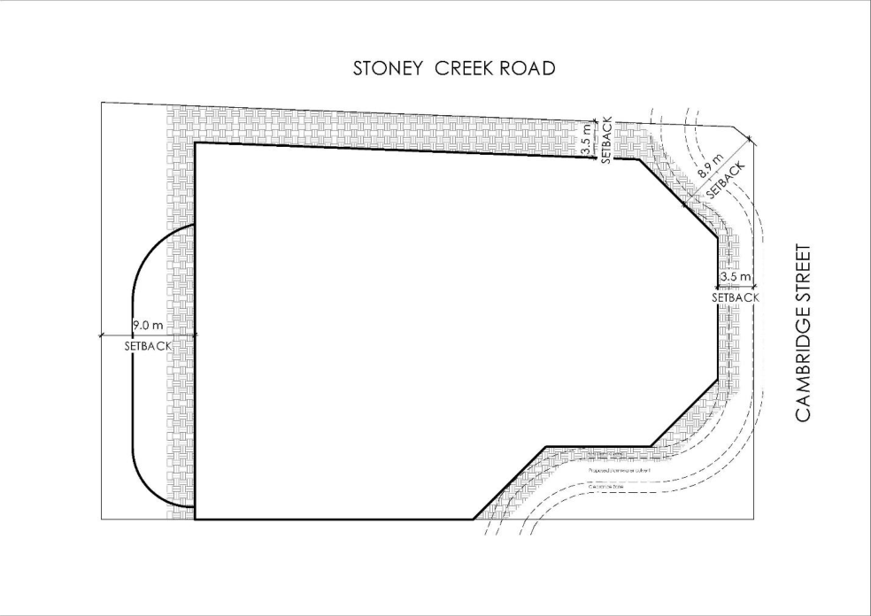
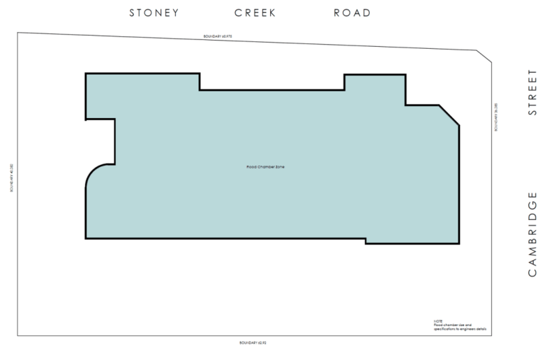
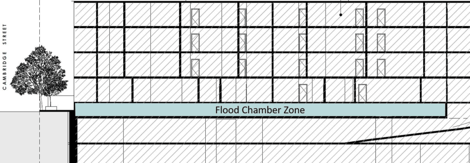

## 3. Purpose and objectives

The purpose of this section is to provide a detailed guide for future redevelopment at 143 Stoney Creek Road, Beverly Hills.

The aims and objectives of this Plan are to:

(a) Develop a high quality built form that responds to the existing and future context.

(b) Ensure the built form outcomes provide an appropriate transition and setback from adjacent sites to preserve their amenity.

(c) Establish specific flood planning controls for the Site.

#### 10.3.2 Built form and setbacks

#### Objectives

(a) Establish the desired spatial proportions of the street and define the street edge.

(b) Ensure setbacks to streets are appropriate for the street widths and functions to ensure a comfortable urban scale of development.

(c) Preserve and enhance the low density street settings.

(d) Provide visual and acoustic privacy for adjacent properties.

(e) Control overshadowing of adjacent properties.

(f) Provide deep soil zones for planting of canopy trees and landscaping.

(g) Mitigate the visual intrusion of building bulk on neighbouring properties.

#### Controls

1\. The development to be erected on the Site shall have a maximum building height of 16 metres being the maximum height shown for the land on the Height of Buildings Map of the Georges River Local Environmental Plan 2021.

2\. The maximum floor space ratio for a building on the Site shall not exceed 1.4:1 being the floor space ratio shown on the Floor Space Ratio Map of the Georges River Local Environmental Plan 2021.

3\. Minimum setbacks and separation distances for all levels above ground are to be provided in accordance with Figure 2.

4\. A minimum front setback of 3.5m should be provided along Stoney Creek Road and

4.2m shall be provided along Cambridge Street to maintain the streetscape character and site context.

5\. Notwithstanding the minimum setbacks specified above and in Figure 2, setbacks may need to be increased to comply with the separation distances in the NSW Government’s Apartment Design Guide.

> [Picture on page 52: a picture, saved as a picture (images/part-10-precincts-page-52-6.gif, 150 dpi).]

Figure 2: Setback Map

#### 10.3.3 Vehicular access and car parking

#### Objectives

(a) Provide adequate facilities for parking for residents and visitors.

(b) Promote the use of public transport facilities and bicycles and walking as an alternative to private motor vehicles.

(c) Minimise the potential for vehicular/pedestrian conflict.

#### Controls

1\. Car parking rates in accordance with Section 3.13 Parking Access and Transport of the GRDCP 2021.

2\. The basement must not extend beyond the setbacks from site boundaries as illustrated in Figure 3 to achieve a stormwater management design which also satisfies Sydney Water’s infrastructure operational and maintenance requirements.

> [Picture on page 53: a picture, saved as a picture (images/part-10-precincts-page-53-1.gif, 150 dpi).]

#### Figure 3: Basement Car Parking Envelope

3\. The vehicle access point to the Site shall be from Cambridge Street in accordance with Figure 2 to achieve safety, minimise conflicts between pedestrians and vehicles and create a high quality streetscape to Stoney Creek Road.

4\. A Traffic Impact Statement must be provided to support the Development Application. Note: Refer to Section 6.3.9 Vehicular Access, Parking and Circulation of the GRDCP 2021.

#### 10.3.4 Contamination

#### Objectives

(a) Ensure that the development of contaminated or potentially contaminated land does not pose a risk to human health or the environment.

#### Controls

1\. A remediation action plan is required to be submitted with any Development Application that involves the excavation at or beyond the depth of the groundwater table, and/or has the ability to influence the nature or depth of the groundwater table.

2\. Controls for the management of contaminated land are outlined in Section 3.6 Contaminated Land of the GRDCP 2021.

#### 10.3.5 Stormwater Management

(a) To reduce stormwater quantity and improve stormwater quality prior to exiting the Site.

(b) To reduce the risk to human life and property from flooding to acceptable levels.

(c) To mitigate any negative environmental impacts arising from the management of rainwater and stormwater from the Site.

#### Controls

1\. Where a new development proposes to divert the existing Sydney Water Reinforced Concrete Box Culvert (RCBC) (with dimensions of 1.981m wide by 1.219m high), the replacement RCBC is to have internal dimensions of 2.1m (wide) by 1.5m (high), or as required by Sydney Water.

2\. Any development proposing basement parking and the diversion of the RCBC will require the construction of a flood storage chamber as an interstitial level between the basement and ground floor, with sufficient capacity of approximately 2000 cubic metres (to be determined through flood modelling) to limit off-site impacts and improve site flood behaviour as indicatively illustrated in Figures 4 and 5 below.

3\. The basement must not extend beyond the setbacks from site boundaries as illustrated in Figure 3 to achieve a stormwater management design which also satisfies Sydney Water’s infrastructure operational and maintenance requirements.

4\. The basement carpark entry threshold is to be set at a minimum of the 1% AEP level plus a freeboard of 500mm. All other openings to the basement including the carpark intake and exhaust, basement carpark stairwells and lift shafts are to be positioned at or above the Probable Maximum Flood (PMF) level.

5\. A stormwater management system is to be provided in accordance with the requirements of the Georges River Stormwater Management Policy 2020 (or its successor).

> [Picture on page 54: a picture, saved as a picture (images/part-10-precincts-page-54-24.gif, 150 dpi).]

#### Figure 4: Plan of Indicative Flood Chamber

> [Picture on page 55: a picture, saved as a picture (images/part-10-precincts-page-55-1.gif, 150 dpi).]

#### Figure 5: Section of Indicative Flood Chamber

#### 10.3.6 Waste Management

#### Objectives

(a) Promote the use of recycled and recyclable materials in the design, construction and operation of buildings and land use activities;

(b) Maximise waste minimisation, material separation and resource recovery in all stages of development (demolition, design, construction) and on-going operations of developments;

(c) Require the design and construction of waste and recycling storage facilities that are:

i. Of an adequate size;

ii. Appropriately designed for the intended uses and capacity;

iii. Hygienic and safe to access;

iv. In compliance with any occupational health and safety requirements;

v. Visually compatible with their surroundings, and;

vi. Minimise noise transfer.

(d) Minimise the environmental impact of poorly designed waste and recycling storage facilities or from the poor management of those facilities;

(e) Provide on-going controls for waste handling and minimisation in all premises;

(f) Ensure source separation of recyclables and organic waste, minimising waste generation and maximising recovery from each dwelling;

(g) Ensure efficient waste management practices from each dwelling with regards to managing bulky waste materials for kerbside clean-up services;

(h) Ensure the appropriate on-site storage of all bins for each dwelling whether bins are stored within individual dwellings or within a common storage area;

(i) Ensure that the storage of bins or bulky waste for each dwelling does not impact negatively on the visual amenity of the area;

(j) Ensure that the storage of bins for each dwelling does not impact negatively on the

neighbouring properties; and

(k) Ensure Councils contracted waste collection vehicle(s) can access and service every development to provide essential waste collection services. Applicants should be aware that this is still an access requirement even if proposing services be provided by private waste contractors, to ensure Council can provide a service in the likely event that residents elect the Council waste service during ongoing use of the development.

#### Controls

1\. Controls for the management of demolition, construction and ongoing operational waste are outlined within Appendix 4 - Waste Management of the GRDCP.
