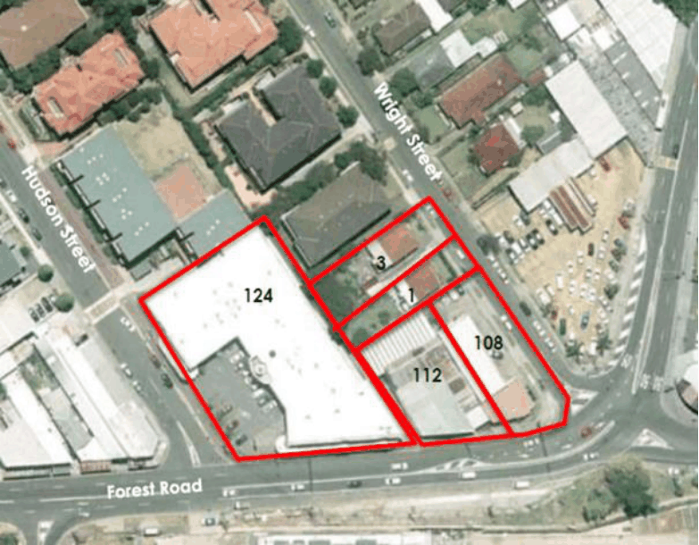

## 1.  General Information

### 1.1 Name of Section

This section is known as the “Bing Lee Site, Hurstville” (“the Site”).

### 1.2 Land to which this Section applies

This section applies to land which is known as the “Bing Lee Site, Hurstville” and includes land bounded by Wright Street, Forest Road and Hudson Street (as outlined in Figure 1) and includes:

• 108 Forest Road, Hurstville (Lot 1 DP 78322);

• 112 Forest Road, Hurstville (Lot 1 DP 75572);

• 124 Forest Road, Hurstville (Lot 531 DP 777334);

• 1 Wright Street, Hurstville (Lot 55 DP 78322); and

• 3 Wright Street, Hurstville (Lot 54 DP 78322).

> [Picture on page 2: a picture, saved as a picture (images/section-08-2-8-1-108-112-and-124-forest-road-and-1-and-3-wr-page-2-14.gif, 150 dpi).]

Figure 1: The Bing Lee Site, Hurstville

### 1.3 Purpose of this Section

The purpose of this Section is to produce a detailed guide for the development of the Bing Lee Site that achieves the below urban design principles:

### 1.4 Urban Design Principles

a) Create a sustainable and livable environment for people through leadership and integration of design excellence.

b) Development is distinctive, visually interesting and appealing.

c) Development is designed to address the context of the area.

d) Provision of good residential amenity in terms of privacy and built form by complying with Chapter 4 of State Environmental Planning Policy Housing 2021 (Housing SEPP) and incorporating appropriate transition between the new development and the adjoining residential development.

e) Development to ensure the built form outcome provides a transition to the adjoining sites.

f) Clearly define the street edge with building podiums.

g) Articulate the building façades to enhance the streetscape character.

h) Maintain a human scale at the street level.

i) Provide pedestrian connections between streets and communal spaces.

j) Create a sense of place, particularly between buildings and in public open spaces.

k) Provide adequate car parking and a safe and efficient access network.

Development of the site must also occur in accordance with the Planning Agreement registered on the title of the land.
