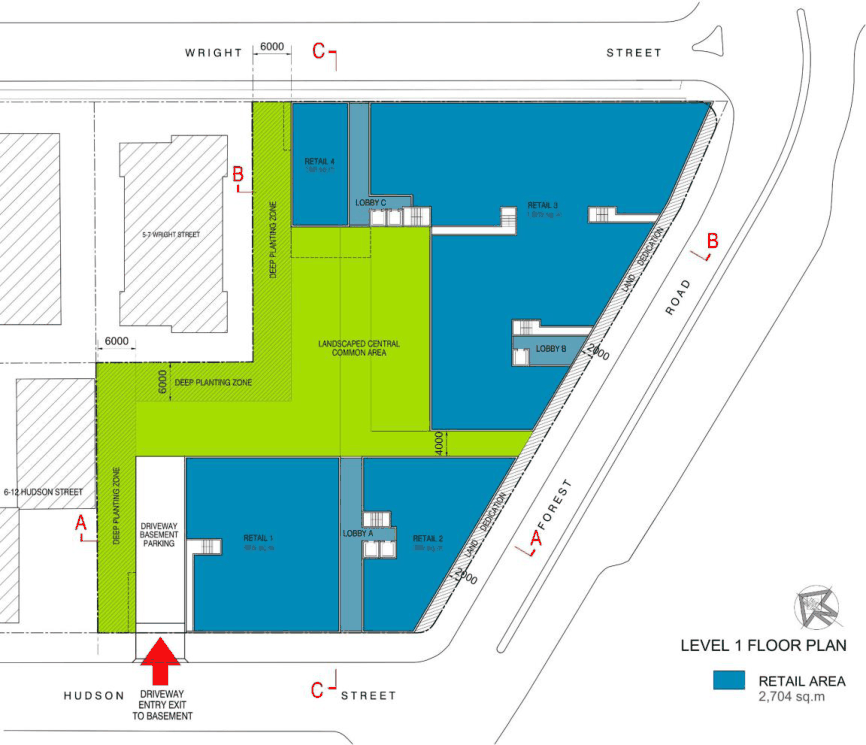

## 2. Background and Context

### 2.1 Urban Context

The site is located in the Eastern Bookend Precinct that currently includes small scale industrial / retail businesses. The Eastern Bookend and the adjoining City Centre East Precincts are under transformation with the construction of a number of large mixed use developments. The new development needs to be suitably designed to maintain a human scale and pleasant pedestrian experience. The new development needs to contribute to the public domain and maintain the amenity of adjoining residential land uses.

### 2.2 Concept Master Plan

A Concept Master Plan (refer to Figure 2) was prepared for the site as part of the assessment of the Planning Proposal which informed Hurstville Local Environmental Plan 2012 (Amendment No.13) and provides general guidance on the overall form of development on the site.

Council will consider alternative schemes subject to compliance with the relevant LEP, Chapter 4 of State Environmental Planning Policy Housing 2021 (Housing SEPP) and the Apartment Design Guide, NSW Department of Planning and Environment (ADG), other sections of the GRDCP as well as the key features listed below being provided:

• Dedication of land to Council along the Forest Road frontage;

• Pedestrian linkages between Wright Street, Forest Road and Hudson Street;

• A central landscaped area; and

• Active street frontages with commercial uses occupying the ground floor and comprising a minimum FSR of 0.5:1.

> [Picture on page 5: a picture, saved as a picture (images/section-08-2-8-1-108-112-and-124-forest-road-and-1-and-3-wr-page-5-1.gif, 150 dpi).]

Figure 2: Concept Master Plan
