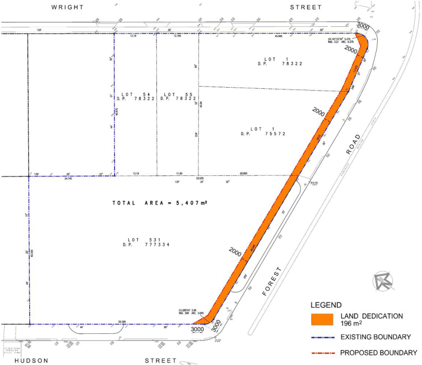
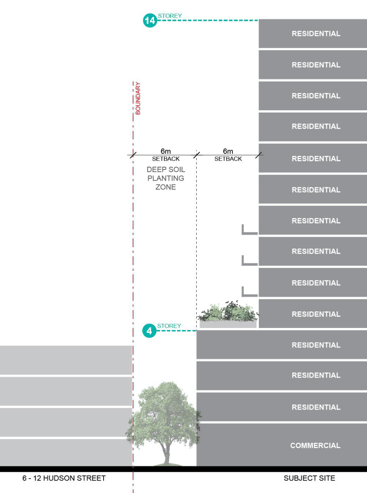
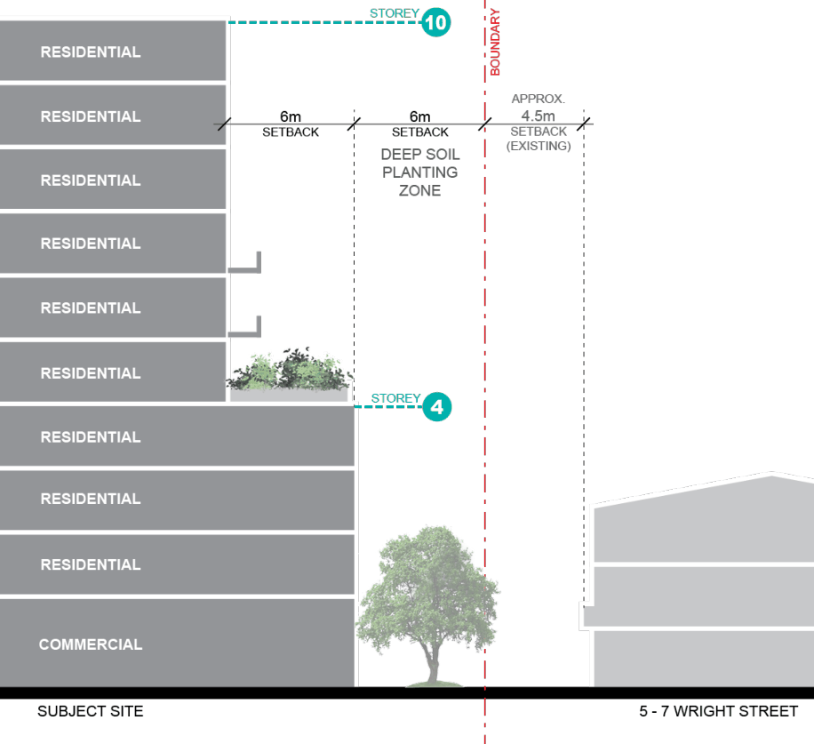
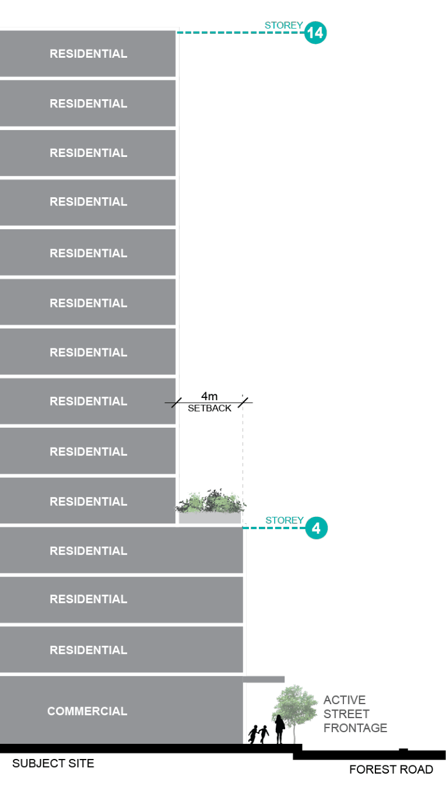
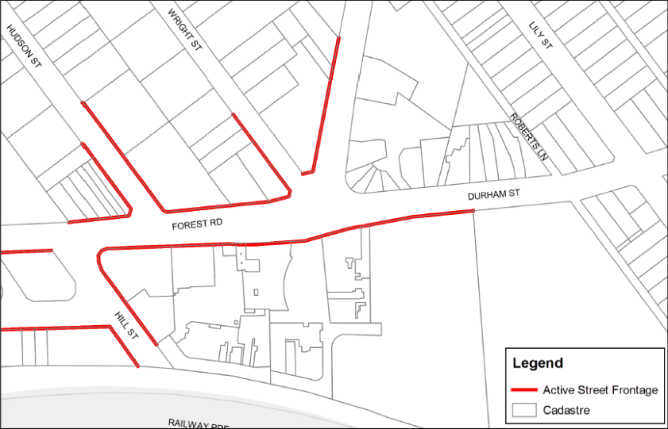
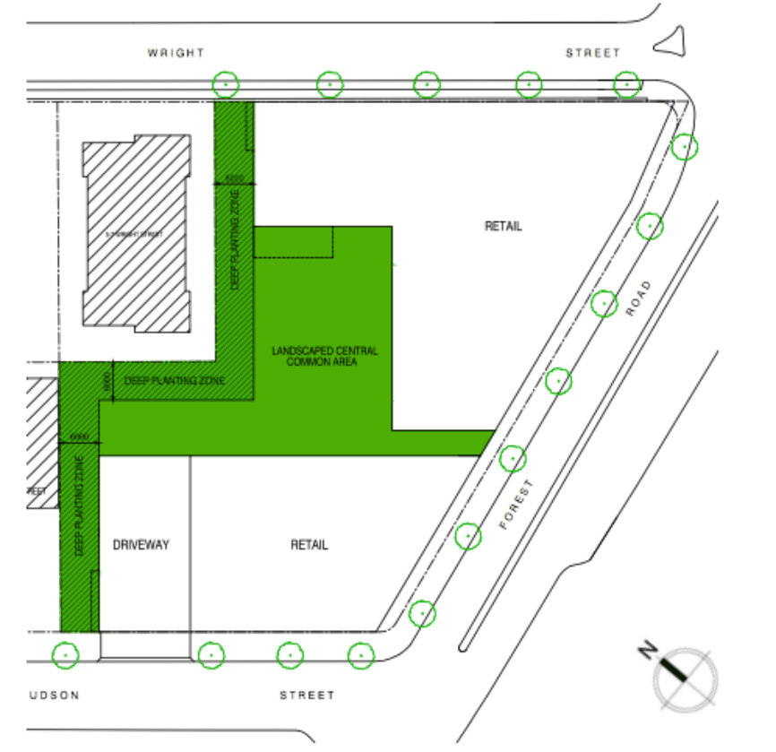

## 3. Development Requirements

### 3.1 Land Dedication

Objective

a) To ensure that land for road widening of Forest Road is dedicated to Council to address the traffic impacts of the future development of the site.

Controls

1\. Development of the site will include a dedication to Georges River Council of a strip of land of approximately 196m2 and 2m wide along the Forest Road boundary, including land at Hudson Street and Wright Street at the intersection with Forest Road, for the purpose of widening Forest Road as detailed in the Planning Agreement applying to the site and as shown in Figure 3.

2\. No permanent structure may be built above or below this area of land.

> [Picture on page 6: a picture, saved as a picture (images/section-08-2-8-1-108-112-and-124-forest-road-and-1-and-3-wr-page-6-13.gif, 150 dpi).]

Figure 3: Land Dedication

### 3.2 Built Form and Setbacks

Objectives

a) To provide a vibrant mixed-use development that takes advantage of the site’s location within the Hurstville City Centre.

b) To ensure that the height of the development responds to the existing scale and character of the adjacent residential development and the desired future character of the Hurstville City Centre (Eastern Bookend Precinct).

c) To ensure adequate separation between the development and adjacent residential development to provide reasonable daylight access to all development, open space and the public domain and privacy to occupants of residential developments on the subject site and adjoining sites.

d) To reduce the apparent bulk and scale of buildings by breaking up expanses of building wall with modulation of form and articulation of facades.

e) To establish the desired spatial proportions of the street and define the street edge.

f) To ensure acoustic privacy for occupants and neighbours.

Controls

1\. Development shall display a built form comprising a maximum15m high (4 storeys) podium built to the street frontage with the upper levels of buildings set back at least 4m on Forest Road and a minimum of 3m on Wright and Hudson Streets.

2\. Development shall provide an appropriate transition in height and density to the adjoining R3 Medium Density Residential area along Hudson and Wright Streets to provide a comfortable pedestrian environment (Refer to Figures 4 and 5).

3\. Define the street edge by building the podium to the street frontage (Refer to Figure 6).

4\. Building layout and setbacks are to be in accordance with Chapter 4 of the Housing SEPP and the ADG.

5\. All residential apartments are to be insulated and to have Impact Isolation between floors to achieve an Acoustical Star Rating of 5 in accordance with the standards prescribed by the Association of Australian Acoustical Consultants (AAAC). An Acoustic Report is to be submitted with the Development Application to ensure that the above standards have been achieved.

> [Picture on page 8: a picture, saved as a picture (images/section-08-2-8-1-108-112-and-124-forest-road-and-1-and-3-wr-page-8-1.gif, 150 dpi).]

Figure 4: Hudson Street transition to adjoining residential development

> [Picture on page 9: a picture, saved as a picture (images/section-08-2-8-1-108-112-and-124-forest-road-and-1-and-3-wr-page-9-1.gif, 150 dpi).]

Figure 5: Wright Street transition to adjoining residential development

> [Picture on page 10: a picture, saved as a picture (images/section-08-2-8-1-108-112-and-124-forest-road-and-1-and-3-wr-page-10-1.gif, 150 dpi).]

Figure 6: Forest Road frontage

### 3.3 Façade Treatment and Street Corners

Objectives

a) To ensure building facades are appropriately modulated and articulated to provide visual interest along the street and well-proportioned built forms.

b) To ensure that the street corners are clearly defined and emphasised.

Controls

1\. Building facades must be articulated and employ materials and finishes that enhance and complement the streetscape character.

2\. Street corners must be given prominence by a change in building articulation, materials, color, form or height.

### 3.4 Pedestrian Access and the Public Domain

Objectives

a) To ensure that the development incorporates publicly accessible pedestrian paths that enhances the permeability of the site.

b) To provide direct and safe pedestrian paths between public spaces.

c) To enable the ground level landscaped public open space to be used in a variety of ways.

d) To provide an attractive and cohesive public domain.

e) To ensure that site facilities are thoughtfully integrated into development and provide a comfortable pedestrian environment.

Controls

1\. All pedestrian links are to have appropriate levels of illumination.

2\. Provide high quality accessible routes to public and semi-public areas of the building and the site, including major entries, lobbies, communal open space, site facilities, parking areas and pedestrian pathways.

3\. The design of through site links is to ensure that a clear and safe path that is unobstructed by parking and services is available for pedestrians at all times.

4\. Separate and clearly distinguish between public and private pedestrian accessways and vehicle accessways and utilise consistent paving treatments throughout the site.

5\. The through-site links from Forest Road to the landscaped central area is to have a clear width of a minimum 4.5m and a minimum clear height of 1.5 times the width or 6m, whichever is greater.

6\. The landscaped public open space on the ground level is to provide the opportunity to be used in a variety of ways over different times of the day, week and year.

7\. A public domain plan is to be submitted with the Development Application detailing public domain improvements adjacent to the subject site, including footpaths, street tree planting and street furniture.

8\. The existing above ground electricity and telecommunication cables within the road reserve and within the site area are to be replaced, at the applicant’s expense, by underground cables and appropriate street light standards, in accordance with the Energy and Communication Provider’s guidelines.

### 3.5 Active Street Frontages

Objectives

a) Ensure ground floor frontages are pedestrian oriented and of high design quality to add vitality to the streets.

b) Encourage frequent building entries that face and open towards the street.

Controls

1\. Active street frontages are to be provided along Hudson Street, Forest Road and Wright Street in accordance with the Active Street Frontage Map (the “ASF Map”) (refer to Figure 7).

2\. Active street frontages are to contribute to the liveliness and vitality of streets by:

• Maximising entries and display windows to commercial premises or other uses that provide pedestrian interest and interaction;

• Providing a high standard of finish and appropriate level of architectural detail for shopfronts; and

• Providing elements of visual interest (minimising blank walls), such as display cases, or creative use of materials where fire escapes, service doors, equipment hatches and other services are provided.

3\. Generally, a minimum of 70% of the ground floor frontage is to be transparent glazing with a predominantly unobstructed view from the adjacent footpath to at least a depth of 6m within the building.

4\. Active frontages are to be designed with the ground floor level at the same level as the footpath.

5\. Security grilles may only be fitted internally behind the shopfront and are to be fully retractable and at least 50% transparent when closed.

> [Picture on page 13: a picture, saved as a picture (images/section-08-2-8-1-108-112-and-124-forest-road-and-1-and-3-wr-page-13-1.gif, 150 dpi).]

Figure 7: Active Street Frontages Map

### 3.6 Open Space and Landscaping

Objectives

a) To provide residents with passive and active recreational opportunities.

b) To provide an area within the site that enables soft landscaping and deep soil planting which will provide for the planting of trees that are, or will, grow to a large or medium size.

c) To ensure that communal open space is consolidated, configured and designed to be useable and attractive.

d) To provide a pleasant outlook and privacy for future residents of the development.

e) To ensure that landscaping is integrated into the design of the development and improve the overall appearance of the development when viewed from neighbouring sites.

f) To contribute to the quality and amenity of communal open space on roof tops, podiums and internal courtyards.

Controls

1\. A landscaped public open space is to be provided generally in the location shown in Figure 8 and is to include:

• 6m wide deep soil landscaped screening along the interface with residential properties to the west;

• North facing central landscaped common area;

• Street tree planting and provision of street furniture in accordance with the Council’s specifications.

2\. Landscape design is to be in scale with the development and should relate to building form; facilitate storm water infiltration through the use of permeable surfaces; and be easily maintained.

3\. Landscaping is to ensure amenity of private and publicly accessible open spaces and solar efficiency of apartments by providing shade from the sun and shelter from the wind, including the use of deciduous trees for shading of windows and open space areas in summer and allowing solar access in winter.

4\. Deep soil planting is to be provided in accordance with the ADG and incorporated in the landscaped central common area – the deep soil area should not be above the basement parking.

5\. Communal open spaces are to be provided in accordance with the ADG above the podium level.

6\. Planting, seating and play equipment is to be provided in the communal open spaces.

7\. All applications are to include a landscaping plan for all landscaped areas prepared by a qualified landscape designer. The landscaping plan should demonstrate that there is no conflict with the location of services on the site and any deep soil planting area.

> [Picture on page 15: a picture, saved as a picture (images/section-08-2-8-1-108-112-and-124-forest-road-and-1-and-3-wr-page-15-1.gif, 150 dpi).]

Figure 8: Public Open Space and Landscaping

### 3.7 On-Site Parking

Objectives

a) To provide adequate car parking for the buildings users and visitors.

b) To integrate the location and design of car parking with the design of the site and the building.

c) To ensure that car parking, loading/unloading and servicing access is accommodated within the property and not on public roads.

Controls

1\. Car parking provision and design is to be in accordance with Part 3 General Planning Considerations of this DCP.

2\. Parking for the development is to be off the street and accommodated underground.

3\. All loading and unloading of goods is to be accommodated within the property and off the public roads, including garbage pickup.

4\. All vehicles are to enter and leave the site in a forward direction at all times.

5\. All the designs for all the levels of the basement car park are to adhere to the latest edition of relevant AS/NZS 2890.1, 2890.2 and 2890.6.

6\. Safe and secure access is to be provided for building users, direct access to residential apartments and convenient access to customers /staff of the commercial uses.

7\. Ventilation grilles or screening devices of car park openings are to be integrated into the overall façade and landscape design of the development.

### 3.8 Vehicle Access

Objectives

a) To integrate adequate car parking and servicing access without compromising street character, landscape or pedestrian amenity and safety.

b) To encourage the active use of street frontages.

c) To ensure that vehicle access to buildings is not incompatible with pedestrian movements and the public domain.

Controls

1\. Vehicular access to the site is to be provided in accordance with Part 3 General Planning Considerations of this DCP.

2\. Vehicle access to the site is to be located off Hudson Street.

3\. The appearance of car parking and service vehicle entries are to be improved by screening and locating garbage collection, loading/unloading and servicing areas within the basement of the development. Refer to Appendix 4 Waste Management of this DCP.

4\. Vehicle access to the site is to be setback a minimum of 6m from the neighbouring residential properties to provide for a landscaping buffer as shown above in Figure 8.
