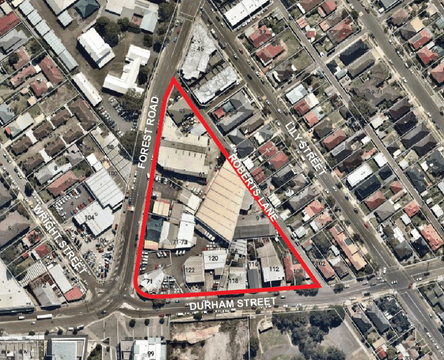

## 1. General Information

### 1.1 Name of Section

This section is known as the “Landmark Square Precinct, Hurstville” (“the Precinct”).

### 1.2 Relationship of this section to the LEP and other DCPs

This DCP section has been made in accordance with S3.43C of the Environmental Planning and Assessment Act 1979 and complements the provisions of the Georges River Local Environmental Plan 2021 (“GRLEP 2021”).

This DCP section must be read in conjunction with other sections of the Georges River Development Control Plan 2021 (“GRDCP”). Where there is any inconsistency between this DCP and other sections of GRDCP, this DCP section prevails.

### 1.3 Land to which this Section applies

This section applies to land known as “Landmark Square” and includes land bounded by Forest Road, Durham Street and Roberts Lane at street addresses 53-75 Forest Road, 108-126 Durham Street & 9 Roberts Lane, Hurstville (as outlined in Figure 1) and includes:

(i) Lot A DP 372835 (53 Forest Road);

(ii) Lot 1 DP 225302 (61-65 Forest Road);

(iii) Lot 101 DP 776275 (67-69 Forest Road);

(iv) Lot 100 DP 776275 (71A Forest Road);

(v) Lot 10 DP 621395 (73 Forest Road);

(vi) Lot 4 DP 12517 (75 Forest Road);

(vii) Lot 3 DP 12517 (75 Forest Road);

(viii) Lot 2 DP 12517 (126 Durham Street);

(ix) Lot 1 DP 12517 (126 Durham Street);

(x) Lot 15 DP 601341 (122A Durham Street);

(xi) Lot 1 DP 337499 (120 Durham Street);

(xii) Lot 1 DP 213685 (118A Durham Street);

(xiii) Lot 2 DP 213685 (118 Durham Street);

(xiv) Lot 5 DP 171179 (116 Durham Street);

(xv) Lot A DP 391801 (114 Durham Street);

(xvi) Lot B DP 391801 (112 Durham Street);

(xvii) Lot C DP 391801 (110 Durham Street); (xviii) Lot D DP 391801 (108 Durham Street); and

(xix) Lot 1 DP 172819 (9 Roberts Lane).

> [Picture on page 3: a picture, saved as a picture (images/section-08-2-8-2-landmark-square-page-3-1.gif, 150 dpi).]

Figure 1: Landmark Square Precinct, Hurstville

### 1.4 Purpose of this Section

The purpose of this Section is to produce a detailed guide for the development of the Precinct that achieves the below objectives.

### 1.5 Objectives of this Section

The objectives of this Section are:

a) To strengthen and promote the Eastern Bookend of the Hurstville City Centre with a unique identity and encourage a range of retail, commercial, residential, community, recreational and entertainment uses.

b) To encourage well designed, safe and active public areas which contribute to the well-being of the community.

c) To encourage sustainable urban renewal through mixed developments comprising of a variety of retail, commercial and residential land uses.

d) To encourage design excellence and high quality adaptable development.

e) To manage the traffic and parking for the benefit of the Hurstville City Centre and surrounding localities.

f) To ensure all urban design principles are achieved.

g) To conserve the heritage significance of the Scout Hall and ensure a high level of amenity is retained.

### 1.6 Planning Agreements

Development of the Precinct must occur in accordance with the Planning Agreement registered on the title of the land.
