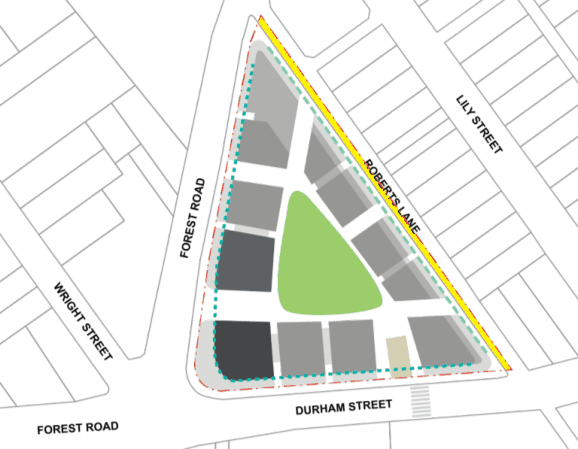

## 3. Background and Context

### 3.1 Urban Context

The Precinct is located in the Eastern Bookend Precinct that currently includes small scale industrial and retail businesses. The Eastern Bookend and the adjoining Hurstville City Centre East Precincts are under transformation with the construction of a number of large mixed use developments. The new development needs to be suitably designed to maintain a human scale and pleasant pedestrian experience. The new development also needs to contribute to the public domain and maintain the amenity of adjoining residential land uses.

### 3.2 Indicative Concept Master Plan

An Indicative Concept Master Plan was prepared for the Precinct as part of the assessment of the Planning Proposal to amend the Hurstville Local Environmental Plan 2012 (Amendment No.16) and provides general guidance on the overall form of development on the site. Council will consider alternative schemes subject to compliance with the relevant LEP, State Environmental Planning Policy (Housing) 2021 and the Apartment Design Guide and other sections of the GRDCP as well as the key features listed below being provided:

(i) Dedication of land to Council along the Roberts Lane frontage in accordance with the applicable Voluntary Planning Agreement;

(ii) A consistent road widening along the Roberts Lane frontage;

(iii) Public pedestrian linkages between Forest Road, Durham Street and Roberts Lane;

(iv) A central landscaped open space; and

(v) Active street frontages with commercial uses occupying the ground floor and comprising a minimum FSR of 0.5:1.

> [Picture on page 6: a picture, saved as a picture (images/section-08-2-8-2-landmark-square-page-6-26.gif, 150 dpi).]

Figure 2: Indicative concept master plan (Refer to GRLEP 2021 Height Maps for maximum permissible building height)
