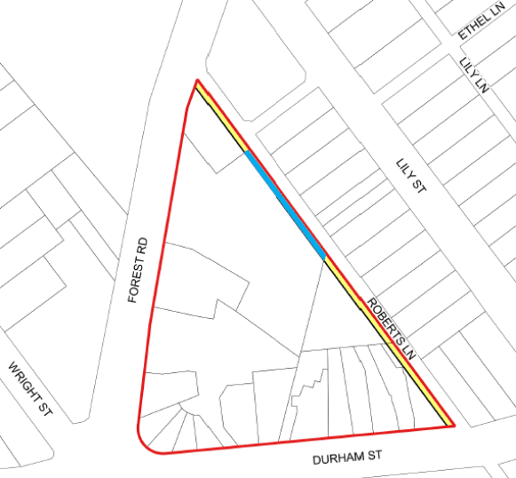
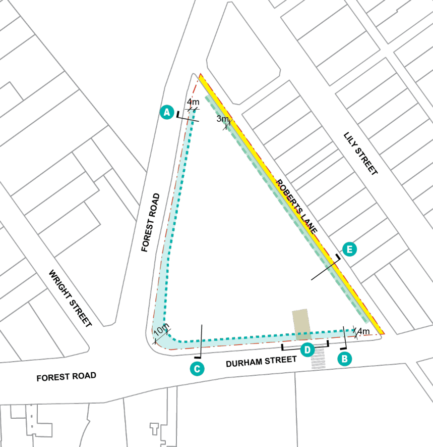
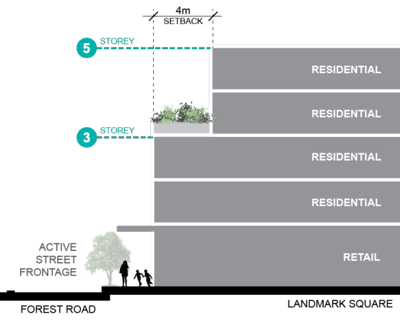
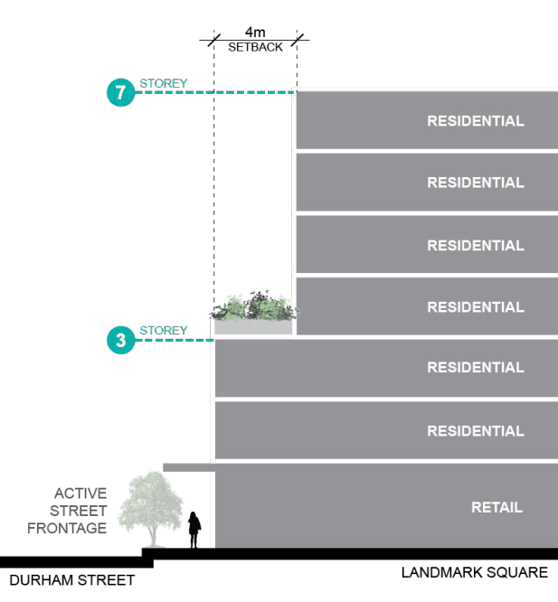
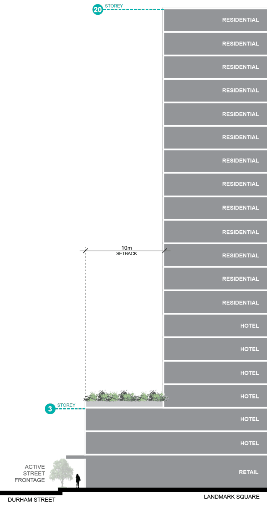
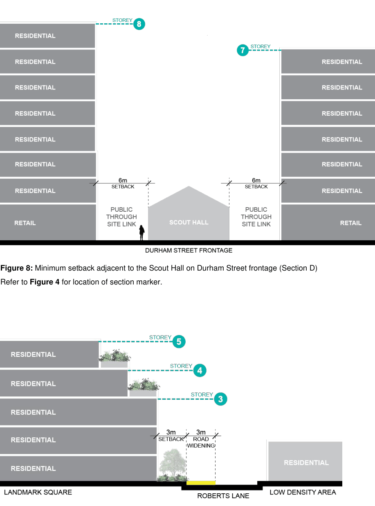
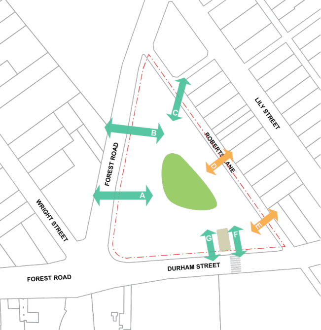
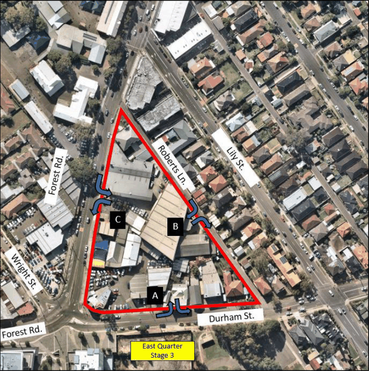

## 4. Development Requirements

### 4.1 Surveyor’s Certificate

Objective

a) To ensure employment generating land uses continue to be developed on the site.

Controls

1\. A Development Application for the site must be accompanied by a surveyor’s certificate that indicates the break-up of the residential and non-residential floor area for the purpose of calculating the gross floor area.

### 4.2 Amalgamation and Site Isolation

Objectives

a) To enable suitable development of isolated sites in a manner which respond to the site context and constraints with an appropriate urban form and maintains a high level of amenity for future occupants and neighbours.

b) To avoid the creation of isolated sites as a result of the development of adjoining lots.

c) To ensure the provision of public through-site links for the Precinct.

Controls

1\. The creation of isolated sites is not desirable.

2\. Isolated sites in this Precinct with a total site area of less than 800m2 are not to be created.

3\. Where a proposed development will result in the creation of an isolated site, the applicant must show that reasonable efforts have been made to amalgamate the site. The applicant must provide evidence of offers made to acquire the site to be isolated (e.g. correspondence including responses to offers) based on at least two independent valuations. These valuations must be based the development of the whole Precinct including the isolated sites.

4\. Where a development may result in the creation of an isolated site on an adjoining site, applicants must demonstrate that orderly and economic use and development of the isolated site can be achieved in a manner consistent with the planning controls. The applicant must provide:

i. A schematic design for the isolated site, indicating height, setbacks, resultant site coverage and/or built area (building and basement), sufficient to understand the relationship between the development and that site; and

ii. An assessment of the likely impacts the developments will have on each other, such as solar access, visual and acoustic privacy, public access provisions and ability to provide site servicing such as parking.

### 4.3 Roberts Lane Widening

Local road widening has been identified for the Precinct in accordance with Clause 5.1 of the GRLEP 2021.

Objectives

a) To ensure that a consistent road widening along the Roberts Lane frontage is achieved.

b) To provide primary residential vehicle access via Roberts Lane.

c) To create an attractive and safe streetscape for pedestrians.

Controls

1\. Roberts Lane is subject to a road widening affectation. Refer to Figure 3 below.

2\. The 3m road widening would enable Roberts Lane to be increased to a 9m wide public road which could accommodate an approximately 2m wide pedestrian footpath with street planting on the western side of the Lane and a minimum 6m wide two-way carriageway.

3\. No permanent structure may be built above or below the land nominated for road widening in Figure 3.

4\. Road dedication and road widening is to be at the proponent’s expense.

> [Picture on page 8: a picture, saved as a picture (images/section-08-2-8-2-landmark-square-page-8-18.gif, 150 dpi).]

Figure 3: Roberts Lane local road widening (Refer to GRLEP 2021 Land Reservation Acquisition Map)

### 4.4 Built Form and Setbacks

Objectives

a) To provide a vibrant mixed-use development that takes advantage of the site’s location within the Hurstville City Centre.

b) To ensure that the height of the development responds to the existing scale and character of the adjacent residential development and the desired future character of the Hurstville City Centre (Eastern Bookend Precinct).

c) To achieve a transition in scale through variation in building form, density and typology that appropriately responds to the surrounding context.

d) To ensure adequate separation between the development and adjacent residential development to provide reasonable daylight access to all development, open space and the public domain and privacy to occupants of residential developments on the subject site and adjoining sites.

e) To reduce the apparent bulk and scale of buildings by breaking up expanses of building wall with modulation of form and articulation of facades.

f) To establish the desired spatial proportions of the street and define the street edge.

g) To ensure acoustic and visual privacy for occupants and neighbours.

h) To provide good residential amenity by complying with Chapter 4 of the State Environmental Planning Policy (Housing) 2021 and the Apartment Design Guide.

Controls

1\. Setbacks are to be provided as per Figure 4.

2\. Development on Forest Road and Durham Street shall display a built form comprising a maximum 3 storeys podium built form to the street frontage.

3\. The levels above the podium on Forest Road and Durham Street shall display a setback of 4m along the street frontages with a 10m setback on the corner of Forest Road and Durham Street as shown in Figures 5, 6 and 7.

4\. Development shall provide an appropriate transition in height and density to the adjoining R2 Low Density Residential area along Roberts Lane to provide a comfortable pedestrian environment as detailed below:

i. Development on Roberts Lane shall display a maximum 3 storey built form to the street frontage; and

ii. Minimum 3m setback shall be provided from Roberts Lane (excluding land dedication as identified in 4.3).

5\. Direct access from the street is to be provided to ground floor apartments located on Roberts Lane.

6\. All residential apartments are to be insulated and to have impact isolation between floors to achieve an Acoustic Star Rating of 5 in accordance with the standards

prescribed by the Association of Australian Acoustical Consultants. An Acoustic Report is to be submitted with any Development Application for the site to ensure that the standards have been achieved.

7\. All developments are to comply with State Environmental Planning Policy (Housing) 2021 and the Apartment Design Guide.

8\. A scaled height map overlay on top of Architectural plans is required at the Development Assessment stage to ensure heights are consistent with heights in the Local Environmental Plan.

9\. A Pedestrian Wind Impact Report prepared by a suitably qualified engineer is to be submitted with Development Applications for buildings 30m or higher, and for other buildings at the discretion of Council. At a minimum, the report is to:

i. Report the likely impacts of wind on the pedestrian environment at the footpath level within the site and the public domain; and

ii. Show how the proposal minimises the impact of wind on the public and private domain.

> [Picture on page 11: a picture, saved as a picture (images/section-08-2-8-2-landmark-square-page-11-1.gif, 150 dpi).]

Figure 4: Building setbacks and section markers for Figures 5 - 9

> [Picture on page 12: a picture, saved as a picture (images/section-08-2-8-2-landmark-square-page-12-1.gif, 150 dpi).]

Figure 5: Minimum setback along Forest Road (Section A) Refer to Figure 4 for location of section marker.

> [Picture on page 12: a picture, saved as a picture (images/section-08-2-8-2-landmark-square-page-12-4.gif, 150 dpi).]

Figure 6: Minimum setback along Durham Street (Section B) Refer to Figure 4 for location of section marker.

> [Picture on page 13: a picture, saved as a picture (images/section-08-2-8-2-landmark-square-page-13-1.gif, 150 dpi).]

Figure 7: Minimum setback on the corner of Forest Road and Durham Street (Section C) Refer to Figure 4 for location of section marker.

> [Picture on page 14: a picture, saved as a picture (images/section-08-2-8-2-landmark-square-page-14-1.gif, 150 dpi).]

Figure 8: Minimum setback adjacent to the Scout Hall on Durham Street frontage (Section D) Refer to Figure 4 for location of section marker.

Figure 9: Roberts Lane transition to adjacent R2 Low Density Residential area (Section E) Refer to Figure 4 for location of section marker.

### 4.5 Façade Treatment and Street Corners

Objectives

a) To ensure building façades are appropriately modulated and articulated to provide visual interest from the public domain, including along the street and through-site links.

b) To ensure well-proportioned built forms and façade treatments that minimise the appearance of building bulk from the public domain, including along the street and through-site links.

c) To ensure that the street corners are clearly defined and emphasised.

Controls

1\. Building facades must be clearly articulated and employ high quality materials and finishes that enhance and complement the streetscape character.

2\. Street corners must be given prominence by a change in building articulation, materials, colours, form or height.

3\. Human scale at street level must be created through the use of scale, rhythm, materiality and/or landscaping.

4\. Essential services such as substations and fire hydrants must be integrated into the design of the façade.

5\. Development must not rely solely on the use of two-dimensional colour and materials to create visual interest. Modulation and articulation in the building form must be explored.

6\. Large areas of blank, minimally or poorly articulated walls are not acceptable. Façade treatments such as wall cladding and green walls should be considered as alternatives to blank walls.

7\. Clear glazing balustrades must be avoided where they are visible from the public domain.

8\. Balconies must be located at interfaces to the Scout Hall to reduce building bulk and enhance visual permeability. However, no structures are to encroach into the 6m wide setback as identified in Figure 8.

### 4.6 Pedestrian Access and the Public Domain

Objectives

a) To ensure that the development incorporates publicly accessible pedestrian paths that enhance the permeability of the site.

b) To provide direct and safe pedestrian paths between public spaces.

c) To enable the ground level landscaped open space to be used as an adaptable space capable of accommodating a broad range of uses and events, experiences and activities.

d) To provide an attractive and cohesive public domain.

e) To ensure that the site facilities are thoughtfully integrated into the development and provide a comfortable pedestrian environment.

Controls

1\. Provide a coherent structure of public through-site links that is highly permeable for pedestrians based on the following hierarchy of usage and minimum widths (refer Figure 10):

i. Primary connection – minimum 6m wide

ii. Supplementary connection – minimum 3m wide

2\. Connections must be open to the sky.

3\. All through-site links are to have appropriate levels of illumination.

4\. Provide high quality accessible routes to public and semi-public areas of the building and the site, including the central plaza, major entries, lobbies, communal open space, site facilities, parking areas and pedestrian pathways.

5\. The design of through-site links is to ensure that a clear and safe path that is unobstructed by parking and services is available for pedestrians at all times.

6\. Separate and clearly distinguish between public and private pedestrian accessways and vehicle accessways and utilise consistent paving treatments throughout the site.

7\. A central plaza of a minimum size of 1,500m2 is to be provided in the Precinct (refer Figure 10). The plaza is to satisfy the following:

i. To be provided as a consolidated, landscaped communal open space on the ground level which permits unrestricted public access;

ii. To be well-designed and easily identifiable by the general public;

iii. To be designed to support community events over different times of the day, week and year through the provision of an adaptable space, variations in levels where appropriate to enable formal and informal seating and the inclusion of services (e.g. water and power supply);

iv. To be surrounded by active land uses (e.g. retail tenancies); and

v. Excludes the site area occupied by public through-site links in the calculation of total area.

8\. A public domain plan is to be submitted with any Development Application. The plan must detail public domain improvements within the Precinct and adjacent to the Precinct, including footpaths, lighting, street tree planting and street furniture.

9\. The existing above ground electricity and telecommunication cables within the road reserve and within the site will be replaced, at the applicant’s expense, by underground cable and appropriate street light standards, in accordance with the Energy and Communication Provider’s guidelines. The applicant will bear the cost of the new installation and the first 12 months of additional street light charges.

> [Picture on page 17: a picture, saved as a picture (images/section-08-2-8-2-landmark-square-page-17-1.gif, 150 dpi).]

Figure 10: Indicative location of public through-site links and central plaza

### 4.7 Open Space and Landscaping

Objectives

a) To provide residents with passive and active recreational opportunities.

b) To ensure that communal open space is configured and designed to be useable and attractive.

c) To provide a pleasant outlook and privacy for future residents of the development.

d) To provide an area within the site that enables soft landscaping and deep soil planting which will provide for the planting of trees that are, or will grow to a large or medium size.

e) To ensure that landscaping is integrated into the design of the development and improves the overall appearance of the development when viewed from neighbouring sites.

f) To contribute to the quality and amenity of communal open space on roof tops, podiums and internal courtyards.

Controls

1\. Deep soil landscaping should be provided in the setback at ground level. Deep soil should not be above basement parking.

2\. Deep soil landscaping must be provided at ground level in the setback fronting Roberts Lane. The landscape design should enhance the visual amenity and pedestrian environment of Roberts Lane.

3\. A landscaped open space is to be provided generally in the location shown in Figure 10 and is to include landscaping and the provision of street furniture.

4\. Landscape design is to be in scale with the development and should relate to building form; facilitate storm water infiltration through the use of permeable surfaces; and be easily maintained.

5\. Landscaping is to ensure amenity of private and publicly accessible open spaces and solar efficiency of apartments by providing shade from the sun and shelter from the wind, including the use of deciduous trees for shading of windows and open space areas in summer and allowing solar access in winter.

6\. Additional communal open spaces are to be provided above the podium level of each building to ensure equitable access by all residents.

7\. Planting, seating and play equipment are to be provided in communal open spaces.

8\. All Development Applications are to include a landscaping plan for all landscaped areas prepared by a qualified landscape designer. The landscaping plan should demonstrate that there is no conflict with the location of services on the site and any deep soil planting area.

### 4.8 Active Street Frontages

Objectives

a) To ensure ground floor frontages are pedestrian oriented and of high design quality to add vitality to the streets.

b) To encourage frequent building entries that face and open towards the street.

Controls

1\. Active street frontages are to be provided along Forest Road and Durham Street.

2\. Active street frontages are to contribute to the liveliness and vitality of streets by:

i. Maximising entries and display windows to commercial premises or other uses that provide pedestrian interest and interaction;

ii. Providing a high standard of finish and appropriate level of architectural detail for shop fronts;

iii. Providing elements of visual interest (minimising blank walls), such as display cases, or creative use of materials where fire escapes, service doors, equipment hatches and other services are provided; and

iv. Utilising smaller retail tenancies to screen large retail tenancies (e.g. supermarkets) to minimise the amount of blank walls adjoining the public domain.

3\. Generally, a minimum of 70% of the ground floor frontage is to be transparent glazing with a predominately unobstructed view from the adjacent footpath at least a depth of 6 metres within the building.

4\. Active frontages are to be designed with the ground floor level at the same level as the footpath.

5\. Security grilles may only be fitted internally behind the shop fronts and are to be fully retractable and at least 50% transparent when closed.

### 4.9 Heritage Item – Scout Hall

Objectives

a) To ensure that the cultural and heritage significance of the Scout Hall as a local heritage item under the GRLEP 2021 is protected from the future development while also being integrated into the development.

b) To ensure that through-site links are provided around the Scout Hall to optimise pedestrian activity around the Scout Hall.

c) To promote the Scout Hall and community uses, and reinforce these uses while encouraging further opportunities for community activities, in or potentially around the Scout Hall.

Controls

1\. Developments adjacent to the Scout Hall are to comply with the minimum setback specified in 4.4.

2\. Through-site links are to be provided around the Scout Hall providing access between Durham Street and the internal future public domain area of the development in accordance with 4.6.

### 4.10 On-Site Parking

Objectives

a) To provide adequate car parking for the buildings’ users and visitors.

b) To integrate the location and design of car parking with the design of the site and the building.

c) To ensure that car parking, loading / unloading and servicing access is accommodated within the property and not on public roads.

Controls

1\. Car parking must be located underground in a basement and to be designed in accordance with Part 3 General Planning Considerations of this DCP.

2\. Car parking rates must comply with RMS car parking rates in accordance with the Apartment Design Guide.

3\. All loading and unloading of goods is to be accommodated within the property and off the public roads, including garbage pickup.

4\. All vehicles are to enter and exit the site in a forward direction at all times.

5\. All the designs for all levels of the basement car park are to adhere to the latest edition of relevant AS/NZS 2890.1 and 2890.6.

6\. Safe and secure access is to be provided for building users, direct access to residential apartments and convenient access to customers / staff of the commercial uses.

7\. Ventilation grilles or screening devices of car park openings are to be integrated into the overall façade and landscape design of the development.

### 4.11 Vehicle Access

Objectives

a) To integrate adequate car parking and servicing access without comprising street character, landscape or pedestrian amenity and safety.

b) To encourage the active use of street frontages.

c) To ensure that vehicle access to buildings is not incompatible with pedestrian movements and the public domain.

Controls

1\. The development is to adhere to traffic generation rates from Roads and Maritime Services Guide to Generating Development for the specific uses of the site;

2\. Service vehicles to the development must be restricted to Medium Rigid Vehicles (MRVs). Heavy Rigid Vehicles (HRV) cannot access Roberts Lane without kerb adjustment and significant loss of parking on local roads.

3\. Service vehicle access to the development is to be outside of school peak times, being 8.00am-9.30am and 2.30pm-4.00pm on Monday – Friday.

4\. Three restricted left in /left out vehicular access points (labelled A, B and C) is the preferred and recommended access to the development. The access points will need to be utilised to separate Retail use access from Residential use access from Service vehicle access.

5\. The appearance of car parking and service vehicle entries are to be improved by screening and locating garbage collection, loading/unloading and servicing areas within the basement of the development. Refer to Appendix 4 Waste Management of this DCP.

> [Picture on page 21: a picture, saved as a picture (images/section-08-2-8-2-landmark-square-page-21-1.gif, 150 dpi).]

Figure 11: Recommended Vehicular Access Points
