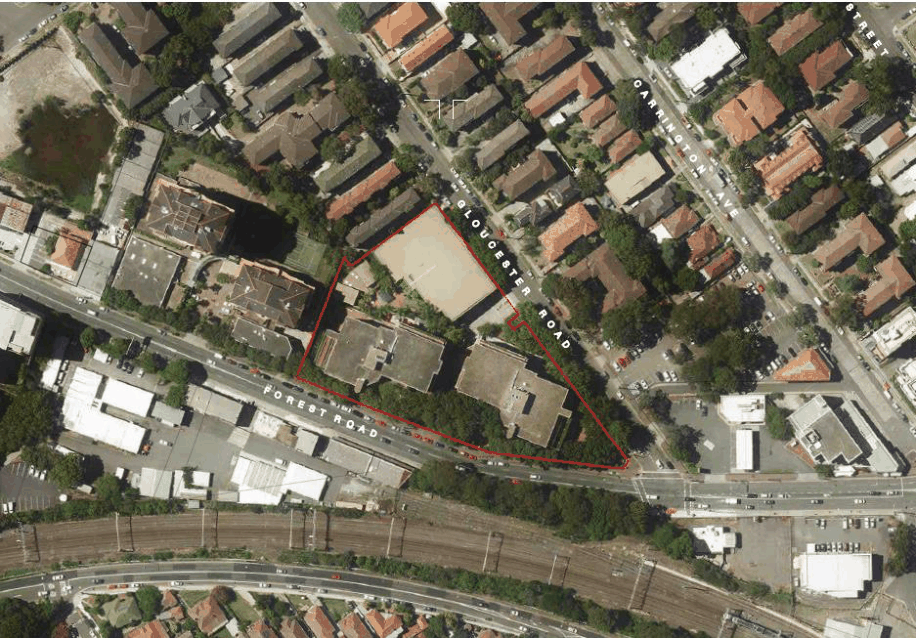

## 1.  General Information

### 1.1 Name of Section

This section is known as 9 Gloucester Road, Hurstville (“the Site”).

### 1.2 Land to which this Section applies

This section applies to land which is known as 9 Gloucester Road, Hurstville (Lot 30 DP785238) and includes land as outlined in Figure 1:

> [Picture on page 2: a picture, saved as a picture (images/section-08-2-8-3-9-gloucester-road-hurstville-page-2-8.gif, 150 dpi).]

Figure 1: 9 Gloucester Road, Hurstville

### 1.3 Purpose of this Section

The purpose of this Section is to produce a detailed guide for the development of the Site that achieves the below urban design principles.

### 1.4 Urban Design Principles

a) Create a sustainable and livable environment for people through leadership and integration of design excellence.

b) Development is distinctive, visually interesting and appealing.

c) Development is designed to address the context of the area.

d) Provision of good residential amenity in terms of privacy and built form by complying with Chapter 4 of State Environmental Planning Policy (Housing) 2021 (Housing SEPP) Apartment Design Guide and incorporating appropriate transition between the new development and the adjoining residential development.

e) Development to ensure the built form outcome provides a transition to the adjoining sites.

f) Clearly define the street edge with building podiums.

g) Articulate the building façades to enhance the streetscape character.

h) Maintain a human scale at the street level, with particular emphasis on the human experience in the built environment.

i) Provide pedestrian connections between streets and communal spaces.

j) Retain significant existing trees and plant new trees to maintain the landscaped character of the Site.

k) Provide adequate basement car parking and a safe and efficient access network for both pedestrians and vehicles.

l) Create an active streetscape that enhances the liveliness and vitality of Forest Road.
