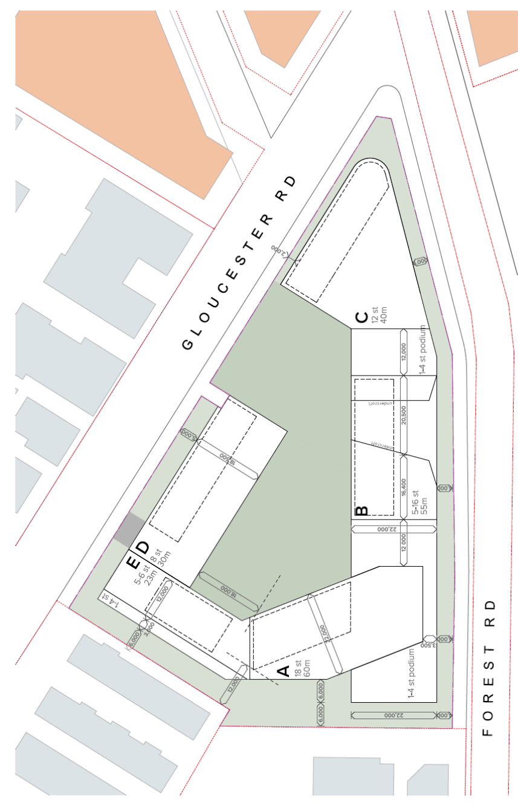

## 2. Background and Context

### 2.1 Urban Context

The site is located within the Hurstville City Centre, bounded by Gloucester and Forest Roads to its north and south. The site is currently zoned MU1 Mixed Use, which facilitates a variety of uses including commercial, which is present on the Site. Its immediate context comprises of a public car park and a service station on the north-east and various commercial premises along Forest Road on the south. The site is well planted with mature street trees, creating a green gateway to the Centre when entering via King Georges Road. The new development needs to provide a range of flexible commercial floor space, contribute to the public domain and maintain the amenity of adjoining residential land uses.

### 2.2 Concept Master Plan

A Concept Master Plan (Refer Figure 2) was prepared for the Site as part of the assessment of the Planning Proposal which informed Hurstville Local Environmental Plan 2012 (Amendment No. 18) and provides general guidance on the overall form of development on the Site.

Council will consider alternative schemes subject to compliance with the relevant LEP, State Environmental Planning Policy (Housing) 2021  (Housing SEPP) and the NSW Department of Planning and Environment Apartment Design Guide (ADG), other sections of the Georges River Development Control Plan 2021 (“GRDCP”) as well as key features listed below being provided:

• A central communal open space

• A through site link between Forest and Gloucester Roads

• Retention of significant trees in accordance with Section 8.3.3.8

• Active street frontages with commercial uses occupying the ground floor along Forest Road and comprising a minimum FSR of 0.5:1.

> [Picture on page 5: a picture, saved as a picture (images/section-08-2-8-3-9-gloucester-road-hurstville-page-5-1.gif, 150 dpi).]

Figure 2: Concept Master Plan
