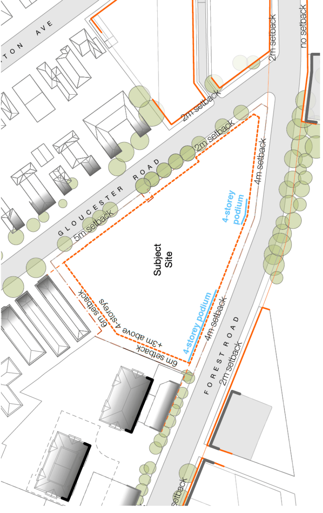
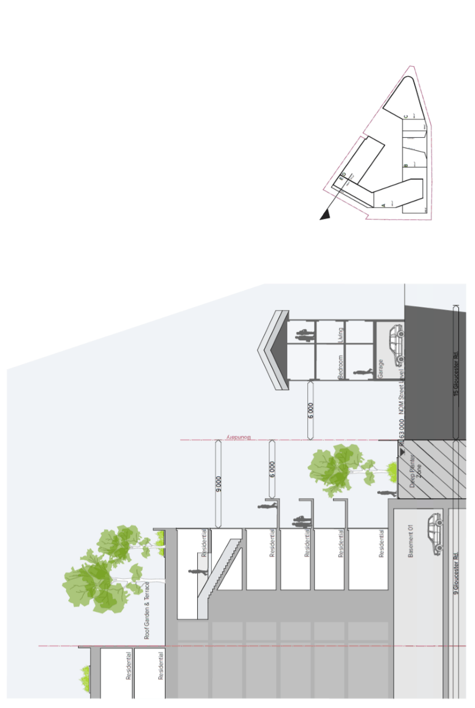
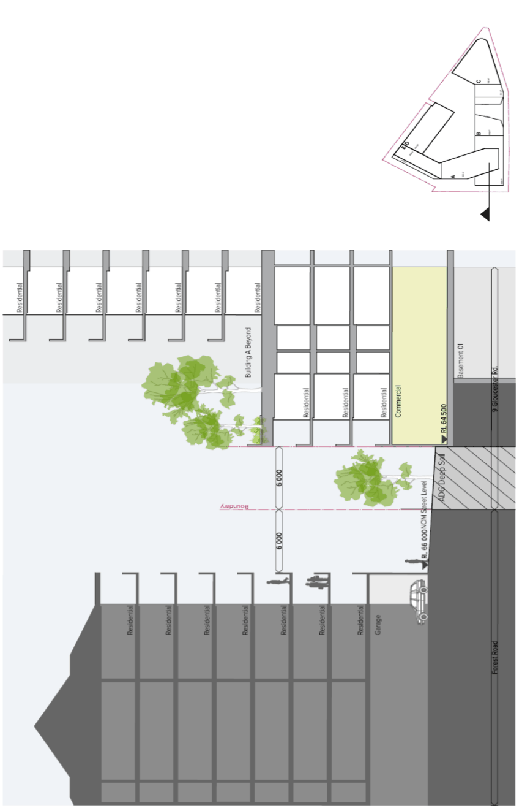
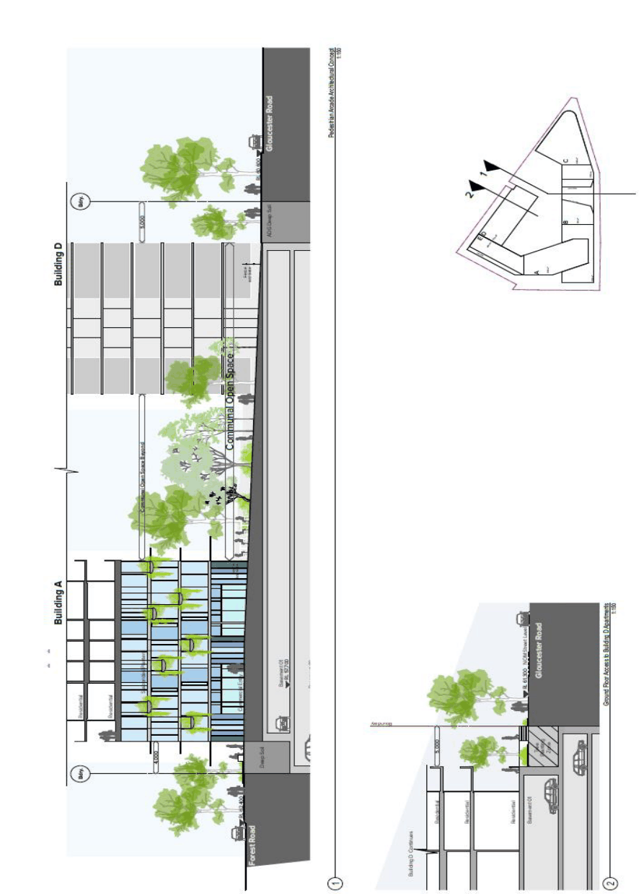
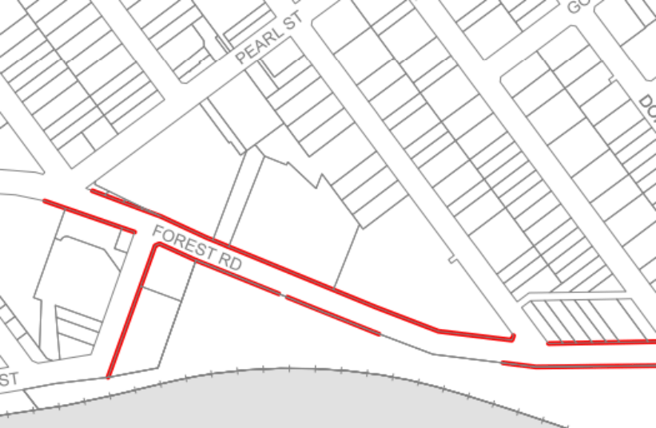
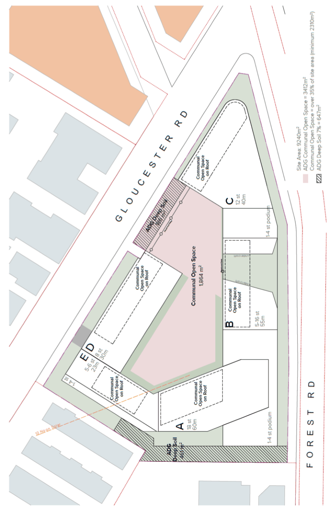
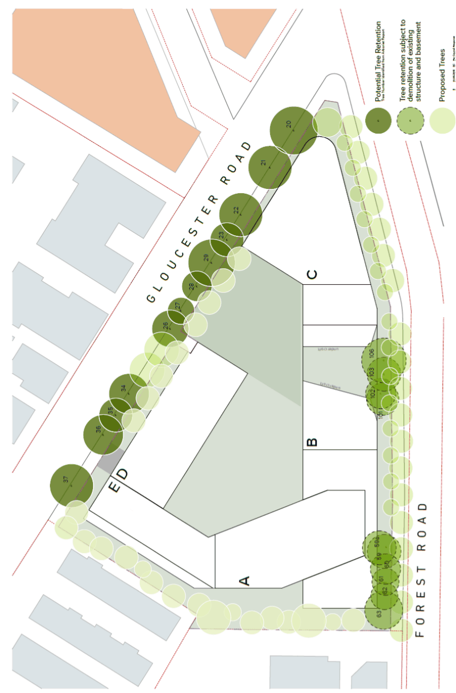
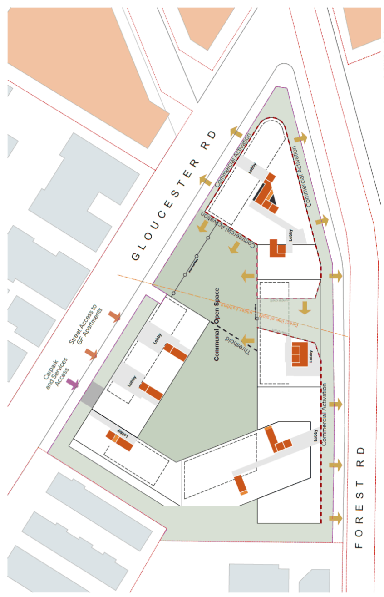

## 3. Development Requirements

### 3.1 Surveyor’s Certificate

Objectives

a) To ensure employment generating land uses continue to be developed on the Site.

Controls

1\. A Development Application for the site must be accompanied by a Surveyor’s Certificate including gross floor area diagrams to scale of each and every proposed level that indicates the breakup of residential and non-residential floor area, with a minimum non-residential floor space of 0.5:1; for the purpose of calculating gross floor area.

Note: This is to be accompanied by a properly scaled surveyor diagram.

### 3.2 Commercial Floor Space

Objectives

a) To ensure a wide range of employment floor space is provided on the site.

b) To facilitate the attraction of a range of employment uses.

Controls

1\. Retail and community uses shall be provided on the whole of the ground floor.

2\. Flexible types of office spaces shall be provided above ground floor, including a range of floor plate sizes.

### 3.3 Built Form and Setbacks

Objectives

a) To provide a vibrant mixed-use development that takes advantage of the site’s location within the Hurstville City Centre.

b) To ensure that the height of the development responds to the existing scale and character of the adjacent residential development and the desired future character of the City Centre West precinct.

c) To achieve a transition in scale through variation in building form, density and typology that appropriately responds to the surrounding context.

d) To ensure adequate separation between the subject development and adjoining residential development to provide reasonable solar access, open space and privacy to occupants of the residential developments on the subject site and adjoining sites.

e) To reduce the apparent bulk and scale of buildings by breaking up expanses of building wall with modulation of form and articulation of facades.

f) To establish the desired spatial proportions of the street and define the street edge.

g) To ensure acoustic privacy for occupants and neighbours.

h) To provide good residential amenity by complying with the State Environmental Planning Policy No.65 Design Quality of Residential Apartment Development and the Apartment Design Guide.

Controls

1\. Development shall display a built form comprising a 4m front setback for the entire length of Forest Road to allow the provision of awnings and street tree planting (Refer #1 in Figure 3).

2\. Define the street edge by retaining significant trees along Forest and Gloucester Roads (Refer Section 3.8).

3\. Development shall display a built form comprising a 2m front setback along the southern portion of Gloucester Road and 5m front setback along the remaining Gloucester Road frontage reflecting the established setback of the adjacent 4 storey residential flat buildings (Refer #2 and #3 in Figure 3).

4\. Development shall display a 6m setback to side boundary at street level to allow for landscaping of the side boundary interface zone (Refer #4 in Figure 3).

5\. An additional setback of minimum 3m is required for built forms above 4 storeys to allow suitable building separation and appropriate transition to adjoining developments (Refer #4 in Figure 3).

6\. Define the Forest Road street edge by providing a podium of maximum 4 storeys, with the exception of Building C and a portion of Building B (unless where indicated in Figure 2).

7\. Building layout, setbacks and separation of building forms are to be in accordance with Chapter 4 of the Housing SEPP and the ADG to ensure the amenity of residents is maintained.

8\. All residential apartments are to be insulated and to have Impact Isolation between floors to achieve an Acoustical Star Rating of 5 in accordance with the standards prescribed by the Association of Australian Acoustical Consultants (AAAC). An Acoustic Report is to be submitted with the Development Application to ensure that the above standards have been achieved.

9\. A Pedestrian Wind Impact Report prepared by a suitably qualified engineer is to be submitted with Development Applications for buildings 30m or higher, and for other buildings at the discretion of Council. At a minimum, the report is to:

a) Report the likely impacts of wind on the pedestrian environment at the footpath level within the site and the public domain; and

b) Show how the proposal minimises the impact of wind on the public and private domain.

> [Picture on page 8: a picture, saved as a picture (images/section-08-2-8-3-9-gloucester-road-hurstville-page-8-1.gif, 150 dpi).]

Figure 3: Minimum Street Setback

> [Picture on page 9: a picture, saved as a picture (images/section-08-2-8-3-9-gloucester-road-hurstville-page-9-1.gif, 150 dpi).]

Figure 4: Section - Gloucester Road transition to adjoining development

> [Picture on page 10: a picture, saved as a picture (images/section-08-2-8-3-9-gloucester-road-hurstville-page-10-1.gif, 150 dpi).]

Figure 5: Section - Forest Road transition to adjoining development

#### Note with respect to Figures 4 and 5:

Council accepts that the design criteria and design guidance under Objective 3F-1 of the ADG (which relate to building separation) take precedence over that which is depicted in these Figures and the proponent must make every attempt to comply with the criteria and guidance.

### 3.4 Façade Treatment and Street Corners

Objectives

a) To ensure building facades are appropriately modulated and articulated to provide visual interest along the street and other areas of the public domain.

b) To ensure well-proportioned built forms and façade treatments that minimise the appearance of building bulk from the street and other areas of the public domain.

c) To ensure that the prominent street corner formed by Forest and Gloucester Roads is clearly defined and emphasised.

Controls

1\. Building facades must be articulated and employ materials and finishes that enhance and complement the streetscape character.

2\. The Forest and Gloucester Road street corner must be reinforced through strong architectural form that reflects the geometry of the site with appropriate use of materials, color, height and transition towards Forest Road.

3\. Human scale at street level must be created through the use of fine-grain elements, rhythm, high quality materials and/or landscaping.

4\. The use of blank walls is not acceptable for façades visible from the public domain. Façade treatments such as wall cladding and green walls should be considered as alternatives to blank walls.

5\. Development must not rely solely on the use of two-dimensional colour and materials to create visual interest. Modulation and articulation in the building form must be explored.

6\. Essential services such as substations and fire hydrants must be integrated into the design of the façade.

7\. Clear glazing balustrades must be avoided where they are visible from the public domain.

8\. The ground floor along the prominent corner and extending up both Forest and Gloucester Roads must have (as close as possible) level access to the footpath and pedestrian access ways without any proposed basement carpark extending above such levels.

### 3.5 Pedestrian Access and the Public Domain

Objectives

a) To ensure that the development incorporates a through-site pedestrian link that enhances the permeability of the site.

b) To provide direct and safe pedestrian paths between public spaces.

c) To enable the ground level landscaped communal open space to be used in a variety of ways.

d) To provide an attractive and cohesive public domain that includes existing significant trees.

e) To ensure that site facilities are thoughtfully integrated into development and provide a comfortable pedestrian environment.

Controls

1\. Provide high quality accessible routes to public and semi-public areas of the building and the site, including major entries, lobbies, communal open space, site facilities, parking areas and pedestrian pathways.

2\. Separate and clearly distinguish between public and private pedestrian accessways and vehicle accessways and utilise consistent paving treatments throughout the site.

3\. All pedestrian links are to have appropriate levels of illumination.

4\. The through-site link from Forest Road to the landscaped communal open space and Gloucester Road (Refer Figure 6) is to:

a) Be a minimum of four storeys in height with no blank walls facing the underpass space.

b) Ensure that a clear and safe path that is unobstructed by parking and services is available for pedestrians at all times.

c) Incorporate elements that positively contribute to the Forest Road streetscape, especially from the public domain.

d) Integrate landscaping elements such as existing and new tree plantings.

e) Ensure pedestrian safety through the application of CPTED principles, especially measures that promote passive surveillance.

5\. The landscaped communal open space on the ground level is to provide the opportunity to be used in a variety of ways over different times of the day, week and year.

6\. The existing above ground electricity and telecommunication cables within the road reserve and within the site area are to be replaced, at the applicant’s expense, by underground cables and appropriate street light standards, in accordance with the Energy and Communication Provider’s guidelines.

> [Picture on page 13: a picture, saved as a picture (images/section-08-2-8-3-9-gloucester-road-hurstville-page-13-1.gif, 150 dpi).]

Figure 6: Section of four-storey through site link

### 3.6 Active Street Frontages

Objectives

a) Ensure ground floor frontages are pedestrian oriented and of high design quality to add vitality to the streets.

b) Encourage frequent building entries that face and open towards the street.

Controls

1\. Active street frontages are to be provided along in accordance with Clause 6.13 of the GRLEP 2021.

2\. Active street frontages are to contribute to the liveliness and vitality of streets by:

• Maximising entries and display windows to commercial premises or other uses that provide pedestrian interest and interaction;

• Providing a high standard of finish and appropriate level of architectural detail for shopfronts; and

• Providing elements of visual interest (minimising blank walls), such as display cases, or creative use of materials where fire escapes, service doors, equipment hatches and other services are provided.

3\. Generally, a minimum of 70% of the ground floor frontage is to be transparent glazing with a predominantly unobstructed view from the adjacent footpath to at least a depth of 6m within the building.

4\. Active frontages are to be designed with the ground floor level at the same level as the footpath.

5\. A continuous awning must be provided above all active street frontages.

6\. Security grilles may only be fitted internally behind the shopfront and are to be fully retractable and at least 50% transparent when closed.

> [Picture on page 15: a picture, saved as a picture (images/section-08-2-8-3-9-gloucester-road-hurstville-page-15-1.gif, 150 dpi).]

Figure 7: Extract from the existing Hurstville LEP 2012 Active Street Frontages Map

### 3.7 Open Space and Landscaping

Objectives

a) To provide residents with passive and active recreational opportunities.

b) To provide designated areas within the site that enables soft landscaping and deep soil planting which will provide for the planting of trees that are, or will, grow to a large or medium size.

c) To ensure that communal open space is consolidated, configured and designed to be useable and attractive.

d) To provide a pleasant outlook and privacy for future residents of the development.

e) To ensure that landscaping is integrated into the design of the development and improve the overall appearance of the development when viewed from neighbouring sites.

f) To contribute to the quality and amenity of communal open space on roof tops, podiums and internal courtyards.

Controls

1\. A landscaped communal open space is to be provided generally in the location shown in Figure 8 and is to include:

• A ground level communal open space of approximately 1,870sqm that is protected from the busier Forest Road environment and receives reasonable solar access;

• Retention of trees and proposed street tree planting in accordance with Section 3.7.

2\. Landscape design is to be in scale with the development and should relate to building form; facilitate storm water infiltration through the use of permeable surfaces; and be easily maintained.

3\. Landscaping is to ensure amenity of private and publicly accessible open spaces and solar efficiency of apartments by providing shade from the sun and shelter from the wind, including the use of deciduous trees for shading of windows and open space areas in summer and allowing solar access in winter.

4\. Deep soil planting is to be provided in accordance with the ADG and incorporated in the landscaped central common area – the deep soil area should not be above the basement parking.

a) 6m wide deep soil landscaped screening along the interface with residential properties to the west (Refer Figure 8);

b) 6m wide deep soil planting along Gloucester Road (Refer Figure 8).

5\. Additional communal open spaces such as above podium and internal courtyards may be provided to ensure equitable access to all residents.

6\. All Development Applications are to include a landscaping plan for all landscaped areas prepared by a qualified landscape designer. The landscaping plan should demonstrate that there is no conflict with the location of services on the site and any deep soil planting area.

> [Picture on page 17: a picture, saved as a picture (images/section-08-2-8-3-9-gloucester-road-hurstville-page-17-1.gif, 150 dpi).]

Figure 8: Communal Open Space and Deep Soil areas

### 3.8 Tree Retention

The subject site contains large trees with dense canopies lining the street frontages, complemented by significant under-storey planting. There are mature trees on the south of the site as well which provides a significantly landscaped area that provides amenity, visual quality, enhanced streetscape, native fauna habitat, soil conservation, enhanced microclimatic conditions, solar access control and improved air quality. It is a requirement of this DCP that a number of trees be retained and a tree replacement strategy be implemented.

Objectives

a) To conserve trees of ecological, heritage, aesthetic and cultural significance.

b) To protect and manage identified individual trees as an important site asset.

c) To ensure all new development considers the trees proposed for retention and the proposed tree planting plan that provides opportunity for the healthy growth of large trees.

Controls

1\. Any new development must retain identified trees in accordance with Figure 9 and Table 1 in this section.

2\. Any new development must propose new trees in the locations identified in Figure 9. Details of the proposed trees, including the species and size, will need to be provided with the Development Application to the satisfaction of Council. The proposed tree canopy must exceed the existing canopy cover on the site of 3,385sqm. The costs of the works are to be borne by the applicant.

3\. Any trees that are located on public land will be subject to the payment of security in accordance with Council’s Tree Management Policy.

> [Picture on page 19: a picture, saved as a picture (images/section-08-2-8-3-9-gloucester-road-hurstville-page-19-1.gif, 150 dpi).]

Figure 9: Potential Tree Retention and Proposed Trees

| Tree number | Species | Location |
|---|---|---|
| 20 | London Plane | Gloucester Road |
| 21 | London Plane | Gloucester Road |
| 22 | London Plane | Gloucester Road |
| 23 | London Plane | Gloucester Road |
| 26 | London Plane | Gloucester Road |
| 27 | London Plane | Gloucester Road |
| 28 | London Plane | Gloucester Road |
| 29 | London Plane | Gloucester Road |
| 34 | London Plane | Gloucester Road |
| 35 | London Plane | Gloucester Road |
| 36 | London Plane | Gloucester Road |
| 37 | London Plane | Gloucester Road |
| 59 | Chinese Hackberry | Forest Road |
| 60 | Chinese Hackberry | Forest Road |
| 61 | Chinese Hackberry | Forest Road |
| 62 | Chinese Hackberry | Forest Road |
| 63 | Chinese Hackberry | Forest Road |
| 59a | Evergreen Alder | Forest Road |
| 101 | Evergreen Alder | Forest Road |
| 102 | Evergreen Alder | Forest Road |
| 103 | Evergreen Alder | Forest Road |
| 106 | Evergreen Alder | Forest Road |

Table 1: Trees to be retained (Refer Figure 9)

Notes:

1\. The London Plane trees along Gloucester Road tabulated in Table 1 are of high value to the streetscape and are suitable for retention. An exclusion zone should be established for the design of buildings and basement levels that ensures the protection of trees.

2\. The dense foliage of Evergreen Alder planted along Forest Road creates a dense canopy and creates a visual barrier from the street to the communal open spaces within the site.

3\. The Chinese Hackberry provides a continuous landscaped edge along Forest Road and is thus recommended for retention.

### 3.9 On-Site Parking

Objectives

a) To provide adequate car parking for the buildings’ users and visitors.

b) To integrate the location and design of car parking with the design of the site and the building.

c) To ensure that car parking, loading/unloading and servicing access is accommodated within the property and not on public roads.

Controls

1\. Car parking must be located underground in a basement and be designed in accordance with Part 3 General Planning Considerations of this DCP.

2\. Car parking rates must comply with RMS car parking rates in accordance with the Apartment Design Guide.

3\. All loading and unloading of goods is to be accommodated within the property and off the public roads, including garbage pickup.

4\. All vehicles are to enter and leave the site in a forward direction at all times.

5\. The designs for all the levels of the basement car park are to adhere to the latest edition of relevant AS/NZS 2890.1, 2890.2 and 2890.6.

6\. Safe and secure access is to be provided for building users, direct access to residential apartments and convenient access to customers /staff of the commercial uses.

7\. Ventilation grilles or screening devices of car park openings are to be integrated into the overall façade and landscape design of the development and must not be located above existing or proposed footpath levels along Forest Road and Gloucester Road.

### 3.10 Vehicle Access

Objectives

a) To integrate adequate car parking and servicing access without compromising street character, landscape or pedestrian amenity and safety.

b) To encourage the active use of street frontages.

c) To ensure that vehicle access to buildings is not incompatible with pedestrian movements and the public domain.

Controls

1\. Vehicular access to the site is to be provided in accordance with Part 3 General Planning Considerations of this DCP.

2\. Vehicle access to the site is to be located off Gloucester Road.

3\. The appearance of car parking and service vehicle entries are to be improved by screening and locating garbage collection, loading/unloading and servicing areas within the basement of the development. Refer to Appendix 4 Waste Management of this DCP.

4\. Vehicle access to the site is to be setback from the neighbouring residential properties to provide for a landscaping buffer as shown in Figure 10.

> [Picture on page 23: a picture, saved as a picture (images/section-08-2-8-3-9-gloucester-road-hurstville-page-23-1.gif, 150 dpi).]

Figure 10: Vehicular and Pedestrian Access
