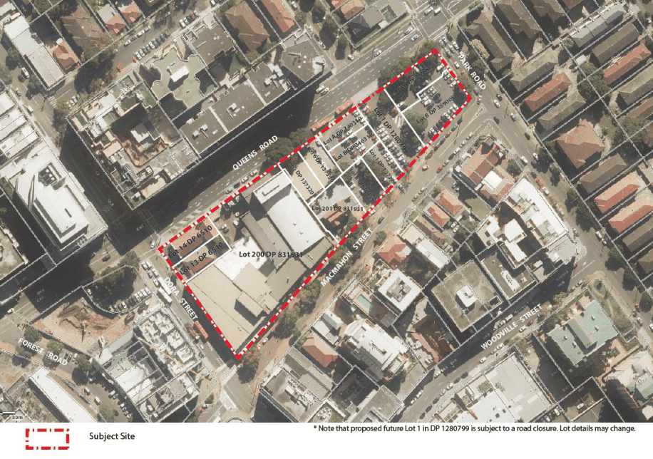

### 1.2 Land to which this Section applies

This section applies to land which is the subject of the Georges River Local Environmental Plan 2021 (Amendment No. 6, which came into operation on 27 October 2023). The Site is known as the Hurstville Civic Precinct which includes land as outlined in red in Figure

1\. The Site is bounded by Park Road, MacMahon Street, Dora Street and Queens Road and includes:

| Lot | DP | Address |
|---|---|---|
| 13 | 6510 | 4-6 Dora Street, Hurstville |
| 14 | 6510 | 4-6 Dora Street, Hurstville |
| 200 | 831931 | 16-32 MacMahon Street, Hurstville |
| 5 | 137320 | 91 Queens Road, Hurstville |
| 6 | 137320 | 91 Queens Road, Hurstville |
| 201 | 831931 | 14 MacMahon Street, Hurstville |
| B | 321590 | 14A MacMahon Street, Hurstville |
| A | 340310 | 3 Patrick Street, Hurstville |
| B | 340310 | 1 Patrick Street, Hurstville |
| 1 | 137320 | 6 MacMahon Street, Hurstville |
| A | 389008 | 2 Patrick Street, Hurstville |
| B | 389008 | 2 Patrick Street, Hurstville |
| 1 | 1280799 | Patrick Street Road Reserve (Subject to road closure process) |

> [Picture on page 3: a picture, saved as a picture (images/section-08-2-8-4-hurstville-civic-precinct-page-3-1.gif, 150 dpi).]

Figure 1: Area of Application – Hurstville Civic Precinct
