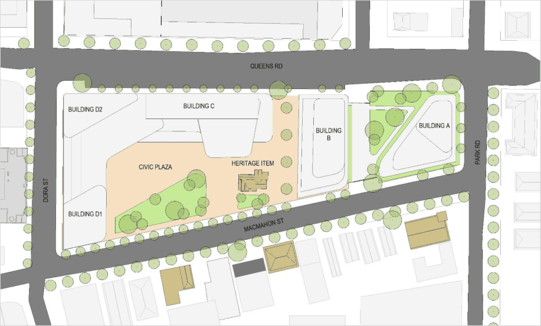

## 3.  Development Controls

### 3.1 Concept Master Plan

A Concept Master Plan (refer to Figure 2) was prepared for the Site as part of the assessment of the Planning Proposal which informed the GRLEP 2021 (Amendment No.

6\) and provides general guidance on the overall form of development on the Site and establishes the following Precinct Objectives and Controls.

#### Objectives

a) To facilitate the coordinated development of the Hurstville Civic Precinct consistent with the vision and development principles for the Precinct.

b) To guide the delivery of key elements of the Precinct whilst providing an appropriate level of flexibility in the detailed Precinct layout and design.

c) To establish the Hurstville Civic Precinct as a vibrant community, cultural, employment and residential destination by providing a mix of civic, cultural, retail, employment and housing uses.

d) To provide new public open space opportunities in locations that achieve an appropriate balance between solar access, visual and acoustic amenity.

e) To provide safe and accessible active transport routes surrounding the Hurstville Civic Precinct.

f) To minimise overshadowing impacts to residential uses on Dora Street.

#### Controls

1\. Development is to be consistent with the key land use elements in Table 1 and the indicative site layout plan at Figure 2.

> [Picture on page 6: a picture, saved as a picture (images/section-08-2-8-4-hurstville-civic-precinct-page-6-1.gif, 150 dpi).]

Figure 2: Indicative Site Layout Plan – Hurstville Civic Precinct

| Land Use | Target GFA |
|---|---|
| Commercial | 7,490m2 |
| Council Chambers | 6,000m2 |
| Community | 8,410m2 |
| Retail | 3,175m2 |
| Residential | 25,975m2 |
| Public Car Parking Spaces (i.e. in addition to the minimum requirements for all land uses provided in the Precinct) | 500+ spaces (subject to the outcomes of a car parking study and traffic impact assessment that assesses the extent to which public car parking for general use is required to be provided at the Site) |
| Public Open Space (at ground level, including a Civic Plaza) | 6,690m2 |

Table 1: Land uses – Hurstville Civic Precinct Note: GFA - Gross floor area has the same definition as provided for within the GRLEP 2021.
