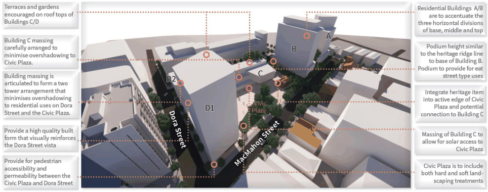
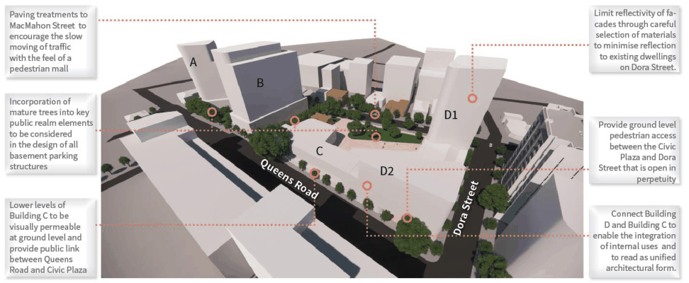
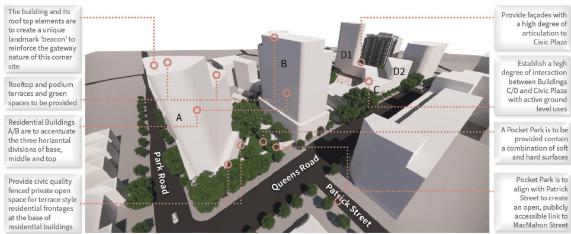

### 3.4 Built Form

#### 3.4.1  Key urban design principles and indicative building envelope

#### Objectives

a) To provide a high quality, accessible and integrated Civic Precinct.

#### Controls

1\. Compliance with the key urban design principles and outcomes illustrated in Figures 3-5.

> [Picture on page 8: a picture, saved as a picture (images/section-08-2-8-4-hurstville-civic-precinct-page-8-22.gif, 150 dpi).]

Figure 3: Key Principles - View looking north from the corner of Dora Street and MacMahon Street

> [Picture on page 9: a picture, saved as a picture (images/section-08-2-8-4-hurstville-civic-precinct-page-9-1.gif, 150 dpi).]

Figure 4: Key Principles - View looking east from the corner of Queens Road and Dora Street

> [Picture on page 9: a picture, saved as a picture (images/section-08-2-8-4-hurstville-civic-precinct-page-9-3.gif, 150 dpi).]

Figure 5: Key Principles - View looking south from the corner of Park Road and Queens Road
