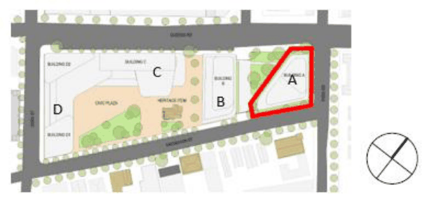

#### 3.4.2  Building A

> [Picture on page 10: a picture, saved as a picture (images/section-08-2-8-4-hurstville-civic-precinct-page-10-2.gif, 150 dpi).]

Building A plays a key role in the Precinct as a gateway to both the Hurstville Civic Precinct and the wider Hurstville City Centre. Building A will be highly visible from a significant distance along the north western approach to the Hurstville City Centre. Therefore, the way in which this building addresses the corner of Park Road and Queens Road is an important consideration for defining this key gateway location.

Building A sits adjacent to the Patrick Street Pocket Park/ View Corridor. Its western façade provides an important frame to this space.

#### Objectives

a) To create a dramatic edge to the Hurstville Civic Precinct and a ‘signifier’ to the surrounding neighbourhood.

b) To provide a design response that highlights the significance of Building A in both day and night-time hours.

c) To ensure a visual relationship between Building A and the Patrick Street Pocket Park.

d) To mitigate the effect of adverse wind conditions for pedestrians at street level.

e) To maximise landscaping on the façades to provide a landscaped entry into the Hurstville City Centre.

#### Controls

1\. The design of the building and its roof top elements are to create a unique landmark ‘beacon’ or significant marker to reinforce the gateway nature of this corner Site.

2\. The building is to be designed to create clear articulation of base, middle and top.

3\. The lower levels of the building are to be formed as a podium edge to step the tower form away from the street edge by a minimum of 3m.

4\. The podium level is to be a maximum of 4 levels.

5\. The western façade of Building A is to include a high degree of landscaping for the purpose of urban greening and reducing the urban heat island effect through any combination of the following mechanisms:

i. Consistent planters on balconies,

ii. Green façade (including space for climbing planters), and/or

iii. Green wall or landscaping that creates the effect of a green wall.

6\. Provide awnings to all non-residential ground level frontages.

7\. Provide high quality fenced private space providing visual permeability and incorporating small gardens, address points and entry gates for terrace-style residences where proposed at the base of Building A.

8\. Balconies are to be designed so that internal living spaces and clothes drying areas are not visible from the public domain.

9\. Balconies are to be integrated/recessed within the façade (i.e. balconies are not to cantilever beyond the main external building wall).

10\. Engineering plants such as air conditioning units and the like are not to be visible on balconies or the facades of the building.

11\. Balconies are to be a combination of solid and open balustrade elements and may be constructed to include a variety of materials to form a composed and harmonious back drop that accentuates the building’s form.
