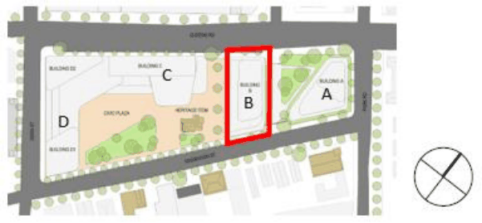

#### 3.4.3  Building B

> [Picture on page 11: a picture, saved as a picture (images/section-08-2-8-4-hurstville-civic-precinct-page-11-18.gif, 150 dpi).]

Building B sits adjacent to the Patrick Street Pocket Park/ View Corridor. Its north-eastern façade provides an important frame to this space. Building B is also a significant backdrop to the heritage item as viewed from the Civic Plaza and arrival point into the Precinct from the Hurstville train station. It is essential to provide an active ground floor which is to include food retailing, cafés and restaurants on the south-western façade to facilitate the delivery of an ‘eat street’ which connects MacMahon Street with Queens Road.

#### Objectives

a) To ensure that Building B is appropriately scaled in form, detail and architectural articulation to reduce its visual mass.

b) To establish an eat street destination.

c) To ensure appropriate solar access is achieved to the Civic (MacMahon Street) Plaza.

d) To mitigate the effect of adverse wind conditions for pedestrians at street level.

#### Controls

1\. The commercial/ retail levels should be designed with an appropriate floor to ceiling height and provide for adaptation to accommodate air filtration and extraction to facilitate restaurant type uses to the western ground floor tenancies.

2\. The form of the building is to accentuate the three horizontal divisions of base, middle and top. The design of the base should be a human scale and relate to the heritage item and the ‘eat street’ in scale and materiality.

3\. The podium must not be greater than two storeys, comprising of retail and dining at ground level. The rooftop of the podium may be used as terraces for the residential tower.

4\. Vertical breaks within the façade are to be provided which create visual articulation that gives the appearance of at least two forms. These breaks should visually relate to any through-site links and /or residential lobbies connecting to the Civic (MacMahon Street) Plaza and the Patrick Street Pocket Park.

5\. Balconies are to be designed so that internal living spaces and clothes drying areas are not visible from the public domain.

6\. Engineering plants such as air conditioning units and the like are not to be visible on balconies or the facades of the building.

7\. Balconies are to be a combination of solid and open balustrade elements and may be constructed to include a variety of materials to form a composed and harmonious back drop that accentuates the building’s form.

8\. Balconies are to be integrated/recessed within the façade (i.e. balconies are not to cantilever beyond the main external building wall).

9\. The design of the eat street is to incorporate retractable material/fabric awnings attached to the podium form to provide variety, colour and scale. The awnings together with outdoor seating across the eat street area will allow for flexible adaption to suit events and environmental conditions.

10\. Provide an architectural response (bulk, height, articulation, and materials) that positively frames the backdrop to the heritage item.
