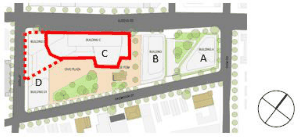

#### 3.4.4  Building C

> [Picture on page 13: a picture, saved as a picture (images/section-08-2-8-4-hurstville-civic-precinct-page-13-2.gif, 150 dpi).]

Building C forms the civic and cultural heart of the Precinct. It is located between Buildings B and D and defines the north west edge of the new Civic Plaza. Building C provides an opportunity to create a sculptural form that blends built form and the adjacent landscape of the Civic Plaza. It is intended that this building be physically connected (at least at the lower levels) to Building D to unify cultural, civic and commercial activities in the Precinct. The built form of Building C is to be designed to minimise the impact of overshadowing on the Civic Plaza to facilitate enjoyment, amenity and activation of the Plaza.

It is expected that the new library, community information, art and performance spaces will deliver a new model incorporating retail, café food service, work and study hubs catering for the diverse needs of the local community. Building C is to offer a high quality, minimal maintenance outcome.

#### Objectives

a) To provide a sculptural form for the Civic Building (Building C) to denote its role as a key destination and special public place.

b) To ensure appropriate solar access is achieved to the Civic (MacMahon Street) Plaza.

c) To design Building C as an integrated extension of the adjoining landscape of the Civic (MacMahon Street) Plaza, particularly through the inclusion of active non-residential uses at ground level.

d) To provide visual permeability from the Civic Plaza through the ground floor of Building C.

e) To provide public access between the Civic (MacMahon Street) Plaza and Queens Road.

f) To reinforce the north western edge of the Civic (MacMahon Street) Plaza as civic in nature with visual and physical accessibility and outward facing active non-residential uses at ground level.

g) To integrate the heritage item into the active edge of the Civic (MacMahon Street) Plaza by investigating an array of uses and potential connection to Building C.

h) To minimise overshadowing to residential uses on Dora Street.

#### Controls

1\. The new civic buildings are to be innovative in their design and management opportunities to create a flexible multipurpose outcome.

2\. Any commercial/retail levels on the north eastern frontage should be designed with an appropriate floor to ceiling height and provide for adaptation to accommodate air filtration and extraction to facilitate restaurant type uses to the western ground floor tenancies.

3\. Provide an integrated approach to the design of Building C and the adjoining Civic Plaza so as to create a built form and landscape that reads as a unified form. This may include the incorporation of the roof and south eastern walls of Building C with the stepped landscape levels of the Civic Plaza.

4\. Provide a physical connection between Building C and Building D at the podium levels to enable the integration of internal uses. The connection between Buildings C and D should read as a unified architectural form creating an internal active civic /commercial street.

5\. Minimise overshadowing to the Civic Plaza through careful articulation of building massing.

6\. Minimise overshadowing to residential uses on Dora Street through careful articulation of building massing.

7\. The lower levels of Building C are to be visually permeable at ground level and provide a public link between Queens Road and the Civic (MacMahon Street) Plaza.

8\. Provide active, non-residential ground level edges to Queens Road, Civic (MacMahon Street) Plaza and through site pedestrian links, including the eat street.

9\. Provide awnings to all ground level frontages.

10\. Provide an architectural response (bulk, height, articulation, and materials) that positively frames the backdrop to the heritage item.
