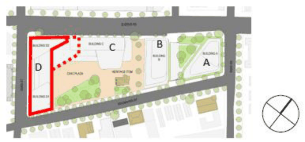
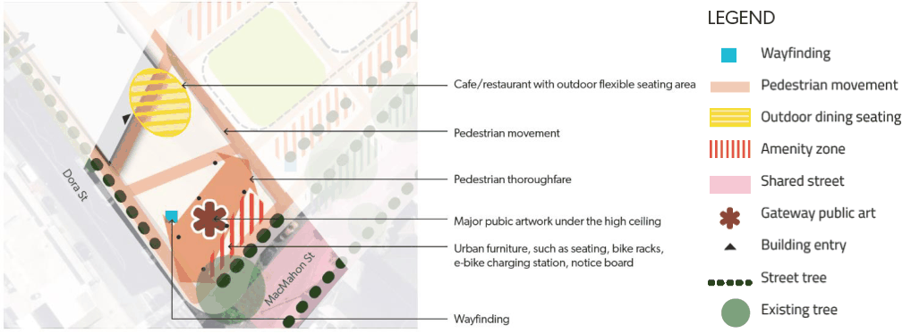

#### 3.4.5 Building D

> [Picture on page 14: a picture, saved as a picture (images/section-08-2-8-4-hurstville-civic-precinct-page-14-27.gif, 150 dpi).]

Building D is located at the corner of MacMahon Street and Dora Street and defines a critical view corridor when entering the Precinct from the Hurstville Railway Station and bus transit areas on Forest Road. Establishing a direct visual link and intuitive pedestrian connection from the Dora Street/ MacMahon Street/ Barratt Street intersection will be the

key to integrating the Hurstville Civic Precinct and Civic Plaza with the wider Hurstville City Centre.

Building D will provide an active and welcoming arrival point to the Civic (MacMahon Street) Plaza providing opportunities for activation of the adjacent streets and public realm, including enhancing pedestrian connections and permeability between Dora Street and the Civic (MacMahon Street) Plaza.

Building D is intended to provide commercial office space in the Precinct and will provide as needed for Council’s civic needs as well as for private enterprise.

Minimising overshadowing to residential development along Dora Street and the Civic Plaza are important considerations for the design of this building.

#### Objectives

a) To provide a high quality built form that visually reinforces the Dora Street vista.

b) To ensure appropriate solar access is achieved to the Civic (MacMahon Street) Plaza.

c) To design Building D as an integrated extension of the adjoining landscape of the Civic (MacMahon Street) Plaza, particularly through the inclusion of active non-residential uses at ground level.

d) To provide for pedestrian accessibility and permeability between the Civic (MacMahon Street) Plaza and Dora Street.

e) To reinforce the south western edge of the Civic Plaza as civic in nature with visual and physical accessibility and outward facing active non-residential uses at ground level.

f) To minimise overshadowing to residential uses on Dora Street.

g) To establish a visual connection and intuitive pedestrian access to the Civic Plaza from the Dora Street/ MacMahon Street/ Barratt Street intersection.

#### Controls

1\. The design of Building D is to be of a high quality and architecturally reinforce the Dora Street/Queens Road and Dora Street/ MacMahon Street corners as well as provide façades with a high degree of articulation and visibility to lively internal uses to Dora Street and the adjacent Civic (MacMahon Street) Plaza.

2\. Provide a physical connection between Building D and Building C at the podium levels to enable the integration of internal uses. The connection between Buildings C and D should read as a unified architectural form creating an internal active civic /commercial street.

3\. Provide ground level pedestrian access between the Civic (MacMahon Street) Plaza and Dora Street. Through-site links are to be registered on the title of the land as an easement for public access.

4\. Provide a finely articulated façade through inclusion of façade elements that create detail through depth of scale and colour. This is specifically important for the east façade facing the Civic (MacMahon Street) Plaza and west façade facing residential buildings on the opposite side of Dora Street.

5\. Limit reflectivity of facades through careful selection of materials to minimise reflection to existing dwellings on Dora Street.

6\. Minimise overshadowing to the Civic Plaza through careful articulation of building massing.

7\. Minimise overshadowing to residential development on Dora Street through careful articulation of building massing.

8\. Provide a direct visual link and pedestrian connection into the Civic Plaza from the Dora Street/ MacMahon Street/ Barratt Street intersection that is publicly accessible in perpetuity. This may occur through setting back the lower levels of Building D from MacMahon Street to provide a generously elevated undercroft having regard to the design considerations in Figure 6.

9\. A wind impact assessment report is to be submitted with the Development Application addressing the wind impacts in and around the undercroft area.

10\. Provide awnings to all ground level frontages.

> [Picture on page 16: a picture, saved as a picture (images/section-08-2-8-4-hurstville-civic-precinct-page-16-19.gif, 150 dpi).]

Figure 6: Undercroft space design considerations (Hurstville Civic Precinct Public Domain Strategy, Place Lab 2022)
