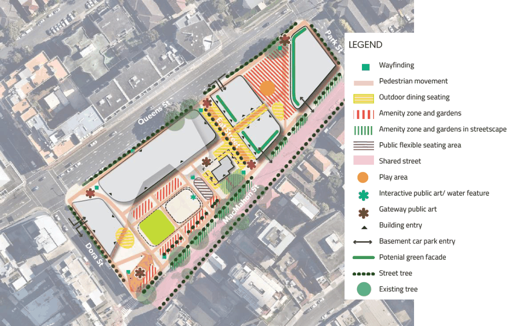

### 3.5 Public Domain

#### 3.5.1 Public Domain Strategy

#### Objectives

a) To establish a cohesive design approach for all public domain elements and linkages.

b) To facilitate the coordinated development of a network of connected public places, streets and pedestrian linkages.

c) To develop a high quality site-specific outcome signifying the Precinct as Hurstville’s “Civic heart”.

d) To achieve a public domain outcome that integrates visually and physically with the wider Hurstville City Centre.

#### Controls

1\. A public domain plan is to be prepared in support of any future development application (DA) and to the satisfaction of Georges River Council as a part of a detailed design process. The public domain plan is to denominate an integrated approach to precinct design with the broader network of streets and public places.

2\. The public domain plan must be consistent with the public domain framework in the Hurstville Civic Precinct Public Domain Strategy (Place Lab 2022) as depicted in Figure 7.

3\. At a minimum, the public domain plan is to address the:

i. Role and function of key open space elements and linkages.

ii. Application of soft (including mature tree planting) and hard landscaping surfaces.

iii. Lighting and service infrastructure that positively contributes to the safety, legibility, wayfinding and visual interest of the public domain.

iv. Smart technologies in the public domain and street furniture to allow for accessibility and connectivity, such as Wi-Fi and charging points.

v. Shelter and awnings.

vi. Street furnishings, including seating and play structures which may include an active water play feature.

vii. Fencing (where necessary).

viii. Public art across the Site and with at least one focal art piece within the Civic Plaza.

ix. Transition between public, semi public and private space.

x. Wayfinding and signage, particularly with consideration to connections from nearby transit (i.e. Hurstville Railway Station and bus interchange).

xi. Pedestrian connectivity and active transport, including bike racks.

xii. Solar access.

xiii. Maintenance and upkeep.

xiv. Protection of the remembrance plaque on the northern wall of the former Hurstville Baptist Church building located at 4-6 Dora Street which is to be removed prior to any demolition of that building and installed in a publicly visible and appropriate location as part of the future redevelopment of the site.

4\. The fittings and all elements of this plan are to demonstrate a minimum 50-year life span, including durable natural stone providing long life and a quality befitting a major

civic place, and be in accordance with Council’s ‘Public Domain Streetscape Works Specification’.

5\. The public domain plan shall consider treatment of the public domain both on the Site and across the adjoining streets where appropriate, including the MacMahon Street shared zone.

6\. The public domain plan is to be developed with consideration for any other public domain plan prepared by or endorsed by Council.

7\. Any form of planting on structures must provide sufficient soil depth and volume to support the long-term growth of plants. Refer to Section 4P of the Apartment Design Guide (NSW Department of Planning and Environment 2015) for the minimum soil standards. Any sub-surface drainage requirements are in addition to the soil depths listed.

Note: All volumes are subject to review against current industry best practice standards. An arborist or soil scientist can provide specific advice about the volume of soil that planting requires.

> [Picture on page 18: a picture, saved as a picture (images/section-08-2-8-4-hurstville-civic-precinct-page-18-16.gif, 150 dpi).]

Figure 7: Public domain framework (Hurstville Civic Precinct Public Domain Strategy, Place Lab 2022)
