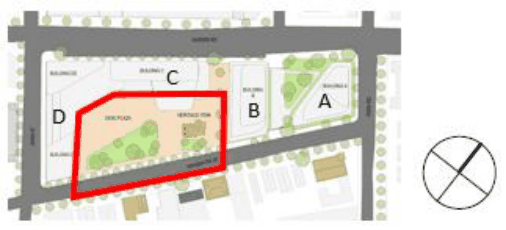
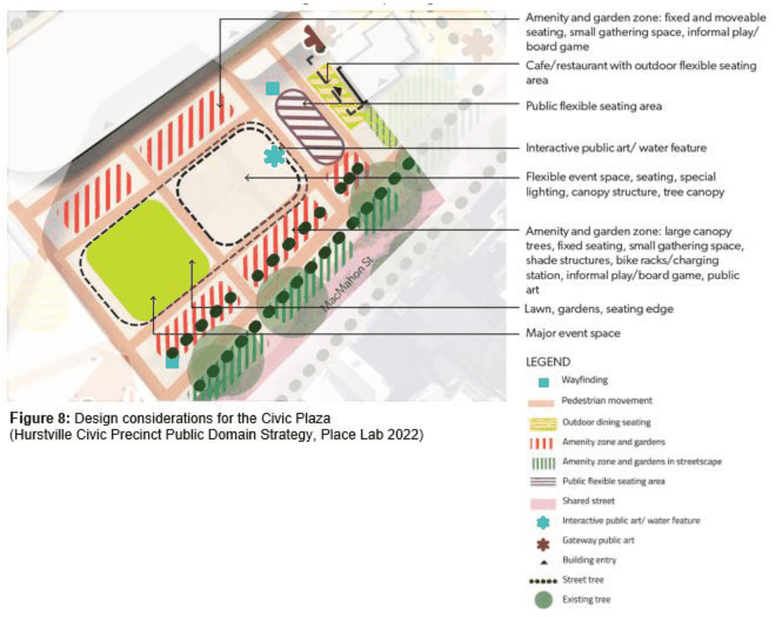

#### 3.5.2 Civic (MacMahon Street) Plaza

> [Picture on page 19: a picture, saved as a picture (images/section-08-2-8-4-hurstville-civic-precinct-page-19-2.gif, 150 dpi).]

The Civic (MacMahon Street) Plaza will form a new active heart for the Hurstville City Centre. The Plaza will be landscaped to include both hard and soft landscaping treatments which will enable the space to perform a variety of place making roles, including social gathering and special event spaces.

Hurstville’s new Civic Plaza will be positioned adjacent to MacMahon Street where it is best connected to the wider Hurstville City Centre in a location that is protected from the high volume traffic routes of Park Road and Queens Road. The relationship between the Civic Plaza and existing heritage buildings on MacMahon Street will create a unique and ambient atmosphere that showcases and celebrates Hurstville’s present and past.

Built form massing in the Concept Master Plan has been carefully considered to ensure that the majority of the Civic Plaza receives a minimum of 3 hours sunlight in mid-winter, and particularly during the lunchtime period when the usage of the Plaza is expected to peak.

#### Objectives

a) To allow for passive recreation opportunities catering for a broad range of activities and intergenerational needs.

b) To provide a public space that is open to the air and provides perpetual access to the public, catering for incidental use and allowing for occasional programmed activities to occur.

c) To facilitate community interaction and gathering for local residents, workers and visitors.

d) To achieve a high degree of solar access to the Civic Plaza throughout the year and specifically mid-winter between the hours of 9am and 3pm, and most importantly during lunchtime hours when the space is expected to be at peak usage.

e) To activate the edges of the Civic Plaza and provide a range of environmental conditions that encourage use throughout various times of the day, night and year.

f) To include integrated services to allow for performance events, presentations, media and IT installations to cater for markets, food events, movie and media projections and public speaking /performance occasions.

1\. Provide a publicly accessible Civic Plaza with minimum dimensions of 60m x 40m, equating to a minimum required area of 2,400m2. This minimum area shall be open to the sky.

2\. The Civic Plaza is to be designed to enable a variety of functions to occur simultaneously and is to have regard to the design considerations in Figure 8.

3\. Key elements in the Civic Plaza are to cater for a broad range of intergenerational activities and are to include a variety of plantings, gathering spaces, and flexible seating areas.

4\. The Civic Plaza is to contain a mix of soft and hard surfaces and allow for intergenerational activities, accessible for all within the community. A minimum area of 40% of the Plaza is to be soft landscaping, including deep soil for canopy tree planting and low level planting beds.

5\. The Civic Plaza is to receive the minimum solar access in accordance with Clause

6.18 of the GRLEP 2021.

6\. The materials and all elements within the Civic Plaza are to provide long term civic quality outcomes designed for a 50-year life.

7\. A Development Application is to be supported by a public art strategy in accordance with Council’s Public Art Policy and Public Art Guidelines for Developers. Public art is to be provided either at grade or integrated with key building facades to Buildings B, C and D.

8\. Any works are to respect the setting to the heritage item by ensuring the heritage curtilage is maintained and protected.

> [Picture on page 21: a picture, saved as a picture (images/section-08-2-8-4-hurstville-civic-precinct-page-21-1.gif, 150 dpi).]
