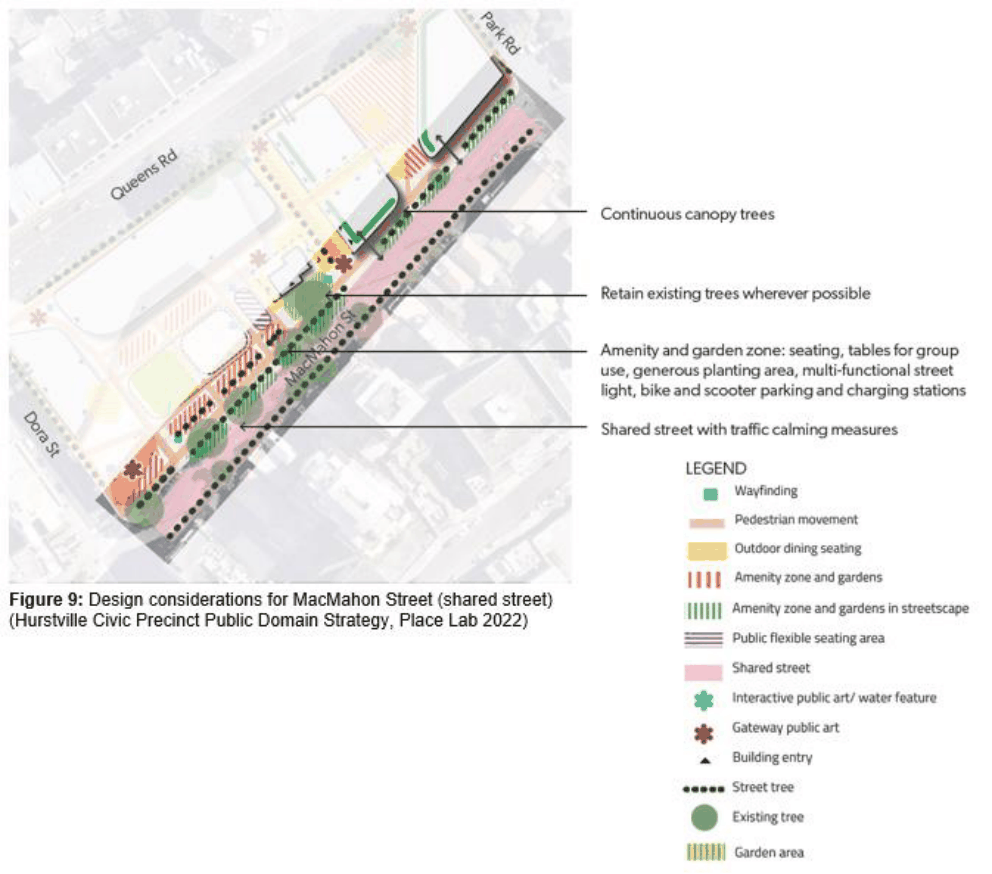

#### 3.5.3 Shared Street – MacMahon Street

MacMahon Street is the interface between the Hurstville Civic Precinct and the rest of the Hurstville City Centre, providing an entry to the Precinct and a movement corridor. Most importantly, MacMahon Street is an extension to the place making qualities of the Civic Plaza, providing a place where people feel comfortable to stay and participate in their everyday activities.

MacMahon Street is intended to be a shared zone, remaining accessible to vehicle traffic, with paving treatments encouraging the slow moving of traffic with the feel of a pedestrian

mall. This will facilitate the occasional closing of the street to accommodate community events (e.g. markets and community fairs).

#### Objectives

a) To provide an active edge to the Civic Plaza and a gateway to the Hurstville Civic Precinct from the rest of the Hurstville City Centre.

b) To provide a shared zone with the opportunity to accommodate community events.

1\. MacMahon Street (shared street) is to be designed to provide an area for slow moving traffic and pedestrians that is an extension of the public domain of the Civic Plaza and is to have regard to the design considerations in Figure 9.

> [Picture on page 22: a picture, saved as a picture (images/section-08-2-8-4-hurstville-civic-precinct-page-22-4.gif, 150 dpi).]
