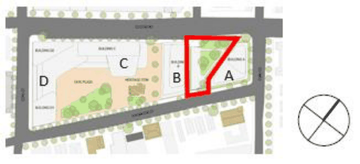
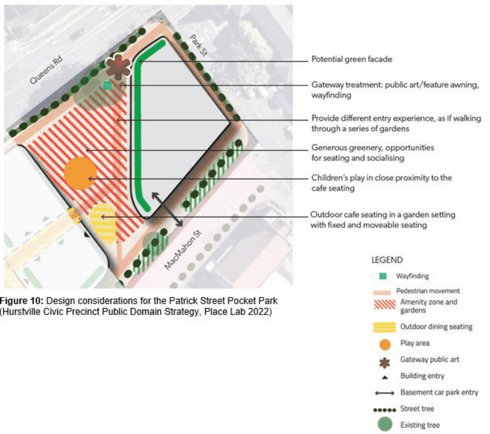

#### 3.5.4 Patrick Street Pocket Park

> [Picture on page 23: a picture, saved as a picture (images/section-08-2-8-4-hurstville-civic-precinct-page-23-2.gif, 150 dpi).]

The Patrick Street Pocket Park is situated between Buildings A and B. It provides a dual role as a public amenity for adjacent residents and restaurant/café patrons as well as maintaining the Patrick Street view corridor, which provides direct line access to Hurstville Oval. The Patrick Street Pocket Park is oriented towards the north, which, in conjunction with the careful design of adjacent Buildings A and B, allows for significant solar access to be achieved throughout the year.

#### Objectives

a) To establish a small park that provides a high level of amenity for adjacent residents and visitors.

b) To maintain strong visual and physical connection between Patrick Street towards MacMahon Street.

c) To maintain an open and accessible vista between Queens Road and MacMahon Street.

#### Controls

1\. The Patrick Street Pocket Park is to be a publicly accessible park having regard to the design considerations in Figure 10.

2\. The landscaped pocket park is to align with Patrick Street, providing a gateway to the Precinct and maximising northern solar access.

3\. The park area (being public open space) located at the north eastern end of the Site between Building A and Building B is required to receive a minimum 50% of direct sunlight for at least 4 hours between 9am and 3pm at mid-winter.

4\. Landscape elements with significant trees and low-level greening are to be included in the Patrick Street Pocket Park, including the potential for green walls.

5\. Where residential is on the ground floor, residential gardens and entrances are to be defined through high quality fencing allowing visual connection from each unit’s private open space to the public pedestrian way.

6\. Where residential is proposed, fencing is to reflect a common design approach and materials palette.

> [Picture on page 24: a picture, saved as a picture (images/section-08-2-8-4-hurstville-civic-precinct-page-24-1.gif, 150 dpi).]
