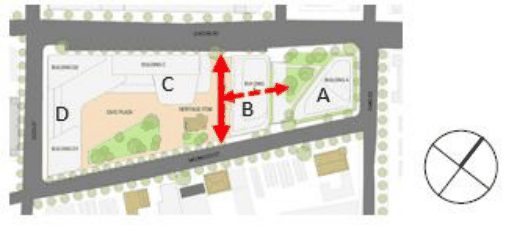
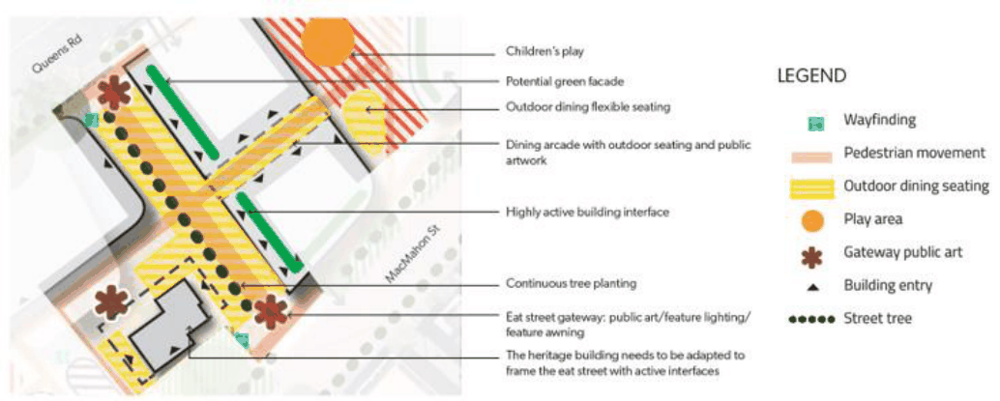

#### 3.5.5 Eat street and laneway connections

> [Picture on page 25: a picture, saved as a picture (images/section-08-2-8-4-hurstville-civic-precinct-page-25-2.gif, 150 dpi).]

New linkages and their relationship to the surrounding public realm will enable active land uses such as restaurants to interact with and activate the new Civic Plaza. The eat street element of the Precinct is intended to provide for activity beyond regular daytime trading hours.

#### Objectives

a) To develop retail food and entertainment activities at the ground floor of Buildings B and C to create an active food and dining precinct.

b) To maximise the pedestrian permeability of the Precinct by connecting Queens Road, Park Road, the Patrick Street Pocket Park and the Civic Plaza.

c) To incorporate the heritage item as an integrated element in the Precinct.

d) To provide indoor and outdoor dining options.

#### Controls

1\. Retail floor space mix with a restaurant/ café/ small bar focus is to be included on the ground floor to provide café and dining experiences to form an eat street having regard to the design considerations in Figure 11.

2\. The intended retail mix is to be economically tested and submitted as part of any design discussion and/or Development Application.

3\. The provision of mini market and whole foods type offers are encouraged. Full scale supermarkets are not supported in this location, however, small format supermarkets incorporating up to 800m2 of retail floorspace may be considered in conjunction with satisfying the stated objective of a mix of cafes and restaurants being achieved as part of a co-ordinated retail strategy.  A single outcome of a small format supermarket is not supported for the Site.

4\. The eat street is to be an appropriate width to accommodate outdoor dining and a public pedestrian thoroughfare.

5\. The eat street is to be unenclosed and open to the sky. Cafes, restaurants, food shops and the like, which open onto eat street should however include weather protection for outdoor dining, potentially in the form of awnings.

6\. The public pedestrian connection between the eat street and the Patrick Street Pocket Park may be provided as an arcade in the undercroft of the podium of Building B, providing a dining arcade with outdoor seating.

7\. The heritage item and its curtilage is to be retained and incorporated as an integral element to the Precinct. Any adaptive re-use is to be consistent with the Conservation Management Plan for the Hurstville Museum and Gallery (Weir Phillips Heritage and Planning 2022) or subsequent amendment and sympathetic to the significance of the item, providing active interfaces with the eat street.

> [Picture on page 26: a picture, saved as a picture (images/section-08-2-8-4-hurstville-civic-precinct-page-26-6.gif, 150 dpi).]

Figure 11: Design considerations for the eat street (Hurstville Civic Precinct Public Domain Strategy, Place Lab 2022)
