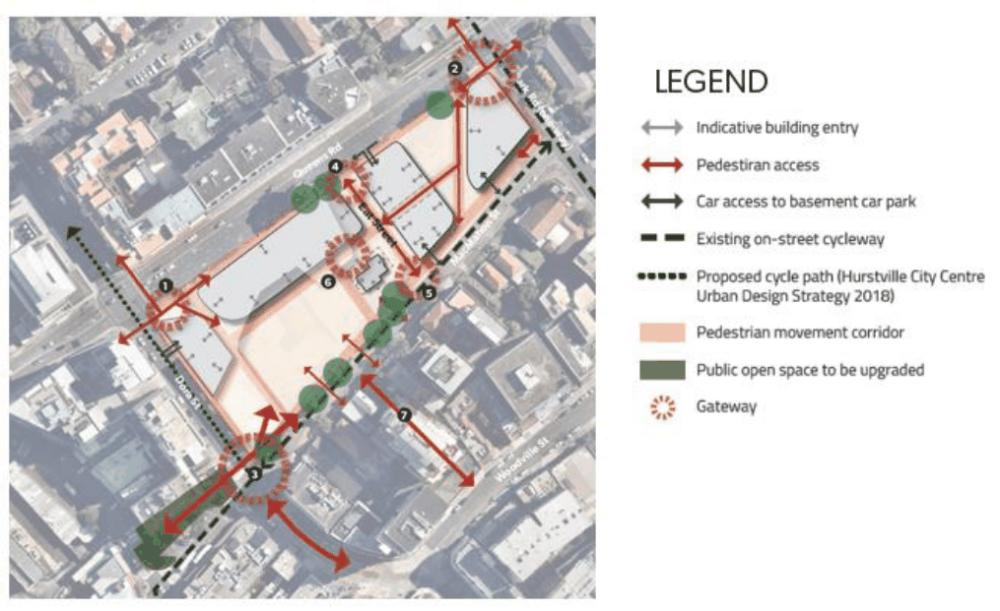

### 3.6 Vehicle Access and Car Parking

#### Objectives

a) To maximise the opportunity for safe pedestrian access to the Site, specifically along the MacMahon Street frontages for everyday activities.

b) To provide for special occasion street closures whilst minimising impacts upon accessibility to residential, commercial, civic and public car parking.

c) To ensure sufficient deep soil is provided to enable the healthy growth of large street trees in the proposed Civic Plaza, Queen Street frontage, the eat street to the west of Building B, and the Patrick Street Pocket Park.

d) To provide for public car parking on the Site to cater for the broader car parking needs of the Hurstville City Centre.

#### Controls

1\. All car parking is to be provided in basement levels. No at grade or above grade car parking is permitted.

2\. Vehicular accesses to the basement car park are to be located away from pedestrian active frontages and open space, set back from intersections and allow for the logical separation of land uses and buildings. Vehicular accesses are to be provided in the locations indicated in Figure 12.

3\. The vehicular accesses on Dora Street and Queens Road are to be left in/left out only.

4\. Vehicle access is only permitted on MacMahon Street where it is provided north east of the heritage building at 14 MacMahon Street and where access to the at grade car park is currently available.

5\. Provision of waste collection, loading and service areas below grade accessible from Queens Road is preferred subject to approval from Transport for NSW (TfNSW).

6\. Basement car parking is to be consolidated and include parking and servicing for each of the uses on the Site.

7\. Basement car parking design shall allow sufficient deep soil provision to enable the incorporation of mature trees into public open space areas (i.e. the Civic Plaza, Patrick Street Pocket Park and the eat street to the west of Building B) to facilitate healthy tree growth. Refer to Section 4P of the Apartment Design Guide (NSW Department of Planning and Environment 2015) for the minimum soil standards. Any sub-surface drainage requirements are in addition to the soil depths listed.

8\. The development is to provide the minimum number of car parking spaces in accordance with the parking rates in Part 3 of this DCP.

9\. In addition to the provision of the minimum number of car parking spaces required for the development, a public carpark is to be provided and allow for electric vehicle charging capability (subject to the outcomes of a car parking/electric vehicle strategy or needs analysis – refer to section 3.11 of this DCP).

> [Picture on page 27: a picture, saved as a picture (images/section-08-2-8-4-hurstville-civic-precinct-page-27-20.gif, 150 dpi).]

Figure 12: Access and movement in and around the Hurstville Civic Precinct (Hurstville Civic Precinct Public Domain Strategy, Place Lab 2022)
