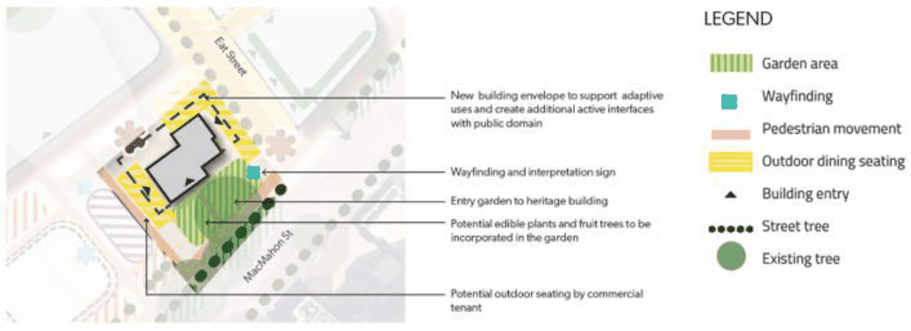

### 3.9 Heritage – Hurstville Museum and Gallery – 14 MacMahon Street

#### Objectives

a) To appropriately address the significance of the existing heritage item (i.e. the ‘Hurstville Museum and Gallery’ at 14 MacMahon Street, Hurstville) within the Precinct.

b) To facilitate the conservation, management and adaptive reuse of the existing heritage item within the Precinct, consistent with the Heritage Conservation Management Plan for the Hurstville Museum and Gallery (Weir Phillips Heritage and Planning 2022) or subsequent amendment.

#### Controls

1\. Conservation, ongoing management and adaptive reuse of the building is to be undertaken in accordance with the Conservation Management Plan for the Hurstville Museum and Gallery (Weir Phillips Heritage and Planning 2022) or subsequent amendment.

2\. Facilitate adaptive reuse of the existing two-storey heritage building for an active use that is accessible to the public having regard to the design considerations in Figure 13.

3\. Facilitate the conservation of the heritage building through removal of unsympathetic existing additions and consider a design response that enhances its physical and visual relationship to Building C.

4\. Consider the design of Building B and its visual relationship with the heritage item in terms of its height, transition in scale, architectural language, colour and material finishes.

5\. As specified within the Conservation Management Plan for the Hurstville Museum and Gallery (Weir Phillips Heritage and Planning 2022) or subsequent amendment, an Interpretation Strategy and Interpretation Plan is to be prepared for the Site that supports visitors’ understanding and appreciation of the heritage item.

6\. All works within the boundary of the heritage curtilage shall ensure an appropriate setting is maintained, ensuring views to and from the item are protected and any pavement treatment, vegetation, signage, ancillary structures, do not diminish or erode the setting to the heritage item.

7\. Any lot subdivision or lot amalgamation shall ensure the protection of the heritage curtilage for the heritage item. Subdivision shall not be less than the heritage curtilage.

> [Picture on page 30: a picture, saved as a picture (images/section-08-2-8-4-hurstville-civic-precinct-page-30-1.gif, 150 dpi).]

Figure 13: Design considerations for the heritage item (Hurstville Civic Precinct Public Domain Strategy, Place Lab 2022)

8\. Prior to the lodgement of any future development proposal involving redevelopment, demolition, change of use, boundary adjustment or subdivision or the like, the Conservation Management Plan for the Hurstville Museum and Gallery (14 MacMahon Street, Hurstville) prepared by Weir Philips Heritage and Planning dated June 2022 must be reviewed and updated in collaboration with Council. At a minimum, the updated Conservation Management Plan is to address the following:

i. Section 5.10 – The grading of significance tables are to be graphically represented on elevation / floor plans to show not only individual elements and features, but other aspects such as floor plan and arrangement, silhouette and profile and the overall ensemble of the building.

ii. Section 6.1.9 - Establishment of the recommended heritage curtilage (graphically represented by a marked-up aerial photograph or the

like) so that in the event of site consolidation, subdivision and or boundary adjustment for allotments comprising the Hurstville Civic Precinct, the extent of the heritage curtilage is clear and known.

iii. Section 7 – Conservation management policies are to be developed that guide suitable adaptive re-use and set parameters on what types of uses may and may not be suitable for the heritage item, together with protection and management of the heritage curtilage and setting. The conservation management policies shall also include policies regarding the protection of views and setting, together with design principles to guide future development with respect to building separation and transitional zone in building heights with reference to the urban design principles, Indicative Site Layout Plan and Concept Master Plan adopted for the Site.

iv. Section 7 – A framework for the implementation of the Conservation Management Plan is to be developed, together with policies on, and a schedule of, required conservation / maintenance works to the heritage item.

9\. Any future development proposal that comprises any part of the Hurstville City Museum and Gallery site, or involves changes to the existing allotment configuration

through subdivision or lot consolidation to the same, must be accompanied by a Heritage Impact Statement that demonstrates how the proposal achieves consistency with the Conservation Management Plan for the Hurstville Museum and Gallery (Weir Phillips Heritage and Planning 2022) or subsequent amendment.
