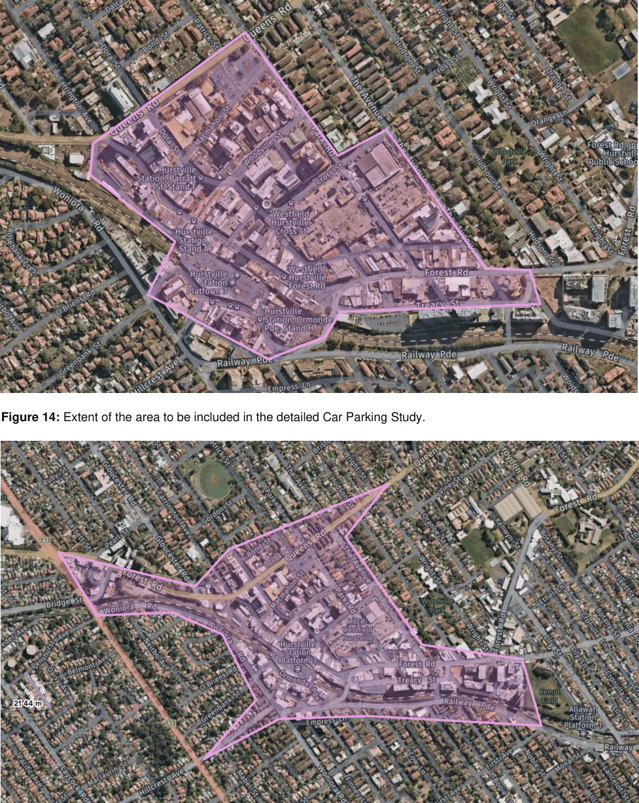

### 3.11 Car Parking Study and Traffic Impact Assessment

#### Controls

1\. A detailed Car Parking Study and Traffic Impact Assessment must be submitted with any Development Application seeking consent for the construction of a new building or buildings, or car parking (either public and/ or land use related), or creation of public parks, or subdivision of the Hurstville Civic Precinct.

2\. The detailed Car Parking Study is to inform the number of spaces and applicable timed restrictions required in the Civic Precinct for public car parking. An adequate number of public car parking spaces is to be provided in accordance with Clause

6.18(3)(f) of the GRLEP 2021. The Study is to include the following elements as a minimum for the area identified in Figure 14 below and must be completed to the satisfaction of Council:

i. Assessment of the current parking situation, including demand and supply with regards to the location, number of spaces, applicable restriction (eg. on-street parking, loading zone etc), length of stay, and turnover.

ii. Assessment of the future parking situation, including demand and supply with regards to the location, number of spaces and applicable restriction (e.g. on-street parking, loading zone etc), length of stay, and turnover. Future demand is to be based on the worst-case scenario (i.e. permitted land uses in the Civic Precinct that require the greatest number of parking spaces), consistent with the Indicative Layout Plan at Figure 2 and the gross floor area amounts in Table 1 (“Land uses”) of Part 3.1 of the Hurstville Civic Precinct DCP).

iii. Ensure supply satisfies demand by various users by providing a range of parking options in the Civic Precinct, including long term, short term, peak and non-peak parking options.

iv. Ensure that parking provision in the Civic Precinct is equitable and caters for the needs for all users, including people with disability, seniors, kiss and ride, taxi zones, service vehicles, motorbikes, and micro-mobility vehicles (electric bicycles and scooters).

v. A wayfinding strategy to direct drivers to available parking, reducing traffic circulation and congestion.

vi. Potential to implement carshare initiatives within the Civic Precinct car park.

vii. Potential to implement initiatives and infrastructure (such as charging stations) suitable for electric cars within the Civic Precinct car park.

viii. Minimising the number of driveways and vehicle access points to the Civic Precinct car park, reducing the loss of on-street parking spaces.

ix. A multimodal transport impact assessment.

3\. The detailed Traffic Impact Assessment is to include the following elements as a minimum:

i. Identify existing traffic issues and potential impacts from the future proposed development based on the worst case scenario (i.e. the permitted land uses in the Civic Precinct with the highest traffic generation) to the road network adjacent to the Civic Precinct within the area identified in Figure 15, including, but not limited to:

• The capacity of the existing road network/existing traffic generation, including identification of existing traffic issues;

• The impact of future development on the road network;

• Any impacts to intersections as a result of the proposed uplift;

• A multimodal transport impact assessment; and

• The identification of active transport links to existing school travel paths.

Note: The modelling methodology is to be agreed with Council and TfNSW.

> [Picture on page 35: a picture, saved as a picture (images/section-08-2-8-4-hurstville-civic-precinct-page-35-3.gif, 150 dpi).]

Figure 14: Extent of the area to be included in the detailed Car Parking Study.

Figure 15: Extent of the area to be included in the detailed Traffic Impact Assessment.
