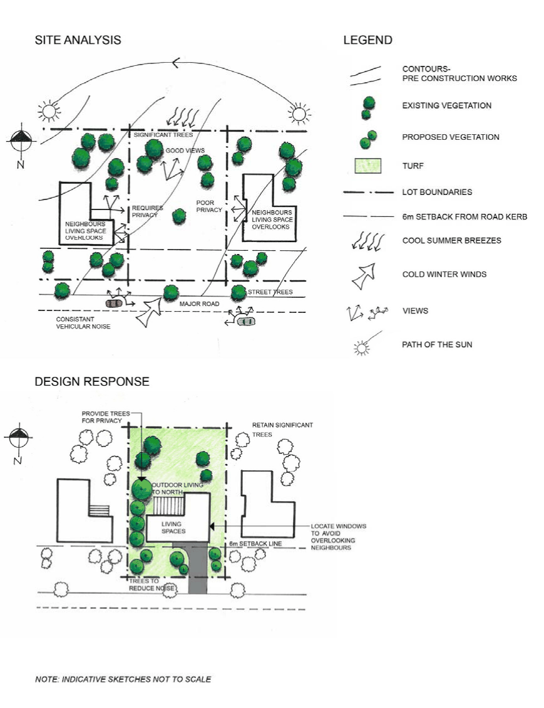

## 4. Site and Context Analysis

The process of Site and Context Analysis is necessary to ensure that development is sensitive to its environment and surrounding neighbourhood. Process

A Site and Context Analysis involves two (2) phases:

a. Site Plan must indicate;-

i) Location of the Development, boundary dimensions, site area (m2) and the north point of the land

ii) Finished floor levels above existing ground levels

iii) Existing vegetation  (including any trees) on the land

iv) Location of existing structures, buildings and roads on the land

v) Identify  the current topography, and specific neighbourhood character

vi) Identifying existing services and drainage corridors.

b. Analysis: based on the relevant site plan information, decisions are made about the existing site conditions, including what to retain through development, such as significant vegetation, views, etc, and/or what site conditions may be compromised through development, eg areas where slope and topography can be altered, vegetation that can be removed and replaced through development. This information is then used to develop strategies and options for development of the site. For further guidance on information required to be submitted for DA and CC can be found on Council’s fact sheets

### 4.1 Requirements for submitting a development application

a. For advice on the information required to be submitted with a development application, please contact Council. All development applications should consider Site and Context analysis. The degree of detail required will vary according to the nature, type and scale of the development and its surroundings. The level of detail required should be clarified with Council.

### 4.2 Site considerations

When assessing the suitability of overall site planning, Council will have regard to the extent that the attributes and constraints of the site have been considered, with particular regard to:

a. The likely impact on surrounding development, particularly with regard to overshadowing and privacy.

b. Topographical features such as slope and existing natural vegetation.

c. Opportunities to maximise the northerly aspect for buildings and private open spaces;

d. The character of surrounding development, particularly setbacks and subdivision layout;

e. Opportunities to link into existing open space, pedestrian and cycle networks;

f. The extent to which driveways and/or parking areas are likely to dominate the appearance of the development;

g. The visibility, width and design speed of proposed roads and/or driveways; and

h. Pedestrian access which is visible and safe.

### 4.3 Site analysis plan

The Site and Context Analysis must comprise detailed plan and can be accompanied by written information. The site analysis must be prepared to scale and should include, but is not limited to, the following elements:

a. Site related information.

b. Contours and levels and where in Flood Planning Area specify level to Australian Height Datum (AHD).

c. Land description including lot dimensions, north point and scale.

d. The footprint, height and use of existing and proposed buildings on the site.

e. Significant vegetation and any other existing trees on the site or in close vicinity of the boundaries with adjoining sites.

f. Site characteristics such as orientation and lot dimensions and climatic features such as wind direction.

g. Site constraints including flood affected land, overland flow paths, unstable land, contaminated land, areas of fill, heritage and archaeological features of the site.

h. Services and utilities including location of drainage infrastructure and connection for utility services.

i. Easements, fences, boundaries and access to the site.

j. The location of adjoining property driveways.

k. The location of any sewer main on the site.

l. Movement corridors including local streets and pedestrian pathways.

m. Any other notable features or characteristics of the site.

### 4.4 Context related information

i. It may be necessary to examine the context of the proposed development site within the street. A context analysis may be required for residential development. The context analysis shall describe the character of existing development in the vicinity of the site in order to understand the streetscape and pattern/form of development.

> [Picture on page 18: a picture, saved as a picture (images/gilgandra-development-control-plan-2011-page-18-1.gif, 150 dpi).]
